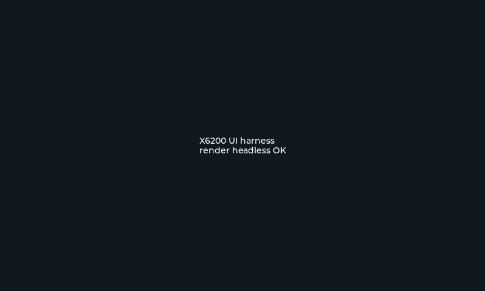

# Arnés de UI: ver la interfaz sin la radio

Verificación del 2026-10-11 a partir de
[`IU1WXY/X6100-IU1WXY/tools/apps_ui_harness`](https://github.com/IU1WXY/X6100-IU1WXY/tree/main/tools/apps_ui_harness).

## ¿Se puede usar? Sí, y es la herramienta correcta

El arnés del X6100 **renderiza los diálogos reales de la GUI en el PC, sin radio**:

- Compila las **fuentes reales** de la GUI con **LVGL 8.3.11 stock** (el fork NEON del firmware no
  compila sin NEON) y escribe **PNG**.
- Los símbolos del firmware que no hacen falta se **auto-stubean**: `gen_stubs.py` lee las
  referencias indefinidas de un link fallido y genera `build/stubs_auto.S` (funciones que
  devuelven 0, datos en cero). Los valores que importan para el layout están a mano en `stubs.c`.
- `cfg_host.cpp` arma un `cfg_sm` real con valores por defecto (sin base de datos) para que
  Ajustes se pueda renderizar; Wireless muestra redes y dispositivos falsos.
- Bloquea la red con `-Wl,--wrap=connect`, así que ningún cliente sale a internet.

**Probado acá**: el método funciona en este entorno. `tools/ui_harness/probe.c` compiló LVGL
headless y escribió `probe.png` (800x480). La sonda ya fue reemplazada por el arnés completo
(milestone 1 de `docs/AB_TESTING_PLAN.md`); comandos en `tools/ui_harness/README.md`:

```bash
docker build -t x6200-uiharness tools/ui_harness      # imagen con libpng/libnm/sqlite/cmake
# compilar y correr (raíz del repo montada en /src); ver README.md
```



## Por qué no sirve tal cual para nuestra ROM

El arnés está atado al árbol del X6100:

| Pieza | X6100 | Nosotros |
|---|---|---|
| Lista de fuentes | JS8, SSTV, WeFax, NavTex, WSPR, Cluster, Field, `theme.c`, `cJSON.c`, `freq_strip/scale`, `spot_marks`, `cluster_column`, `dialog_modes`, `dialog_cw_trainer`… | no existen; tenemos `dialog_about`, `band_plan*`, `adaptive_tuning`, `audio_enhancement`, `update_check`, `screen_rec`, `ft8_udp` |
| `cfg_host.cpp` | arma su `cfg_sm` | necesita **nuestro** `cfg_init(sqlite3*)` |
| Temas | `theme.c` + `themes/*.json` | no tenemos sistema de temas (paleta fija) |
| Submódulos | `third-party/js8core`, `wsprd` | no los usamos (el build del arnés del X6100 falla justo ahí si se clona sin `--recurse-submodules`) |

## Plan de adaptación (para nuestra ROM)

1. **Lista de fuentes propia**: `dialog.c`, `dialog_settings.c`, `dialog_about.c`, `dialog_ft8.c`,
   `buttons.cpp`, `styles.c`, `meter.c`, `band_plan.c` + `band_plan_data.c`, `clock.c`, `info.c`,
   `tx_info.c`, `widgets/lv_waterfall.c` + `lv_finder.c`, `cfg/*`, `qth`, `scheduler.cpp`,
   `fonts/*` y las nuevas que queramos ver.
2. **Shim de cfg**: crear una base temporal desde `sql/` (mismo esquema que la imagen) con
   sqlite3 y llamar a `cfg_init(db)` + `cfg_mode_params_init(db)` + `params_init()`; así Ajustes
   y la pantalla principal usan los caminos reales de la GUI.
3. **Stubs**: copiar `gen_stubs.py` (LGPL) e iterar; en `stubs.c` dejar los valores que definen
   el layout (dial, bordes de filtro, espectro/waterfall falsos, estado de radio).
4. **Deps propias**: `fetch_deps.sh` que clone LVGL v8.3.11 y ft8_lib (hoy uso las del arnés del
   X6100, que viven en `.x6100_ref`). fftw3f, liquid y libpng para el espectro.
5. **Runner**: la imagen `x6200-uiharness` (Dockerfile en `tools/ui_harness/`) ya queda lista y
   aislada del toolchain cruzado.

## Qué podríamos verificar con esto

- La **aguja del S-meter** (geometría del dial, marcas y etiquetas) en sus dos estados.
- La **franja del band plan** sobre el espectro, alineada con la fila de frecuencia y con los
  segmentos recortados en los bordes.
- Las **filas nuevas de Ajustes** (Audio enhance, Waterfall battery mode, S-meter needle,
  Band plan) y el diálogo **About**.
- El **indicador de grabación** de pantalla.
- Y, a medida que se porten: los diálogos de WSPR, SSTV, JS8, NavTex, Field Ops y el cluster.

Es exactamente lo que faltaba para no trabajar a ciegas en lo visual: hoy las features de UI se
verifican solo por compilación y strings del binario.

## Estado

- ✅ Método verificado (render headless + PNG).
- ✅ Imagen de build reproducible (`tools/ui_harness/Dockerfile`).
- ✅ **Arnes adaptado (milestone 1 de `docs/AB_TESTING_PLAN.md`)**: `tools/ui_harness/`
  compila componentes reales (`theme.c`, `styles.c`, `fonts/`, `clock.c`, `info.c`,
  `meter.c`) sobre LVGL 8.3.11 del submódulo, renderiza la barra de arriba de la
  pantalla principal a PNG y es determinista (dos corridas → PNG idéntico por
  sha256, `tests/check_harness_determinism.sh`). Ver el README del arnés para los
  comandos y la tabla de cobertura REAL/PARTIAL/SYNTHETIC/UNSUPPORTED.
- ✅ **Pantalla principal completa (incremento)**: el arnés llama a
  `main_screen()` real y compila el resto de los componentes visuales
  (`spectrum.c`, `waterfall.c`, `tx_info.c`, `band_plan*`, `pannel.c`, `vol.c`,
  `msg*`, `adaptive_tuning.c`, `cw_tune_ui.c`, `buttons.cpp`, `mfk.cpp`,
  `controls.cpp`, `cfg/subjects.cpp`). Espectro/agua quedan **PARTIAL**: el
  componente es real, los datos vienen de un generador determinista por `seed`.
  Seis fixtures (incluye TX simulado, batería baja, frecuencia extrema, otro
  tema y waterfall en movimiento); determinismo PASS en todos. Ver
  `docs/AB_TESTING.md`.
- ✅ **Diálogos reales**: el **Ajustes** (`settings-home`, `settings-wfbat`) se
  abre por el camino del firmware
  (`ACTION_APP_SETTINGS` → `dialog_construct`), con el
  `dialog_settings.c` real y las superficies que llama mockeadas (mixer, preset de
  DSP, wfview, RTC). El About y su fixture `dialog-about` se eliminaron por orden
  del owner el 2026-10-14. Ver `docs/AB_TESTING.md` → *Fixture del diálogo de Ajustes*.
- ⏳ Resto de los diálogos y apps (menú de apps, BT/FT8/WSPR/WeFax/SSTV, etc.):
  siguientes incrementos.
