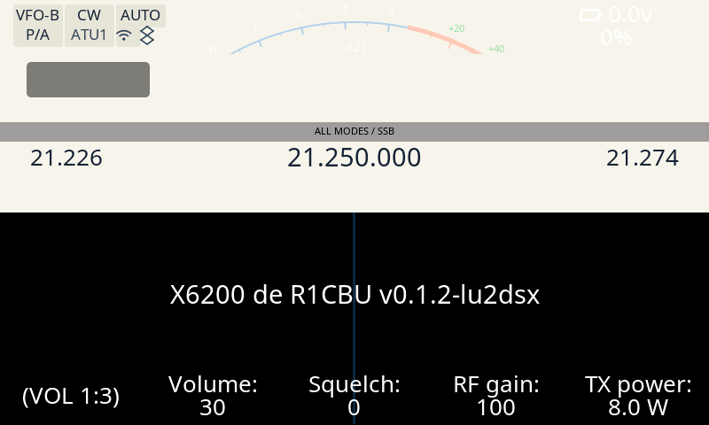

# Evidencia del banco — ancho de la línea central del waterfall (issue #92)

Prueba QEMU-banco del fix del [#92] (`waterfall_signal_width`, la línea central
del waterfall pasa a ser clave de tema; `Sunlit` y `Trail` la ponen en **3**).
Cierra el pendiente de evidencia del PR [#92]: lo que faltaba era la **captura
del banco** (binario ARM real, sin radio) que mostrara los 3 px.

## Qué se prueba

Con el firmware del trunk (que ya trae el fix) y la **DATA fresca** (los temas v2
del trunk en `/mnt/themes`), el renderer dibuja la línea central del waterfall
**3 px de ancho, en x=398..400**, con `theme_name=Sunlit`.

## Método

1. **Banco + rebuild** (binario ARM real con `qemu-arm-static`, framebuffer falso,
   sin radio), desde el worktree de esta corrida:

   ```sh
   CHROOT=/home/pablo/desa/x6200/.vfix3 \
   BUILDROOT=/home/pablo/desa/x6200/buildroot_new/AetherX6200Buildroot \
   RECONSTRUIR=si tools/captura-banco.sh /tmp/opencode/wf92-final/banco.png
   ```

   El script corre el **gate fail-closed de #86** (`tools/verifica-firmware-port.py`)
   antes de arrancar la GUI: si el binario copiado no es el firmware del port, no corre.

2. **DATA fresca**: la GUI lee los temas de `/mnt/themes` y **sólo los copia si
   faltan** (`src/main.c`), así que una copia vieja en `DATA` gana. Se copian los
   **6 temas v2 del trunk** a `/mnt/themes/` (los `Holo`/`Material 3`/`RS` legacy
   quedan: son temas del usuario). `params.db` con `theme_name=Sunlit`.

   ```sh
   docker run --rm --entrypoint "" \
     -v /home/pablo/desa/x6200/.vfix3:/t \
     -v <worktree>/rootfs/usr/share/x6200/themes:/src:ro \
     x6200-buildroot sh -c 'cp /src/*.json /t/mnt/themes/'
   ```

   > El `--entrypoint ""` es necesario: el entrypoint de la imagen es
   > `exec tail -f /dev/null`, así que sin él `docker run ... sh -c '...'` **no
   > ejecuta el comando** (se queda vivo) y la copia no ocurre — esa es,
   > precisamente, la forma en que la DATA quedó vieja.

3. **Medición determinista** (PIL): la línea (`src/waterfall.c` → `draw_middle_line`)
   pinta `TC(panel_border)` con `LV_OPA_60` y `LV_BLEND_MODE_ADDITIVE`. Sobre el
   fondo negro del waterfall (sin señal) el píxel vale `panel_border * 153/256` por
   canal: para `Sunlit` (`#14456F`) → `0x0b2942` = `(11, 41, 66)`. Se mide la
   corrida horizontal contigua de ese color que contiene `x=399`, en `y = 240..470`.

   ```python
   from collections import Counter
   from PIL import Image

   LINE = (11, 41, 66)          # 0x0b2942: #14456F (Sunlit panel_border) * 153/256 sobre negro
   im = Image.open("banco-sunlit-3px.png").convert("RGB")
   px = im.load()
   hist = Counter()
   for y in range(240, 471):
       if px[399, y] != LINE:
           continue
       x0 = x1 = 399
       while x0 - 1 >= 0 and px[x0 - 1, y] == LINE:
           x0 -= 1
       while x1 + 1 < im.width and px[x1 + 1, y] == LINE:
           x1 += 1
       hist[(x0, x1, x1 - x0 + 1)] += 1
   print(sorted(hist.items(), key=lambda kv: -kv[1]))
   ```

## Resultado



`banco-sunlit-3px.png` (800x480), ventana `y=240..470` (231 filas):

| corrida (x0..x1) | ancho | filas |
|---|---|---|
| `x=398..400` | **3 px** | **214** |
| `x=399..400` | 2 px | 3 |
| `x=399..399` | 1 px | 2 |
| (x=399 sin línea) | — | 12 |

**214/231 filas (93 %) = 3 px exactos, en x=398..400**; el resto son las filas
donde un widget de la GUI tapa la línea. Los números crudos están en
[`medicion.txt`](medicion.txt).

## md5 (provenance)

| Qué | md5 |
|---|---|
| binario `x6200_gui` (chroot, 13 738 048 B) | `91d9631dc5ce4acd7abd5363fd5bb0da` |
| fuente (`src/` + `lvgl/src`) | `a6f3a3ec51b038a0cd60b4163ae8bb91` |
| captura `banco-sunlit-3px.png` | `9b6e50d3bac332b6cee1d22e7b4574b3` |
| tema `Sunlit.json` (trunk y DATA, 4226 B) | `71dd165b824483ddb75b74cb8d011eb9` |
| trunk base | `65cdda6be34ed0ef9c075094291d912c8ec99a36` |

**Determinismo**: dos corridas independientes del banco dan PNG **byte-idénticas**
(`banco.png` y `banco-2.png`, mismo md5 `9b6e50d3bac332b6cee1d22e7b4574b3`).

## Contraste con el defecto (DATA vieja)

Con la copia vieja de `Sunlit.json` (4193 B, **sin** la key) la medición da
**1 px**, en `x=400`, 218/231 filas (la captura del orquestador del 15/10 23:15:
`/tmp/opencode/wf92/banco-sunlit-3px.png`). Con la DATA fresca: **3 px**, en
`x=398..400`. El default retro-compatible es 1 (`src/theme.c:138-139`).

## Gates

El diff es **sólo** `docs/evidencia/**`, así que la matriz de la app
(`scripts/apps/x6200/check-matrix.sh 65cdda6 factory/banco-evidencia-92`) no
dispara ningún check funcional (**exit 0**). Como el cambio no toca el firmware,
se corrieron además los gates del repo para dejar constancia de que el trunk
probado está verde:

| Gate | Resultado |
|---|---|
| `scripts/apps/x6200/check-matrix.sh` (base `65cdda6`) | exit 0 (docs-only: ningún check funcional) |
| `tests/check_harness_determinism.sh` (determinismo del arnés) | `PASS: deterministic (identical PNGs for every fixture)` |
| `tests/native/run_native_tests.sh` | 6 suites, **1031 comprobaciones, 0 fallos** (exit 0) |
| `tests/check_cfg_fills.py` | OK: los 69 campos de `cfg_t` se inicializan |
| `tests/check_actions.py` | 38/38 acciones con manejador |
| `tests/check_settings_focus.py` | todos los widgets de Ajustes en el grupo de foco |
| `tests/check_apps_menu.py` | 20/20 `make_app_btn`, 2/2 `make_action_btn` con dispatcher; 24 apps en el control remoto |
| `tests/check_app_handlers.py` | 268 botones / 61 páginas, 0 sin handler |
| `tests/check_wcag.py` | 1042 pares OK, 0 fallas |

Además, la propia evidencia del banco es determinista: **dos corridas
independientes dan el mismo PNG** (byte-idéntico, ver arriba).

## Alcance

Esta corrida es **sólo evidencia** (`docs/evidencia/**`, riesgo *low*): no toca
`src/`, `rootfs/` ni ningún otro path del firmware, así que **no cambia los
píxeles del trunk**.

[#92]: https://github.com/iariap/x6200_gui/issues/92
