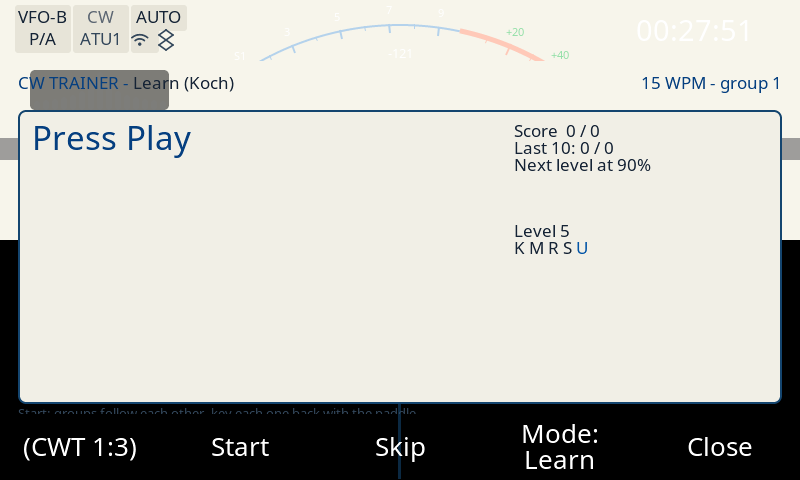

# Evidencia de build y banco — #116: ELF exacto de la radio + humo del banco

## 1. El ELF que corre la radio, reconstruido (md5 verificado)

La radio corre el build del trunk **`23926241`** ("Ajustes: el campo de año con la
misma caja que Day/Month (issue #110) (#112)"). Se reconstruyó en un **directorio
propio** (volumen docker privado `cw116-build-output`, no el compartido
`x6200-build-output`) desde un checkout propio del commit
(`git archive 23926241` + el submódulo `lvgl` pineado `74d0a816`), con el toolchain
`x6200-buildroot`:

```sh
docker run --rm --entrypoint "" \
    -v .../AetherX6200Buildroot:/workspace \
    -v cw116-build-output:/workspace/build \
    -v <checkout 23926241>:/workspace_gui:ro \
    -e FORCE_UNSAFE_CONFIGURE=1 -w /workspace/build x6200-buildroot \
    sh -c 'make x6200-gui-dirclean; make x6200-gui-rebuild -j$(nproc)'
```

```
-rwxr-xr-x  13 742 964 B  /workspace/build/target/usr/sbin/x6200_gui
3604cece0e4382229a2de328d9baa614  x6200_gui        <- == md5 que corre la radio
```

El md5 **coincide** con el del binario de la radio (`md5sum /usr/sbin/x6200_gui` →
`3604cece0e4382229a2de328d9baa614`), así que la pila se resolvió contra el ELF
correcto (ver [`../2026-10-16-cw116-radio/`](../2026-10-16-cw116-radio/)). El
binario no está stripped (16 629 símbolos), con `main` en `0x1ea74`.

Salida cruda: [`rebuild.txt`](rebuild.txt).

## 2. El fix compila para ARM (y el firmware entero se reconstruye)

Verificador mínimo (patrón de los flujos de hoy), `src/cw_encoder.c` con el fix,
toolchain de buildroot, `-Wall -Wextra`:

```
$ docker run --rm --entrypoint "" -v cw116-build-output:/b:ro -v <stage>:/s -w /s x6200-buildroot \
    sh -c '/b/host/bin/arm-buildroot-linux-gnueabihf-gcc -std=gnu11 -O2 -Wall -Wextra \
           -Wno-unused-parameter -pthread -I/s -c /s/cw_encoder.c -o /s/cw_encoder.o'
cw_encoder.c: compila para ARM ok
/s/cw_encoder.o: ELF 32-bit LSB relocatable, ARM, EABI5 version 1 (SYSV), not stripped
```

Y el firmware entero (el `x6200_gui` real, con el fix, en el volumen privado):

```
-rwxr-xr-x  13 747 976 B  /workspace/build/target/usr/sbin/x6200_gui
e5eb7bfd6b9ff03a7f0a5389d5735b7a  x6200_gui
```

El único warning del build es de `lvgl/widgets/lv_waterfall.c` (`discards 'const'
qualifier`), del submódulo LVGL pineado, pre-existente y ajeno al cambio.

## 3. Banco QEMU: la GUI corre con el fix (capturas)

Se corrió el banco de la casa (chroot compartido `.vfix3`, `docker ps` antes → libre)
con **el binario del fix**, reconstruido desde el worktree por el gate de la matriz:

> **Corrección de lo que decía antes esta evidencia**: la primera pasada intentó el
> banco con un chroot **propio** (copia de `target/`) y la GUI crasheaba temprano en
> `subject_get_int` (entorno: sin `params.db` preparado ni tarjeta de audio,
> `amixer: Mixer attach default error`). El control lo probó: el binario **sin** el fix
> (`3604cece`) crasheaba **igual** (mismo `fallo=0x10`, mismo `pc`/`base`). Con el chroot
> de la casa el banco corre, así que aquel "no alcanzable en aislamiento" era del chroot
> propio, no del cambio. (El aislamiento de la spec era para el **build de la pila**, no
> para el banco; el volumen del banco sigue siendo el privado de esta corrida.)

```sh
export CHROOT=/home/pablo/desa/x6200/.vfix3
export BUILDROOT=/home/pablo/desa/x6200/buildroot_new/AetherX6200Buildroot
export VOLUMEN=cw116-build-output          # el volumen privado de esta corrida
scripts/apps/x6200/check-matrix.sh 223b30ae HEAD <worktree>
```

La matriz sale **exit 0** con todos los checks ok, incluido el banco
(`reconstruyendo la GUI: el hash de los fuentes cambio` → `captura de humo (home)
ok`, `binario: md5 e5eb7bfd6b9f`, `qemu-cpu: cortex-a7`).

**Gate #86** (el binario copiado al chroot es el firmware del port) y provenance:

```
$ python3 tools/verifica-firmware-port.py .vfix3/usr/sbin/x6200_gui
OK: /home/pablo/desa/x6200/.vfix3/usr/sbin/x6200_gui es el firmware del port (ELF32 ARM, 13747976 B, 3/3 marcas)
$ md5sum .vfix3/usr/sbin/x6200_gui
e5eb7bfd6b9ff03a7f0a5389d5735b7a  .vfix3/usr/sbin/x6200_gui     <- el build del fix
$ file .vfix3/usr/sbin/x6200_gui
ELF 32-bit LSB pie executable, ARM, EABI5, dynamically linked, ..., not stripped
```

Las capturas (el arnés del banco: `qemu-arm-static` + framebuffer falso, orden por
el socket de control, rotado 270 como en la radio):

| captura | orden | md5 |
|---|---|---|
| [`banco-home.png`](banco-home.png) | (arranque) | `18f763ea640c61c0af4da55cbd85d871` |
| [`banco-cwtrainer.png`](banco-cwtrainer.png) | `{"cmd":"app","text":"CwTrainer"}` | `5f33b94a062f3253dd9790bcd56aa6cd` |
| [`banco-cw-kbd.png`](banco-cw-kbd.png) | `{"cmd":"app","text":"CW"}` | `a424645098eb995470aba4d4da470d7d` |



La GUI arranca y responde con el fix: `{"t":"ok"}` en cada orden, `343`/`397`/`395`
colores distintos por captura (no son pantallas vacías).

## 4. La ventana del crash NO es alcanzable desde el socket (probado exacto)

La ventana de mensajes de CW (`dialog_msg_cw`, la de **Send**/**Beacon**) se abre
**sólo** con la tecla `MSG` del panel (`src/main_screen.c:779`, `case KEYPAD_MSG`,
que construye `dialog_msg_cw` cuando el modo es CW/CWR). El control remoto **no tiene
comando de teclado**:

* `{"cmd":"app",...}` sólo acepta las 22 apps del menú (`app_names[]`,
  `src/remote_server.cpp:137`): está `"CW"` pero es la app **CW Keyboard**
  (`ACTION_APP_CW_KBD`, `dialog_cw_kbd`), no la ventana de mensajes.
* `{"cmd":"btn","val":N}` (`remote_server.cpp:736`) aprieta el botón N de la página
  **actual**. Las páginas de botones (`buttons_group_app/key/dfn/dfl/gen`,
  `src/buttons.cpp`) no tienen ningún botón que abra la ventana de mensajes; la página
  `key` es `{btn_key_p1, btn_key_speed, btn_key_volume, btn_key_train, btn_key_tone}`.
* `{"cmd":"page",...}` sólo cambia de página de botones.

No hay camino, así que **no se inventó**: la ventana del crash queda
**`requires-radio`** (el mecanismo está fundado por el desensamblado y por el test
nativo; ver [`../2026-10-16-cw116-radio/`](../2026-10-16-cw116-radio/)).

**Dato que sí aporta el banco**: su tabla `msg_cw` está **vacía** — la misma condición
que dispara el crash en la radio (`table_rows == 0`):

```
$ sqlite3 .vfix3/mnt/params.db "select count(*) from msg_cw;"
0
```

(la app CW Keyboard lo refleja: su botón de página queda deshabilitado, `pages == 1`).
O sea: el banco **tiene** la condición del crash; lo único que le falta es la tecla
`MSG`.

## Limpieza

El banco deja la GUI viva entre llamadas; se termina con:

```sh
docker rm -f banco-apps
```

## Alcance

El fix es sólo `src/cw_encoder.c` (guard NULL + dos defectos que el suite nativo
destapa) y `src/dialog_msg_cw.c` (los callbacks de Send/Beacon) + el test nativo
nuevo. No toca RF/TX/DSP, `lvgl/` ni el render (el A/B lo confirma: capturas
pixel-identical).
