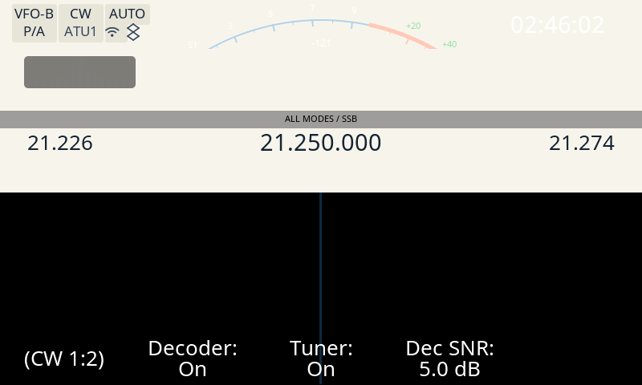

# Evidencia — #122: el widget de CW tune (oculto con `cw_tune=0`, visible con `cw_tune=1`)

Diagnóstico del [#122] ("el widget de Tune no aparece en la banda CW"). El widget **existe y
funciona**; no aparece porque el parámetro `cw_tune` está en **0**, que es su valor de arranque
(`src/cfg/cfg.c:349`) y el estado persistido de la radio. La visibilidad la decide
`update_visibility()` (`src/cw_tune_ui.c:158-171`), que exige `cw_tune` **y** modo CW/CWR.

Esta carpeta funda las tres cosas con medición: **la causa** (el parámetro), **que la página CW se
alcanza con el decodificador apagado** (refuta la hipótesis 1 del issue) y **el A/B del widget** en
las dos superficies disponibles (arnés de UI y banco QEMU con el binario ARM real). De paso mide un
defecto de contraste en el tema claro (HALLAZGOS §49).

## Qué se prueba

1. **Causa**: con `cw_tune=0` el widget está en la pantalla pero **oculto** (el `LV_OBJ_FLAG_HIDDEN`
   del gate); con `cw_tune=1` **aparece**. Medido en el banco (binario real) y en el arnés.
2. **Hipótesis 1 refutada**: la página `(CW 1:2)` —la que lleva el botón `Tuner`— se alcanza con
   `cw_decoder=0`. Se prueba en el **arnés**, que corre esa ruta con el decodificador apagado
   (fixture `cw-tune-off`/`cw-tune-on`, `cfg.cw_decoder` en 0, con una assertion que lo codifica) y en
   **código**: `KEYPAD_KEY` → `buttons_load_page_group(buttons_group_key)` (`src/main_screen.c:773`)
   no consulta `cw_decoder`, y `buttons_group_key` siempre incluye `page_cw_decoder_1`
   (`src/buttons.cpp:443-444`, `526-531`).
3. **A/B del widget**, mismas geometría y conteos en las dos superficies: la región del widget
   (`(30,70)` `139x40` = `WIDTH`x`HEIGHT`) pasa de **1 color** (oculto: se ve el fondo de la página)
   a **panel + barras** (visible). El panel ocupa **4136 px** en las dos (misma geometría).
4. **Hallazgo aparte** (no es la causa del issue): en el único tema claro, `Sunlit`, las barras
   quedan a **1.01:1** contra el panel del widget y no se distinguen (HALLAZGOS §49). En `Redshift`
   —el tema de la radio— miden `2.00:1` y se ven.

## Método

### 1. Arnés de UI (determinista, sin radio ni QEMU)

Desde el worktree de la corrida:

```sh
docker run --rm --entrypoint bash --user "$(id -u):$(id -g)" -v "$PWD:/src" -w /src/tools/ui_harness \
    x6200-uiharness -lc "mkdir -p build && cd build && cmake .. -DHARNESS_REVISION=$(git rev-parse HEAD) \
        && make -j\$(nproc)"
docker run --rm --entrypoint bash --user "$(id -u):$(id -g)" -v "$PWD:/src" -w /src/tools/ui_harness/build \
    x6200-uiharness -lc "mkdir -p out/cw122 && for n in cw-tune-off cw-tune-on; do \
        ./ui_harness --scenario ../fixtures/\$n.scn \
            --png out/cw122/\$n.png --json out/cw122/\$n.json; done"
```

Las fixtures `cw-tune-off` / `cw-tune-on` (`tools/ui_harness/fixtures/`) recorren la ruta del
usuario: `buttons_load_page_group(buttons_group_key)` + dos pulsaciones del botón-página →
`(CW 1:2)`; `cw-tune-on` pulsa además el botón `Tuner` (índice 2) por el mismo camino del usuario
(`button_action_cb` → `controls_toggle_cw_tuner` → `cfg.cw_tune`, `src/buttons.cpp:274-276`,
`src/controls.cpp:35`). `scenario_settle` codifica, y corta la corrida si no se cumple: la barra
quedó en `(CW 1:2)`, el botón dice `Tuner: Off`/`On`, `cfg.cw_decoder` arrancó en 0, el widget existe
(`139x40`) y su flag `HIDDEN` sigue a `cfg.cw_tune`.

### 2. Banco QEMU (binario ARM real, el mismo que corre la radio)

```sh
CHROOT=/home/pablo/desa/x6200/.vfix3 \
BUILDROOT=/home/pablo/desa/x6200/buildroot_new/AetherX6200Buildroot \
RECONSTRUIR=no tools/captura-banco.sh <out.png> '{"cmd":"page","text":"key"}'
```

El script corre el gate fail-closed de #86 (`tools/verifica-firmware-port.py`) antes de arrancar la
GUI. Las capturas se toman manejando el control remoto de la GUI (`tools/remote/x6200-remote`, el
mismo camino que la tecla `KEY` de la pantalla): la ruta de páginas `{"cmd":"page","text":"key"}` ×3
carga `(CW 1:2)` y `{"cmd":"btn","val":2}` pulsa el botón `Tuner` (índice 2 de la página,
`src/buttons.cpp:443-444`). La ruta exacta y sus rótulos los codifica el arnés (arriba); el banco
aporta el **binario ARM real**. El binario que corrió es `md5 aaa60c1d3ab54d9682423379e688a57a`
(13 747 976 B): **el mismo md5 que el `/usr/sbin/x6200_gui` de la radio** (`ssh` de sólo lectura,
2026-10-17 03:05 UTC), así que las capturas del banco son lo que la radio dibuja. El tema del banco
es `Sunlit` (el `params.db` del chroot).

## Resultado

Región del widget: `(30,70)` `139x40`. **1 color = widget oculto** (se ve el fondo de la página);
**más de 1 = widget visible**.

| captura | superficie | página / estado | colores en la región | panel |
|---|---|---|---|---|
| `01-cw-home.png` | banco | principal, banda CW, Tuner **On** | 7 | 4136 px |
| `02-cw-page-tuner-on.png` | banco | `(CW 1:2)`, Tuner **On** (llegada) | 7 | 4136 px |
| `03-cw-tuner-off.png` | banco | `(CW 1:2)`, Tuner **Off** | **1** (fondo `(247,245,235)`) | 0 px |
| `04-cw-tuner-on.png` | banco | `(CW 1:2)`, Tuner **On** | 7 | 4136 px |
| `05-harness-cw-tune-off.png` | arnés | `(CW 1:2)`, `cw_tune=0` (Redshift) | **1** (fondo `(10,5,5)`) | 0 px |
| `06-harness-cw-tune-on.png` | arnés | `(CW 1:2)`, `cw_tune=1` (Redshift) | 12 | 4136 px |



**El A/B es `03` ↔ `04`** (misma página `(CW 1:2)`, mismo binario, único cambio = el botón `Tuner`):
con `Tuner: Off` la región es **uniforme** (sólo el fondo `(247,245,235)`, 5560 px); con `Tuner: On`
aparece el **panel** `(125,124,119)` de **4136 px** en el rectángulo exacto `(30,70)-(168,109)` más
las **barras** `(125,125,122)` de 1272 px. En el arnés (tema `Redshift`) el panel también mide
**4136 px**, con las barras `(65,64,64)` y el bloque activo en verde `(90,178,89)`: misma geometría,
distinto tema. Los rótulos de la barra de botones de las cuatro capturas del banco están en
[`barras.png`](barras.png) (`(VOL 1:3)` en `01`; `(CW 1:2)` con `Decoder: On` y `Tuner: On/Off/On` en
`02`/`03`/`04`).

Números crudos y el comando que los produce: [`medicion.txt`](medicion.txt).

## md5 (provenance)

| Qué | md5 |
|---|---|
| binario `x6200_gui` (chroot y radio, 13 747 976 B) | `aaa60c1d3ab54d9682423379e688a57a` |
| fuente (`src/` + `lvgl/src`, lo que corrió el banco) | `8fd73e09e145` |
| `params.db` de la radio (`cw_tune=0`, `cw_decoder=0`, `theme_name=Redshift`) | `c6e49987d11c35a8b98bb793f247d601` |
| `01-cw-home.png` | `d9b4e2815dfe99454655ec8b4ab1f22f` |
| `02-cw-page-tuner-on.png` | `1204ccd901b0acf308f4d612dfd93820` |
| `03-cw-tuner-off.png` | `b0fd6390cae21a6d2cbcc5489d61e1ba` |
| `04-cw-tuner-on.png` | `1caa0be5a8d46aabedfa6c2a19489ecb` |
| `05-harness-cw-tune-off.png` / `.json` | `96837446037450e0f13c42f69846bcee` / `8464ab2a48ec83c8b7bec7b5ac3b34c1` |
| `06-harness-cw-tune-on.png` / `.json` | `df858d8f66e8aa24f35aacbadf68cc1c` / `8cf7e05a0ad0dff0ac5e0d53f386d241` |
| `barras.png` | `e4d72b79620e71d2a11ece16a017d6c1` |
| base de la corrida | `3553a476` |

El campo `revision` de los JSON del arnés es el `git rev-parse HEAD` con el que se **compiló** el
arnés (`CMakeLists.txt` → `-DHARNESS_REVISION`); el de estos dos apunta al commit que introduce las
fixtures `cw-tune-*` (`aa8fcc78`). El render es determinista: re-compilar el arnés en cualquier
revisión con estas fixtures da el **mismo PNG** (md5 de arriba).

## Contraste con el defecto

Con `cw_tune=0` —el estado de la radio— la región del widget es **uniforme**: el objeto está en la
pantalla pero con `LV_OBJ_FLAG_HIDDEN` (`src/cw_tune_ui.c:165-169`), así que no se ve ni el panel ni
las barras. Un toque en `Tuner` (o `cfg.cw_tune=1`) y la región pasa a panel + barras. El defecto no
es un widget faltante ni una página inalcanzable: es el **parámetro en 0**.

## Alcance y límites

- **La radio se usó sólo lectura.** Hay otra sesión activa sobre el banco (el chroot `.vfix3`): el
  contenedor `banco-apps` se reinició durante la corrida y una re-corrida con `cw_decoder=0` no se
  pudo completar de forma confiable. Por eso **la refutación de la hipótesis 1 con el decodificador
  apagado se funda en el arnés** (que corre esa ruta con `cw_decoder=0` y lo codifica) **y en el
  código**, no en una captura nueva del banco. Las capturas `02`/`03`/`04` del banco tienen
  `Decoder: On` (el `params.db` del chroot tenía `cw_decoder=1` cuando se tomaron); su valor es el
  A/B del widget, no la ruta con el decodificador apagado.
- El **tono** que mueve el bloque activo lo empuja el DSP y en el banco no existe: la fixture
  `cw-tune-on` lo sintetiza con `cw_tune_set_freq(8.0f)` (la función real). El feed del DSP está
  gateado por el mismo `cw_tune` (`src/cw.cpp:215-217`), así que no es una causa aparte.
- Los temas del chroot son los que tiene el `params.db` (`Sunlit`); el de la radio es `Redshift`.

## Gates

El diff de la corrida es evidencia + fixtures del arnés + spec + hallazgos (no toca `src/`), así que
la matriz de la app no dispara ningún check funcional. Se corrieron además los gates del repo (salida
real en el reporte de la corrida):

| Gate | Resultado |
|---|---|
| `tests/check_harness_determinism.sh` (`SKIP_BUILD=1`) | `PASS: deterministic (identical PNGs for every fixture)` (66 fixtures, incluidos los dos nuevos) |
| `tests/native/run_native_tests.sh` | exit 0 — **1839 comprobaciones, 0 fallos** (8 suites) |
| `tests/check_cfg_fills.py` | exit 0 — los 69 campos de `cfg_t` se inicializan |
| `tests/check_actions.py` | exit 0 |
| `tests/check_settings_focus.py` | exit 0 |
| `tests/check_apps_menu.py` | exit 0 |
| `tests/check_app_handlers.py` | exit 0 |
| `tests/check_wcag.py` | exit 0 — todos los pares cumplen WCAG 2.1 (AA) |
| `tools/ab_testing` `ruff check` | `All checks passed!` |
| `tools/ab_testing` `ruff format --check` | 169 files already formatted |
| `tools/ab_testing` `ty check` | `All checks passed!` |
| `tools/ab_testing` `pytest -m "not e2e"` | **227 passed**, 13 deselected |
| `.agents/hallazgos-fundados/scripts/audita-hallazgos.sh docs/HALLAZGOS.md` | 0 problemas de estructura (igual que la base) |
| `scripts/apps/x6200/check-matrix.sh 3553a476 factory/cw-tune-122` (con `CHROOT`/`BUILDROOT` del banco) | exit 0 — `ruff check`/`ruff format --check`/`pytest -m 'not e2e'` (ab_testing) ok, **gate de determinismo ok**, banco QEMU: preflight ok, idempotencia del rebuild ok y **captura de humo ok** (`/tmp/banco-qemu-home.png`, 346 colores, binario `md5 aaa60c1d3ab5`) |

Sin `CHROOT`/`BUILDROOT` en el entorno, la matriz resuelve el chroot relativo al
worktree (`$APP/../.vfix3`) y el paso del banco sale **BLOCKED** (no FAILED): es
el comportamiento diseñado para un runner sin el entorno del banco.

[#122]: https://github.com/iariap/x6200_gui/issues/122
