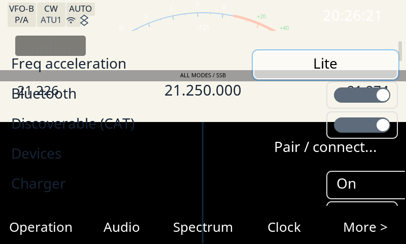
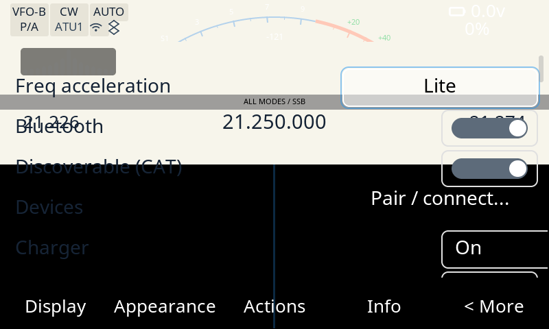
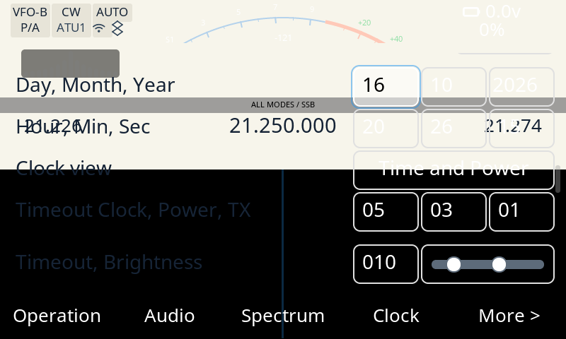

# Evidencia del banco — tabs de Ajustes en inglés y ordenados por utilidad QSO (issue #109)

Prueba QEMU-banco del [#109]: los **ocho tabs** del diálogo de Ajustes pasan al
**inglés de ham radio** y se **reordenan por utilidad** para hacer contactos
(Operation · Audio · Spectrum · Clock · Display · Appearance · Actions · Info).
Cierra el requisito de evidencia del banco (regla del owner: cierre con prueba
QEMU salvo requiere-radio): el cambio es 100 % visible en QEMU.

## Qué se prueba

Sobre el **binario ARM real** (el firmware del port, `qemu-arm-static`, sin
radio), con la pantalla de Ajustes abierta por el socket de control:

- **Página 1** de la barra de tabs: `Operation · Audio · Spectrum · Clock · More >`
  (el orden por utilidad QSO, todo en inglés);
- **Página 2** (que carga el botón `More >`): `Display · Appearance · Actions · Info · < More`;
- **Fila Day / Month / Year** (heredada del #112): los **tres** campos de fecha
  miden **93 px** (la caja de dos columnas de la grilla) y el `2026` entra
  completo, con margen.

## Método

1. **Cliente del banco** (falta en el worktree; `captura-banco.sh --check` lo
   reporta):

   ```sh
   tools/remote/compila.sh          # deja tools/remote/x6200-remote (gitignored)
   ```

2. **Rebuild + captura** de la pantalla de Ajustes con el binario ARM real
   (`RECONSTRUIR=si` → `make x6200-gui-dirclean` + `x6200-gui-rebuild`; el script
   corre antes el gate fail-closed de #86, `tools/verifica-firmware-port.py`):

   ```sh
   CHROOT=/home/pablo/desa/x6200/.vfix3 \
   BUILDROOT=/home/pablo/desa/x6200/buildroot_new/AetherX6200Buildroot \
   RECONSTRUIR=si tools/captura-banco.sh /tmp/opencode/seten109/banco/banco-pag1.png \
       '{"cmd":"app","text":"Settings"}'
   ```

   La pantalla de Ajustes se abre con la acción `APP Settings` por el socket de
   control (método del precedente `docs/evidencia/2026-10-15-fallback91/banco.txt`).
   La GUI queda viva entre llamadas; las páginas se recorren como el usuario, por
   el **botón de la barra** (`{"cmd":"btn","val":N}`, `src/remote_server.cpp` →
   `buttons_press()`):

   ```sh
   # More > (página 1, índice 4) -> página 2
   chroot /t /tmp/x6200-remote '{"cmd":"btn","val":4}'
   # < More (página 2, índice 4) -> vuelve a página 1
   chroot /t /tmp/x6200-remote '{"cmd":"btn","val":4}'
   # Clock (página 1, índice 3) -> settings_goto(GRP_RELOJ): la fila de fecha arriba
   chroot /t /tmp/x6200-remote '{"cmd":"btn","val":3}'
   ```

   El framebuffer falso (480×800×32 BGRA) se rota 270 como en la radio (el mismo
   camino de `captura-banco.sh`).

3. **Medición determinista** (PIL, **sin OCR**): [`medir-tabs.py`](medir-tabs.py)
   detecta la tinta de los labels en la banda del texto (`y=428..463`; fondo
   negro `#000000` de la barra, texto claro), agrupa las columnas contiguas (el
   hueco entre tabs es grande, el de dos glifos chico) y reporta la caja de cada
   label. [`medir-fecha.py`](medir-fecha.py) es el del #112 (detección de bordes
   de widget para la fila de fecha). Salida cruda de los dos:
   [`medicion.txt`](medicion.txt).

## Resultado

### Página 1 — `Operation · Audio · Spectrum · Clock · More >`



### Página 2 (por el botón `More >`) — `Display · Appearance · Actions · Info · < More`



Cajas de los labels (tinta clara, `medir-tabs.py`; el texto se lee en la captura,
la medición no hace OCR):

| # | página 1 (x) | ancho | centro | página 2 (x) | ancho | centro |
|---|---|---|---|---|---|---|
| 1 | `20..140` | 121 | 80 | `39..124` | 86 | 81 |
| 2 | `205..273` | 69 | 239 | `167..312` | 146 | 239 |
| 3 | `342..456` | 115 | 399 | `356..443` | 88 | 399 |
| 4 | `529..591` | 63 | 560 | `536..582` | 47 | 559 |
| 5 | `679..761` | 83 | 720 | `677..761` | 85 | 719 |

Los **centros** caen en `80 / 240 / 400 / 560 / 720` (la barra son 5 columnas
fijas de 160 px): la barra de tabs está en el orden esperado en las dos páginas.

### Cross-check con el harness (mismo font)

El banco corre con el tema que guarda su `params.db` (**Sunlit**, font
`notosans`), no con el default del harness (**Aurora**, font `inter`), así que los
**anchos** de los labels difieren entre los dos caminos (el font es otro). Para
que la comparación sea válida se renderizó el harness con el **mismo font** y la
**misma métrica**:

| página | harness (mismo font) | banco | Δ |
|---|---|---|---|
| 1 `Operation` | `20..140` (121) | `20..140` (121) | 0 |
| 1 `Audio` | `205..273` (69) | `205..273` (69) | 0 |
| 1 `Spectrum` | `342..456` (115) | `342..456` (115) | 0 |
| 1 `Clock` | `528..591` (64) | `529..591` (63) | ≤1 px |
| 1 `More >` | `678..761` (84) | `679..761` (83) | ≤1 px |
| 2 `Display` | `38..124` (87) | `39..124` (86) | ≤1 px |
| 2 `Appearance` | `158..322` (165)¹ | `167..312` (146) | (¹) |
| 2 `Actions` | `355..443` (89) | `356..443` (88) | ≤1 px |
| 2 `Info` | `536..582` (47) | `536..582` (47) | 0 |
| 2 `< More` | `677..762` (86) | `677..761` (85) | ≤1 px |

Harness: `ui_harness --scenario settings-home.scn --font notosans` (página 1) y
`settings-tema-sunlit.scn` (página 2, el tema Sunlit real). ¹ El ink de
`Appearance` del harness mide 165 por píxeles del borde de la grilla que caen en
la banda; el `text_natural` del label es **149** (`x=166 w=149` → `166..314`), que
coincide con el banco (`167..312`, 146) dentro del rasterizado. Las **diez** cajas
del banco coinciden con el harness del mismo font en ≤1 px: el binario ARM dibuja
las **mismas cadenas en el mismo orden** que el arnés.

### Fila Day / Month / Year (herencia del #112)



Cajas de la fila (span externo, `medir-fecha.py`):

| Campo | span | ancho |
|---|---|---|
| Día (`16`) | `499..591` | **93** |
| Mes (`10`) | `595..687` | **93** |
| Año (`2026`) | `691..783` | **93** |

Los **tres** campos miden **93** (`SMALL_2`, la caja de dos columnas de la
grilla): el campo Año ya no queda más angosto (el fix del #112, que este worktree
hereda al rebasar sobre su tip). La tinta del `2026` mide `698,110 60x20` con
**24 px** de margen derecho al borde interno (antes del #112 el margen era 5 px).
Los tres `x` (`499 / 595 / 691`) son los mismos que declara el harness en la
fixture `settings-home` (spinboxes `499/595/691` de 93 px): el layout del banco
coincide con el del harness, así que la métrica es comparable.

## Determinismo

Dos capturas independientes de la misma pantalla (mismo binario) son
**byte-idénticas en la región que se mide**:

```
tab bar y=418..480:                 diff px=0  bbox=None
date-row band y=95..158 x=460..800: diff px=0  bbox=None
```

Lo único que cambia entre capturas es el **reloj vivo** del encabezado (fuera de
la barra de tabs y de la fila de fecha).

## md5 (provenance)

| Qué | md5 |
|---|---|
| binario `x6200_gui` (chroot, 13 742 964 B) | `781d28c54c975ff6d1186e78201f3793` |
| fuente (`src/` + `lvgl/src`) del árbol probado | `7cfb03d11ca0b59d130a7ac392b464f5` |
| captura `banco-pag1.png` | `29796e01bb8bbf9be64d657acaf79f95` |
| captura `banco-pag2.png` | `a45af8230d869aa4724104744caef832` |
| captura `banco-fecha.png` | `18dd25e0ac2b02a3c5fa032f10236dff` |
| commit del árbol probado | `8d4f4338` (HEAD del worktree al capturar) |

El binario es el firmware del port (gate #86: `ELF32 ARM, 13 742 964 B, 3/3
marcas`), construido desde el fuente `7cfb03d11ca0` de esta corrida (recomputado
sobre el árbol actual: **mismo md5**). El `fuente:` impreso por el script es el
del árbol que se compiló; el `src/` no se volvió a tocar después de la captura,
así que la provenance del binario es la de la tabla.

> El tema del banco (`Sunlit`, font `notosans`) sale del `params.db` del chroot
> (`theme_name = Sunlit`), **no** del cambio del #109: el orden y el idioma de los
> tabs viven en `src/dialog_settings.c` y son independientes del tema. Se
> documenta porque explica la diferencia de anchos contra el default del harness
> (Aurora/`inter`).

## Limpieza

El banco deja la GUI viva entre llamadas; se terminó con:

```sh
docker rm -f banco-apps
```

## Alcance

El cambio es **sólo** `src/dialog_settings.c` (los tabs: labels + orden +
paginación), las fixtures de navegación y sus goldens/docs. No toca RF/TX/DSP,
`lvgl/`, `theme.c` ni `make_date()` (la caja del Año es del #112, heredada en el
rebase).

[#109]: https://github.com/iariap/x6200_gui/issues/109
[#112]: https://github.com/iariap/x6200_gui/issues/112
