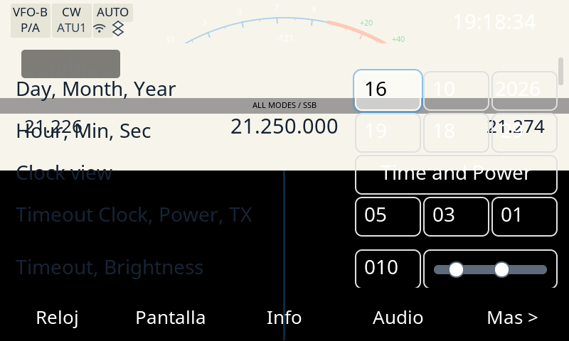

# Evidencia del banco — el campo Año con la caja de la fila (issue #110)

Prueba QEMU-banco del fix del [#110]: en la fila **Day / Month / Year** de
Ajustes el campo **Año** pasa a la **misma caja que Día y Mes** (`SMALL_2` = 93,
en la grilla) en vez de dimensionarse por contenido (`ancho_campo_cifras`). Cierra
el requisito de evidencia del banco (regla del owner: cierre con prueba QEMU
salvo requiere-radio): el defecto es 100 % visible en QEMU.

## Qué se prueba

Sobre el **binario ARM real** (el firmware del port, `qemu-arm-static`, sin radio),
con la pantalla de Ajustes abierta por el socket de control:

- la caja del **Año** queda **igual** a la de **Día** y **Mes** (las tres 93 × 56),
  y
- el texto **"2026"** entra **completo** (sin recorte) con margen.

## Método

1. **Antes** (el binario que ya estaba en el volumen compartido, el del trunk
   desplegado —sin el fix—; no se reconstruye, `RECONSTRUIR=no`):

   ```sh
   CHROOT=/home/pablo/desa/x6200/.vfix3 \
   BUILDROOT=/home/pablo/desa/x6200/buildroot_new/AetherX6200Buildroot \
   RECONSTRUIR=no tools/captura-banco.sh /tmp/opencode/year110/banco/banco-antes.png \
       '{"cmd":"app","text":"Settings"}'
   ```

2. **Después** (rebuild real de la GUI con el fuente de esta corrida,
   `RECONSTRUIR=si` → `make x6200-gui-dirclean` + `x6200-gui-rebuild`):

   ```sh
   CHROOT=/home/pablo/desa/x6200/.vfix3 \
   BUILDROOT=/home/pablo/desa/x6200/buildroot_new/AetherX6200Buildroot \
   RECONSTRUIR=si tools/captura-banco.sh /tmp/opencode/year110/banco/banco-despues.png \
       '{"cmd":"app","text":"Settings"}'
   ```

   El script corre el **gate fail-closed de #86** (`tools/verifica-firmware-port.py`)
   antes de arrancar la GUI: si el binario copiado no es el firmware del port, no corre.
   La pantalla de Ajustes se abre con `{"cmd":"app","text":"Settings"}` (control remoto
   por socket; método del precedente `docs/evidencia/2026-10-15-fallback91/banco.txt`).

3. **Medición determinista** (PIL) de la fila de fecha sobre la captura 800×480:
   se detectan las columnas que son una **línea de borde vertical** del widget
   (`control_border` = `#E0E0E0`, o blanco en el campo que tiene el foco) en la
   banda `y=100..155`; se agrupan y se arma una caja por cada par de grupos
   separados por un interior (> 8 px), así que el hueco de 3 px entre el Mes y el
   Año no cuenta como caja. Se reporta el **span externo** de cada caja (borde a
   borde, el anillo de foco cyan queda **fuera** y no se cuenta) y la tinta del
   `2026` son los píxeles blancos dentro del Año. Script y salida cruda:
   [`medir.py`](medir.py) y [`medicion.txt`](medicion.txt).

## Resultado



Cajas de la fila en la banda `y=100..155` (span externo = ancho declarado del
widget; el campo del Día lleva el foco en esta pantalla, por eso su borde se
dibuja blanco en vez de gris):

| Corrida | Día | Mes | Año | tinta `2026` | margen der. del Año |
|---|---|---|---|---|---|
| **antes** (`banco-antes.png`) | `499..591` = 93 | `595..687` = 93 | `691..764` = **74** | `698,115 60x20` | 5 px |
| **después** (`banco-despues.png`) | `499..591` = 93 | `595..687` = 93 | `691..783` = **93** | `698,115 60x20` | 24 px |

Los tres widgets caen en `x=499 / 595 / 691`, los **mismos x** que declara el
harness en la fixture `settings-home` (spinboxes `499,595,691` de 93 px): el
layout del banco coincide con el del harness, así que la métrica es comparable.

El **"2026"** (tinta blanca) mide `698,115 60x20` en **las dos**: no se mueve (el
campo es el mismo, la caja se agranda hacia la derecha). Con el fix el margen
derecho al borde interno del Año pasa de **5 px** (la caja casi justa) a **24 px**.

- **Antes**: el Año (74) era **19 px más angosto** que Día/Mes (93) → la fila
  desalineada (el síntoma del issue).
- **Después**: los **tres** campos de la fila miden **93** (`SMALL_2`): la fila
  queda alineada y el "2026" entra completo, con margen.

### Contraste con el harness (A/B)

La misma medición sobre las capturas del A/B (`x6200-ab`, Docker) —`a-settings-home.png`
vs `b-settings-home.png`— da **Día 93 / Mes 93 / Año 70 → 93** con la misma
métrica (span externo; los tres en `x=499/595/691`, igual que el banco), y el A/B
reporta **358 px** de diff, todos en `x=752..783, y=100..155` (el borde derecho
del campo pasa de `x=760` a `x=783`; el texto no se mueve). En el banco el ancho
base sale **74** (no 70) porque `ancho_campo_cifras` mide en runtime y la fuente
real mide `0000` un poco más ancho que en el harness; el ancho del fix (93) es la
caja fija de la grilla, idéntico en los dos caminos.

(La tinta del `2026` difiere entre caminos —`56x17` en el harness, `60x20` en el
banco— por el rasterizado de la fuente, pero en los dos el `text_natural` del
label es 60: en el harness la caja útil del Año es `93 − 6 − 4 = 83`, así que el
texto entra con margen en ambos.)

## Determinismo

Dos corridas independientes del banco con el fix (`banco-despues.png` y
`banco-despues-2.png`, mismo binario `3604cece0e43`) **no son byte-idénticas**:
difieren en **1006 px**, en dos regiones fuera de la fila de fecha —la **hora viva**
del encabezado (`x=679..734, y=20..40`, 530 px) y un **valor vivo** que la GUI
refresca (`x=609..718, y=174..193`, 476 px)—. La **región que se mide** —la fila de
fecha— queda **byte-idéntica** entre las dos corridas (**0 px** de diferencia en
`x=460..799, y=95..158` y en la caja del Año `x=692..782, y=100..155`): lo único
que cambia es el reloj y un valor vivo, no el layout.

## md5 (provenance)

| Qué | md5 |
|---|---|
| binario **antes** `x6200_gui` (chroot, 13 743 036 B) | `f88813ae85e3…` |
| binario **después** `x6200_gui` (chroot, 13 742 964 B) | `3604cece0e4382229a2de328d9baa614` |
| fuente (`src/` + `lvgl/src`) del árbol probado | `2d911dfd8eef4d12f099008471b35c05` |
| captura `banco-antes.png` | `73b678131cb06f51e20be72ee277f18a` |
| captura `banco-despues.png` | `fc992d708fa7a9b1eafe1b12de66050c` |
| captura `banco-despues-2.png` | `956a60910b071b12bb4bd94e59b0c71f` |
| commit del árbol probado | `7c87b8dcd2c8335eb6ed160fa58e3bb5a4686226` |

El binario **después** es el firmware del port (gate #86: `ELF32 ARM, 13 742 964 B,
3/3 marcas`) construido desde el fuente `2d911dfd8eef` (esta corrida, `src/` limpio
en `7c87b8dc`). El binario **antes** es el que ya estaba en el volumen compartido
`x6200-build-output` (el del trunk desplegado, `f88813ae85e3`): **no** se
reconstruyó desde este worktree, así que su `fuente:` impreso por el script es el
del árbol actual y **no** corresponde a ese binario (se documenta para no dejar
evidencia falsa).

La línea `version:` de [`banco.txt`](banco.txt) (salida cruda del script) es el
`HEAD` del worktree **en el momento de la captura** (`03b075a3`, el tip local
previo a una reescritura de historia pre-push de esta rama; ese sha **no** está en
la rama publicada). El árbol fuente que se compiló de verdad es el de `7c87b8dc`
—el `fuente: md5 2d911dfd8eef` de `banco.txt` coincide con el `src/` de la rama
actual (recomputado: mismo md5)—, así que la provenance del binario es la de la
tabla, no la de la línea `version:`.

> **Corrección de medición (2026-10-16)**: el primer build de esta corrida anotó
> en el comentario del fuente que el `2026` medía **54** de natural —un número
> sacado de un build **del harness en el host** (el que deja
> `tests/check_harness_determinism.sh`, que compila con el repo en `/src` y
> produce un render inválido). La medición autoritativa (`ui_harness --inspect`
> por el camino del A/B, Docker) da **60** (igual que el peor caso `0000`). Se
> corrigió el comentario; el rebuild desde el fuente corregido da el **mismo
> binario** (`3604cece0e43`): el cambio es sólo de comentario.

## Limpieza

El banco deja la GUI viva entre llamadas; se termina con:

```sh
docker rm -f banco-apps
```

## Alcance

El fix es **sólo** `src/dialog_settings.c` (la caja del Año en `make_date()`) +
`tests/check_settings_focus.py` + docs/golden/contratos. No toca RF/TX/DSP,
`lvgl/`, `theme.c` ni los tabs/labels de Ajustes (eso es del run paralelo #109).

[#110]: https://github.com/iariap/x6200_gui/issues/110
