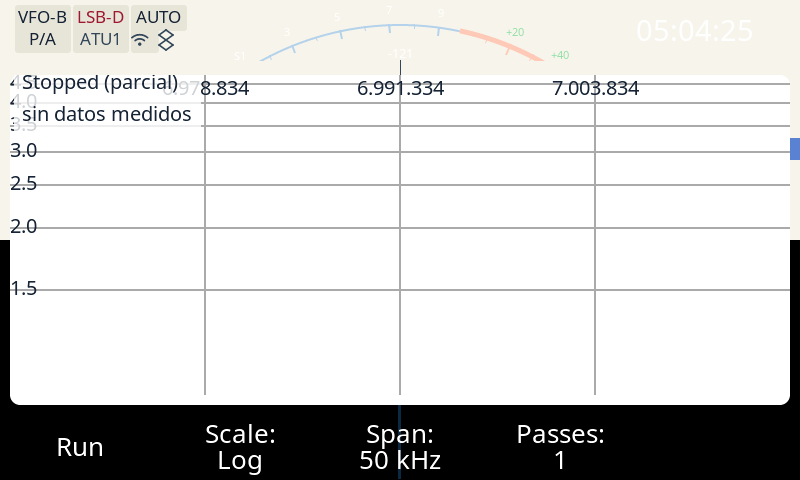

# Evidencia #133 — comando remoto `swrscan` en el banco QEMU

Fecha: 2026-10-18. Rama de evidencia: `factory/swrscan-remote-133`. Código medido:
`33522a30` (`fix(swrscan): el Stop repinta el chart ...`), encima de `a37b8048` (la evidencia
original del comando). El comando remoto ya está en el trunk: `d3e84ed` (PR #135, squash de
`aea54215`).

**Alcance:** evidencia del comando Run/Stop/doble Run y del fix de repintado que destapó la
corrida anterior. No se tocó nada fuera de `src/dialog_swrscan.c` y su test nativo.

## Método

1. `docker ps` antes de empezar: sin contenedor `banco-apps`; imagen `x6200-buildroot` disponible.
2. Build **limpio** con el procedimiento del banco y el gate #86:

   ```sh
   RECONSTRUIR=si \
   CHROOT=/tmp/opencode/vfix3-swr133 \
   BUILDROOT=/home/pablo/desa/x6200/buildroot_new/AetherX6200Buildroot \
   tools/captura-banco.sh /tmp/opencode/bench-swr133-stopfix.png '{"cmd":"app","text":"SWRScan"}'
   ```

   Salida cruda: `build-gate86.log`. El build hizo `dirclean` + rebuild, pasó el gate #86
   (`OK: ... es el firmware del port (ELF32 ARM, 13757724 B, 3/3 marcas)`) y dejó el binario
   **`991bb0e2fabc26f7f7e2c803e8b40530`** (fuente `3340b37a956a`). El código medido es `33522a30`.

3. **Integridad del banco:** se usó una copia privada del rootfs (`/tmp/opencode/vfix3-swr133`)
   para no atribuir la evidencia a otro binario del chroot compartido. El md5 se comprobó antes y
   después de la secuencia: `991bb0e2fabc26f7f7e2c803e8b40530` en los dos extremos
   (`binario-y-gate86.txt`).

4. Secuencia por socket, sin radio, con la GUI ARM real bajo `qemu-arm-static` y framebuffer
   falso. Cada pedido y cada respuesta cruda quedan en `02-secuencia-completa.txt`; las capturas
   se rotaron 270° igual que `tools/captura-banco.sh`. El banco no tiene radio ni flow: no se emite
   RF y no se puede medir potencia entregada.

5. `docker rm -f banco-apps-swr133` al terminar (`docker-ps-final.txt`).

## Tabla pedido → respuesta → estado

Las respuestas `{"t":"state",...}` están recortadas en la tabla (se muestran los campos que
importan); el JSON completo, con todos los campos, está en `02-secuencia-completa.txt`.

| # | Pedido | Respuesta cruda | Estado observado (`get`) |
|---|---|---|---|
| 1 | `{"cmd":"get"}` (baseline) | `{"t":"state",...,"mode":"LSB-D","tx":false,"app":"","ax":{}}` | app cerrada, `tx:false` |
| 2 | `{"cmd":"swrscan","val":1}` con la app cerrada | `{"t":"err","err":"app not open"}` | sigue `app:""`, `ax:{}`, `tx:false` (no hubo TX) |
| 3 | `{"cmd":"app","text":"SWRScan"}` | `{"t":"ok"}` | `app:"SWRScan"`, `ax:{"swrscan_state":"Idle","passes":1,"pass":0,"points":51,"swrscan_tx":false}`, `tx:false` |
| 4 | `{"cmd":"swrscan","val":1}` (Run) | `{"t":"ok"}` | +0,5 s: `mode:"LSB"` (antes `LSB-D`), `filter:2670`, `tx:true`, `ax:{"swrscan_state":"Scanning","passes":1,"pass":1,"points":51,"swrscan_tx":true}` |
| 5 | `{"cmd":"swrscan","val":1}` (doble Run durante `Scanning`) | `{"t":"ok"}` | sigue `Scanning`, `pass:1`, `tx:true`; no pasó a `Stopped` ni reinició |
| 6 | `{"cmd":"get"}` cada 1 s, 10 veces | 10 × `{"t":"state",...,"ax":{"swrscan_state":"Scanning","passes":1,"pass":1,"points":51,"swrscan_tx":true}}` | **se quedó en `Scanning`/`tx:true` los 10 s; no hubo `Error: timeout de RF` ni `Completed`** |
| 7 | `{"cmd":"swrscan","val":0}` (Stop) | `{"t":"ok"}` | +1 s: `mode:"LSB-D"` y `filter:2800` restaurados, `tx:false`, `ax:{"swrscan_state":"Stopped","passes":1,"pass":0,"points":51,"swrscan_tx":false}`; botón de la app: `Run` |
| 8 | `{"cmd":"swrscan","val":2}` (valor inválido) | `{"t":"err","err":"Invalid value"}` | sigue `Stopped`, `tx:false`; no se encoló nada |
| 9 | `{"cmd":"app","text":"off"}` (cierre) | `{"t":"ok"}` | — |

## Capturas

- `01-app-abierta.png`: la app `SWRScan` abierta en el banco, `Idle`, `sin datos medidos`,
  `Run`, `Span: 50 kHz`, `Passes: 1`.
- `03-run-scanning.png`: durante el Run, `Scanning pass 1/1 p 1/51`, botón `Stop`, barra en `LSB`.
- `04-post-poll-10s.png`: **10 s después**, todavía `Scanning pass 1/1 p 1/51`; el estado por
  socket sigue `Scanning` y `swrscan_tx:true`.
- `05-stopped.png`: después de `val:0`, la barra volvió a `LSB-D`, el botón a `Run` y **la leyenda
  del chart ahora dice `Stopped (parcial)`** (con `sin datos medidos`, porque el banco no tiene
  flow). El `get` dice `Stopped`/`tx:false`.
- `06-final.png`: después de `val:2` (sigue `Stopped`).

## Antes / después del Stop

Antes (`05-stopped-antes.png`, binario `ffef63df58cb`, HEAD original `efae955e`): el `get` y el
botón ya decían `Stopped`/`Run`, pero el chart seguía con la leyenda del último draw:


Después (`05-stopped.png`, binario `991bb0e2fabc`, código `33522a30`): el Stop pide el repintado
del chart y la leyenda pasa a `Stopped (parcial)` en el mismo frame:



## Causa y fix del repintado

**Causa:** `swrscan_stop()` marcaba la sesión como `SWR_SESSION_STOPPED`, apagaba el TX y restauraba
memoria/frecuencia, pero no enviaba `LV_EVENT_REFRESH` al chart (`src/dialog_swrscan.c:256-269` en
`a37b8048`). El camino del botón Stop tampoco lo hacía después de llamarlo
(`dialog_swrscan_run_cb`, `src/dialog_swrscan.c:681-688`). El estado lógico cambiaba; la leyenda
quedaba con el último texto dibujado (`Scanning pass 1/1 p N/51`).

**Fix:** el único camino de Stop (operador y remoto comparten `swrscan_stop()`) ahora refresca el
chart a través de `swrscan_chart_refresh()`. Para el cierre con el barrido corriendo (issue #85)
`swrscan_release()` marca `chart = NULL` antes de llamar a `swrscan_stop()`: el helper solo manda
el evento si el objeto sigue vivo, así no se redibuja sobre objetos que LVGL está por liberar.

**Test nativo (`tests/native/test_swrscan.c`, seam `swrscan`):** tras el Stop del operador y el
Stop remoto se pide exactamente un `LV_EVENT_REFRESH` del chart; al destruir el diálogo no se pide
ninguno. RED observado antes del fix: 2 fallos (las dos aserciones de refresh del Stop); GREEN:
`461 comprobaciones, 0 fallos`.

## Por qué no se vio el timeout en QEMU

En el banco no hay BASE/radio. `radio_init()` reintenta `x6200_control_init()` 30 veces y, si no
responde, **retorna antes de crear el hilo de radio** (`src/radio.c:447-457`; el
`pthread_create(radio_thread)` está en `src/radio.c:582`). El log lo dice:

```
[Error] radio_init: La BASE no respondió: la GUI sigue sin control de la radio (in radio.c line #456)
```

El watchdog del barrido (`dialog_swrscan_poll()`) se ejecuta **desde `radio_thread`/`radio_tick`**,
en la rama en la que el flow no entrega paquetes (`src/radio.c:268-272`). Sin hilo de radio no hay
quien llame al poll, así que la sesión queda en `Scanning` con `swrscan_tx:true` y no dispara el
timeout de `SWRSCAN_PASS_TIMEOUT_MS` (2.285 ms, `src/dialog_swrscan.h:40`). Esto es una **limitación
del banco sin radio**, no una conclusión sobre hardware: el camino de timeout está cubierto por el
test nativo `test_swrscan_timeout` (`tests/native/test_swrscan.c`) y por `test_swr_session`; en la
radio real el hilo de radio existe y recibe el flow.

El comando en sí **sí cumple el diseño** en lo que el banco puede medir:

- **Run** cambia el estado a `Scanning`, pone `swrscan_tx:true` y fuerza `LSB` (el `get` lo muestra).
- **Doble Run** responde `{"t":"ok"}` y **no reinicia ni para**: el estado sigue `Scanning` con
  `pass:1` y `tx:true`. Si hubiera llegado al callback del botón con `run=true`, ese callback hace
  `swrscan_stop()`; el hecho de que siga `Scanning`/`tx:true` prueba que fue un no-op por la guarda
  de idempotencia del comando remoto. La captura `04-post-poll-10s.png`, tomada 10 s después del
  doble Run, sigue mostrando el botón `Stop` (no volvió a `Run`).
- **Stop** responde `{"t":"ok"}`, deja `Stopped`, apaga `swrscan_tx`, restaura modo/filtro
  (`LSB-D`, 2800), pone el botón `Run` y **repinta el chart a `Stopped (parcial)`**. Las guardas de
  app cerrada y de valor inválido también responden como está especificado.

## Gates de la corrida

- Nativos completos: `tests/native/run_native_tests.sh` **exit 0** (SWR Scan: 461 comprobaciones,
  0 fallos; multipasada 4851, 0 fallos).
- Estáticos del repo: **8/8 OK** (`cfg`, `actions`, `settings_focus`, `apps_menu`, `app_handlers`,
  `manual_apps`, `wcag`, `cw_tune_feed`).
- Determinismo del arnés: **PASS**, 16 fixtures con PNG idénticos run-a-run.
- A/B (`AB-SWR133-STOPFIX`): **PASS**, 85 escenarios capturados en A y B y **pixel-idénticos**.
  Es lo esperado: el arnés de UI (`tools/ui_harness`) mockea `dialog_swrscan` (no corre este
  diálogo), así que este fix no cambia ningún pixel del arnés. La prueba real del repintado es la
  captura del banco (`05-stopped.png`) y el test nativo del seam.
- `contracts`: **PASS** (873 checks, 0 failures); `audit`: 0 findings estructurales sobre 9462
  objetos/85 escenarios; `themes`: **PASS** (contraste WCAG de los temas servidos).
- Python del arnés: `ruff check` / `ruff format --check` / `ty check` limpios;
  `pytest -m "not e2e"` → **227 passed, 13 deselected**.
- ARM cross-compile: test nativo del seam compilado estático con
  `arm-buildroot-linux-gnueabihf-gcc` y corrido con `qemu-arm-static` → **461 comprobaciones,
  0 fallos** (ELF32 ARM). El build ARM real de la GUI es el del banco (`build-gate86.log`, binario
  `991bb0e2fabc`).

## Archivos

- `build-gate86.log` — build limpio + gate #86 (salida cruda).
- `binario-y-gate86.txt` — md5, tamaño, gate #86 y commit del binario que corrió.
- `02-secuencia-completa.txt` — todos los pedidos y respuestas crudas, con timestamps.
- `banco-out.txt` — log completo de la GUI en el banco.
- `banco-out-relevante.txt` — `radio_init`, `CRASHLOG`, `crash.txt`.
- `01-app-abierta.png`, `03-run-scanning.png`, `04-post-poll-10s.png`,
  `05-stopped-antes.png`, `05-stopped.png`, `06-final.png` — capturas.
