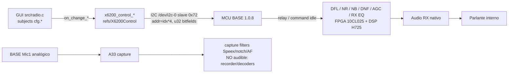

# #390-QA-NATIVE-DSP — Filtros RX nativos Xiegu y arquitectura de integración DSP

**Issue/épica:** [#390](https://github.com/iariap/x6200_gui/issues/390) [#362](https://github.com/iariap/x6200_gui/issues/362) · **PRs preservados:** [#391](https://github.com/iariap/x6200_gui/pull/391) [#389](https://github.com/iariap/x6200_gui/pull/389) [#388](https://github.com/iariap/x6200_gui/pull/388) [#386](https://github.com/iariap/x6200_gui/pull/386) [#385](https://github.com/iariap/x6200_gui/pull/385)
**Worktree/rama:** `x6200-native-dsp-filter-path` / `research/x6200-native-dsp-filter-path` · **Base real:** `681074e0adac5a79f0392b4e51284167abf5e342` (`fork/main`; `origin/main`=`e1476ece` distinto, no usado; `main` local añejo `6a29687d` intacto).
**Tipo:** investigación **offline**; sin radio, sin flash, sin IAP/XMODEM, sin GPIO/registros/MUX/ALSA/GUI/ajustes/volumen/frecuencia. No incluye firmware ni binarios vendor.

## Veredicto: `RECOMMENDED_ARCHITECTURE = A` — reutilizar el DSP nativo controlado desde Linux

La ruta nativa de filtros **existe y ya está expuesta** por `X6200Control` (el mismo camino que usa el
GUI y el fabricante): **GUI (`src/radio.c` + `src/cfg`) → `x6200_control_*` → registro de control
6 bytes (`addr = índice*4`, valor 32 bits con bitfields) → MCU BASE → DSP/FPGA nativo**. Reutilizarla
mantiene por construcción el **RX continuo** y el **parlante interno**, sin USB/BT/audio externo ni
cambios físicos, y sin añadir DSP Linux en la ruta audible (que hoy no está resuelta: QA45/QA390).

No se propone B (extender el DSP del STM32) ni C (DSP Linux→parlante): ver `integration-comparison.md`.
La validación **física/audible** del efecto de los filtros nativos queda **PENDING** (requiere radio y
autorización del owner); este trabajo no la simula.

## Gates (literales)

| Gate | Valor | Evidencia |
|---|---|---|
| `NATIVE_FILTER_PIPELINE` | **FOUND** (control VERIFIED; aplicación final PARTIAL) | Cadena completa a nivel API/registro verificada en `refs/X6200Control/src/control.c` + `src/radio.c` + `src/cfg/cfg.c`/`mode.c`; MCU con handlers dedicados por parámetro (strings en `logs/qa19-scan-extract.txt`); identidad índice→registro FPGA observada reg12→cmd `0x0C`, reg24→cmd `0x18` (QA390). |
| `DFL_IMPLEMENTATION` | **PARTIAL** | Filtros RX: `x6200_rxfilter` (idx 30) + perfiles por modo `filter_ssb...filter_wfm` (45–50), empaquetado y límites/defaults verificados (`filter-matrix.csv`); algoritmo exacto y bloque (FPGA vs DSP MCU) **UNKNOWN** sin bitstream. |
| `NR_IMPLEMENTATION` | **PARTIAL** | `x6200_nrthr_nbw_nbthr_nre_nbe` (23): NR enable bit24, nivel [7:0]; NB enable bit25, width [15:8], nivel [23:16]; MCU log `update dnr threshold=%d`, `update dnr type=%d`; algoritmo espectral/temporal **UNKNOWN**. |
| `NB_IMPLEMENTATION` | **PARTIAL** | Mismo registro 23: enable/nivel/ancho; MCU log `update nb enable/threshold`; detector/blanking y posición vs demod/AGC **UNKNOWN**. |
| `DNF_IMPLEMENTATION` | **PARTIAL** | `x6200_dnfcnt_dnfwidth_dnfe` (24): centro [11:0], ancho [23:12], modo [25:24] (off/manual/auto); MCU log `update notch filter, type=%d, fc=%d`; IQ vs PCM y adaptación **UNKNOWN**. |
| `AGC_IMPLEMENTATION` | **PARTIAL** | Modo AGC por VFO (`vfoa_agc`=5/`vfob_agc`=11, off/slow/fast/auto); `agcknee_agcslope_agchang` (27): knee int8 [7:0], slope [11:8], hang bit12; `agctime` (28) ms; MCU logs `[INFO] AGC params %d,%d,%d`, `reset AGC`; detector/ataque/recuperación numéricos **UNKNOWN**. |
| `RX_EQ_IMPLEMENTATION` | **PARTIAL** | `x6200_rxeq` (35), `rxeqwfm` (36), `miceq` (37): enable bit25 + **5 bandas × 5 bits** (p1 [4:0] … p5 [24:20]); MCU logs `update rxeq_en/p1..p5`, `rxeqwfm_*`, `miceq_*`; frecuencias centrales/ganancias/escala y si es pre/post PCM **UNKNOWN**. |
| `NATIVE_DSP_REUSE` | **YES** (recomendado) | Ya expuesto por la API; el GUI ya controla DFL/NR/NB/DNF/AGC/EQ; no requiere reverse del algoritmo ni firmware nuevo. Efecto audible: PENDING físico. |
| `MCU_DSP_EXTENSION` | **NOT_JUSTIFIED / NO-GO** | Requiere parchear firmware MCU (flash sin recuperación verificada), el endpoint del PCM TX `0x30000C00` es UNKNOWN (QA390), y no hay presupuesto de formato/rate/CPU/latencia. Si A alcanza, no se agrega B. |
| `LINUX_DSP_SPEAKER_LOOP` | **NOT_VERIFIED / NO-GO** | No hay camino PCM Linux→parlante conservando RX: QA28/QA32/QA35/QA36 midieron que el selector BASE/DAC pierde la RX capturada y el PCM Linux no sonó; QA390 dejó el endpoint I2S3/parlante UNKNOWN. No se reutilizan los parches fallidos de reg12/reg24/0x34. |
| `RECOMMENDED_ARCHITECTURE` | **A** | Reutilizar DSP nativo, controlado desde Linux; cero cambios de firmware; RX continuo y parlante por diseño. Plan mínimo en `minimum-plan.md`. |

**Gates A/B de integración:** A = **GO** (infraestructura ya existente; efecto audible PENDING físico) ·
B = **NO-GO** · C = **NO-GO**. No se implementa harness de firmware ni DSP Linux.

## Cadena reconstruida (mermaid)

Puntos de evidencia:
- `src/radio.c`: observers de `cfg.filter.low/high`, `cfg.agc_*`, `cfg.dnf_*`, `cfg.nb_*`, `cfg.nr_*`,
  `cfg.eq.rx.*`, `cfg.eq.rx_wfm.*`, `cfg.eq.mic.*` → `x6200_control_*` bajo `WITH_RADIO_LOCK`.
- `X6200Control/src/control.c`: cada setter escribe un único registro de 32 bits con los bitfields de
  `filter-matrix.csv`; `set_rx_filters()` además espeja el valor en el perfil del modo activo
  (`filter_ssb/cw/am/nfm/wfm`).
- MCU 1.0.8: strings de log por parámetro (p. ej. `update rx filter, hpf=%d, lpf=%d` en `0x08050DFB`,
  `update notch filter...` `0x080505CB`, `update dnr...` `0x080508B4/D0`, `update nb...`
  `0x080508E8/90 0`, `update rxeq_*` `0x08050BE4..0x08050C60`, AGC `0x08050E5C/0x08050814`), y
  funciones de actualización de estado que marcan dirty flag (`FUN_08042CF6` regíón 0x08042000–
  0x08042F00, `logs/qa19-region.log`) antes de aplicar en el lazo de control.
- Identidad índice→registro: QA390 decompiló `voice_rec` (`FUN_08045320`) escribiendo reg12→FPGA `0x0C`
  y reg24→FPGA `0x18`; por eso los registros de filtros (idx 23,24,27,28,30,35,36,37,45–50) se
  mapean a comandos FPGA con el mismo id (INFERRED para esos índices; VERIFIED para 12/24).
- El DSP Linux de captura (`src/audio_enhancement.c`, "Capture filters" en `src/dialog_settings.c`)
  procesa **solo la copia capturada** para grabadora/decoders; no se entrega al parlante
  (`src/audio.c::capture_deliver` no llama playback). No compite con A: sirve para análisis/grabación.

## DFL/RX filter — lo verificado

- GUI: `low/high` por modo con defaults reales: LSB/USB `50..2950 Hz`; CW `-250..250`; AM `0..4500`;
  NFM `0..3500`; WFM `0..8000` (`src/cfg/mode.c::mode_default_values`). LSB espeja el dominio
  (`update_real_filters`: `from=-high, to=-low`). En DB de modo, valores negativos se ignoran **excepto CW**.
- Codificación: SSB/USB/LSB → `low<<16 | high`; CW/AM/NFM/WFM → `(-high)<<16 | high` (simétrico;
  `radio.c::on_high_filter_change`). `x6200_rxfilter` idx30 + perfil de modo 45–50 con el mismo valor.
- Algoritmo del filtro (FIR/IIR, orden, transición) **no reconstruible offline**: no hay bitstream FPGA
  ni del DSP, y el apply no está en el MCU analizado. Marcado PARTIAL/UNKNOWN, no se inventan defaults.

## Versión 1.0.6 vs 1.0.8

- **MCU**: la superficie de control de filtros/DSP es **idéntica** (mismos strings `update rx filter`,
  `notch`, `dnr`, `nb`, `rxeq`, `rxeqwfm`, `miceq`, AGC; 12 de `update rxeq` en ambas). Lo distinto en
  1.0.8 son mensajes de boot/updater/NVPARAM y regs MAX172xx/FPGA/MCU (`logs/mcu-106-vs-108-filter-strings.txt`).
- **GUI vendor**: mismos símbolos y strings (`BaseCommIIC::updateRxFilters`, `MainWidget::sig_updateFilter`,
  `XTwinFilterWidget`, `XRadioFilterSetting`, `filter_ssb/cw/am/nfm/wfm`, `rx_filter`, `NOTCH FC`);
  sólo cambian direcciones (`logs/vendor-gui-106-vs-108-filter.txt`). Sin features nuevas visibles.

## Limitaciones y faltantes exactos

1. **No hay bitstream FPGA** en el set de fábrica (QA390: `FPGA_ARTIFACT_FOUND=NO`) ⇒ no se puede
   reconstruir con exactitud el algoritmo de DFL/NR/NB/DNF/AGC/EQ si corre en la 10CL025.
2. El **apply** desde el estado del MCU al FPGA/DSP no está identificado (funciones de update marcan
   dirty y el lazo de aplicación no se resolvió con el análisis estático de Ghidra 12.1.4; ver
   `rea-ghidra-log.md`). Por eso todos los `*_IMPLEMENTATION` quedan PARTIAL y no se declara bit-exact.
3. Ghidra 12.2 esperado en `/tmp` **no existe** en este sandbox; se usó Ghidra 12.1.4 real y el proyecto
   QA390. Desviación registrada.
4. Efecto audible/medición de respuesta de cada filtro nativo: **PENDING** (requiere radio/owner).

## Siguiente paso único (plan mínimo, sin firmware)

**`NEXT_EXECUTABLE_STEP`:** completar/verificar en el GUI el control de los filtros nativos existentes
(NR enable+level, NB enable+level+width, DNF modo+centro+ancho, AGC modo+knee+slope+hang+tiempo, RX EQ
5 bandas + WFM/MIC, DFL edges ya presentes) usando **sólo** `x6200_control_*`, con los tests offline de
`tools/native-dsp-rea/tests/`; luego una **prueba física autorizada del owner** (A/B auditivo y captura
externa) para validar el efecto. No se implementa DSP nuevo ni se parchea el MCU.

## Archivos

`filter-matrix.csv` (mapeo completo) · `integration-comparison.md` (A/B/C) · `validation.md` (tests) ·
`minimum-plan.md` · `rea-ghidra-log.md` (REA/Ghidra real) · `commands.log` · `logs/` (REA/Ghidra/handlers/diffs) ·
`tools/native-dsp-rea/` (scripts reproducibles + tests).

## Estado / seguridad

Radio **intacta**: no se conectó ni modificó; sin flash/IAP/XMODEM/GPIO/registros/MUX/ALSA/GUI/ajustes.
Firmware oficial 1.0.8 y estado del operador sin cambios. `main` no tocado; PRs QA11–QA45 preservados.
Sin merge; sin issues nuevas.
