# Atlas UI/UX — candidato `c888308e` (capa HOST, 800x480)

199 capturas originales en [`captures/`](captures/). Miniatura por fixture (abre el PNG original). Columnas: fixture, pantalla, tema solicitado/efectivo, seed, capa, revision embebida, cobertura dominante.

> Recordatorio: la miniatura es una PNG del harness host; no prueba legibilidad al sol, tacto ni LCD real (PENDING_HARDWARE).

| miniatura | fixture | pantalla | tema | seed | capa | revision | cobertura |
|---|---|---|---|---|---|---|---|
|  | `app-bands` | app-bands | Aurora | 20 | HOST | c888308eede7 | REAL |
|  | `app-close-home` | app-close-home | Aurora | 20 | HOST | c888308eede7 | REAL |
| <a href="captures/apps-menu-1.png">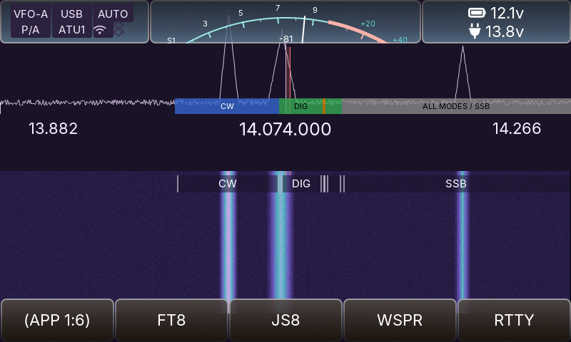</a> | `apps-menu-1` | apps-menu | Aurora | 20 | HOST | c888308eede7 | REAL |
| <a href="captures/apps-menu-2.png">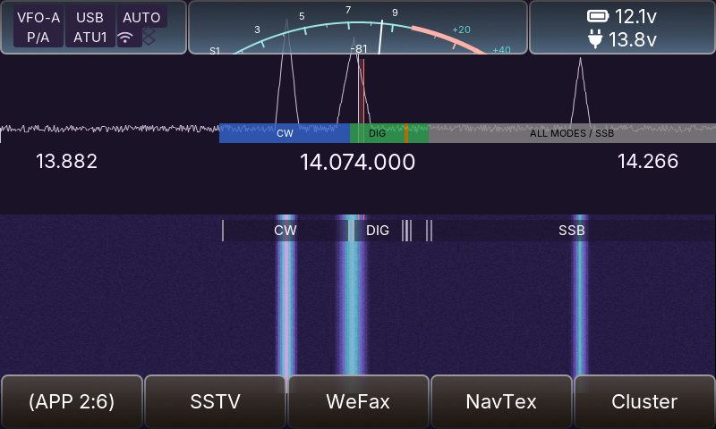</a> | `apps-menu-2` | apps-menu | Aurora | 20 | HOST | c888308eede7 | REAL |
| <a href="captures/apps-menu-3.png">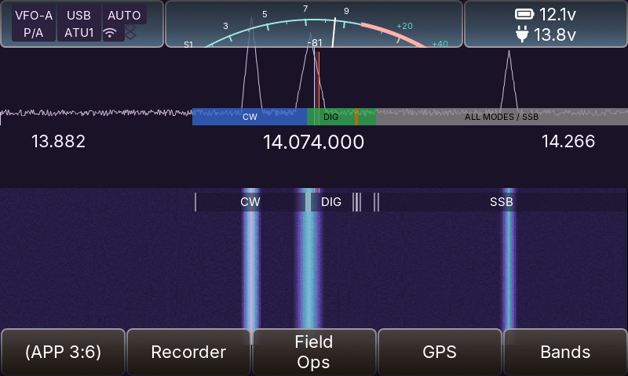</a> | `apps-menu-3` | apps-menu | Aurora | 20 | HOST | c888308eede7 | REAL |
| <a href="captures/apps-menu-4.png">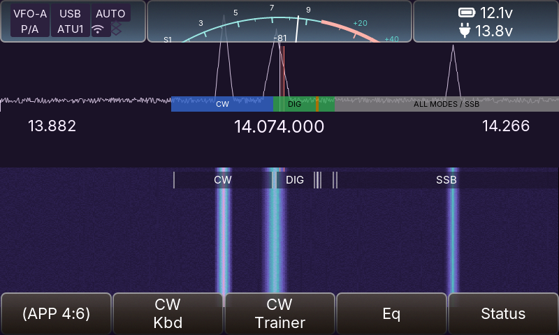</a> | `apps-menu-4` | apps-menu | Aurora | 20 | HOST | c888308eede7 | REAL |
| <a href="captures/apps-menu-5.png">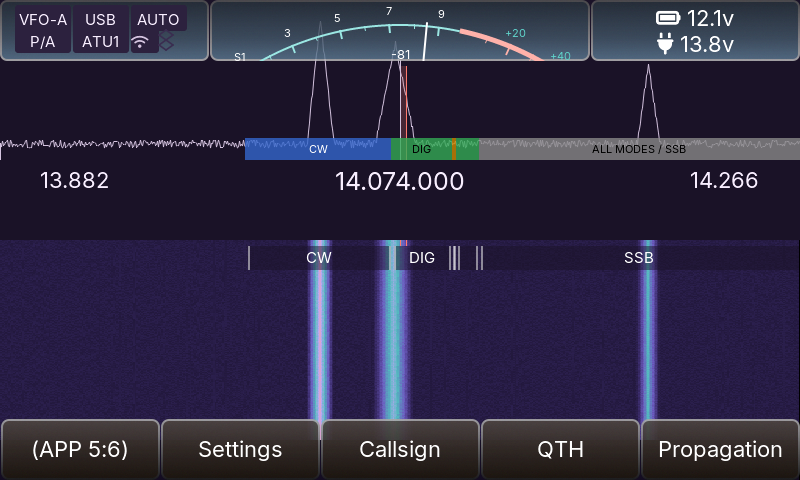</a> | `apps-menu-5` | apps-menu | Aurora | 20 | HOST | c888308eede7 | REAL |
|  | `apps-menu-6` | apps-menu | Aurora | 20 | HOST | c888308eede7 | REAL |
| <a href="captures/autotune-found.png">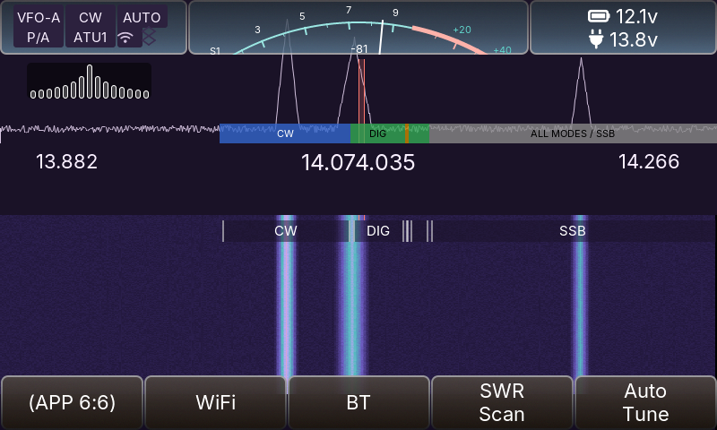</a> | `autotune-found` | autotune-found | Aurora | 20 | HOST | c888308eede7 | REAL |
| <a href="captures/autotune-notcw.png">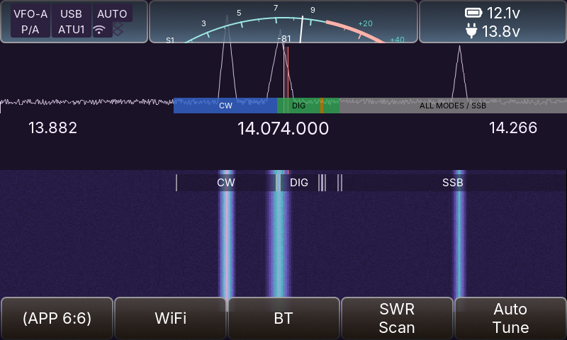</a> | `autotune-notcw` | autotune-notcw | Aurora | 20 | HOST | c888308eede7 | REAL |
|  | `autotune-progress` | autotune-progress | Aurora | 20 | HOST | c888308eede7 | REAL |
|  | `autotune` | autotune | Aurora | 20 | HOST | c888308eede7 | REAL |
| <a href="captures/bench-render.png">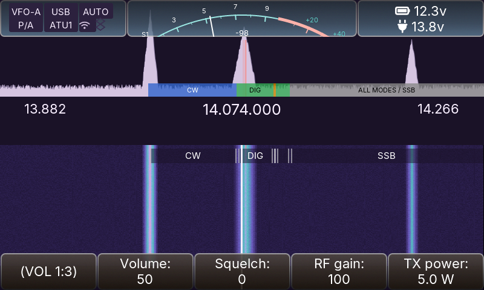</a> | `bench-render` | main | Aurora | 11 | HOST | c888308eede7 | REAL |
|  | `bt-dialog-tema-aurora` | bt-dialog | Aurora | 20 | HOST | c888308eede7 | REAL |
| <a href="captures/bt-dialog-tema-cathode.png">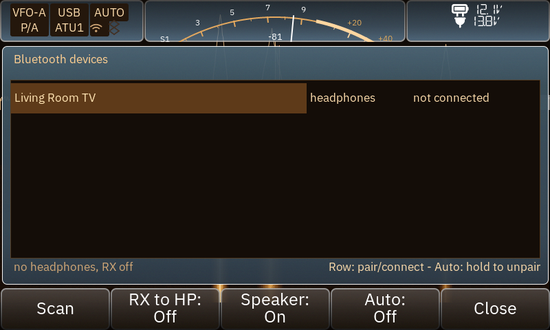</a> | `bt-dialog-tema-cathode` | bt-dialog | Cathode | 20 | HOST | c888308eede7 | REAL |
| <a href="captures/bt-dialog-tema-redshift.png">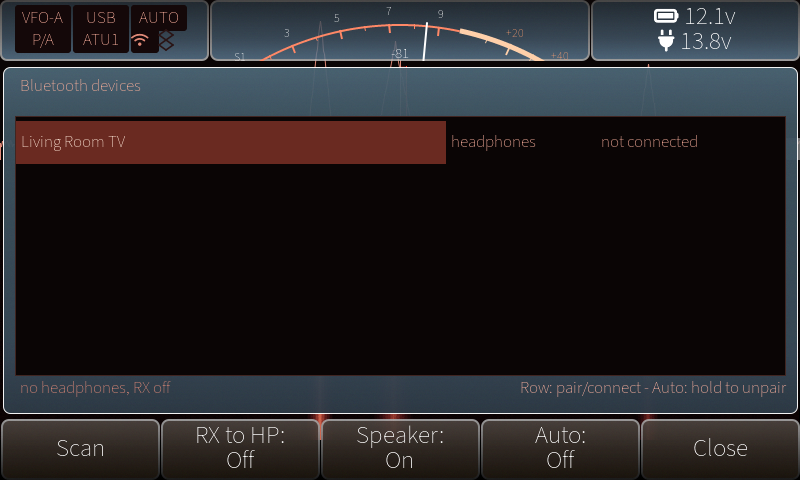</a> | `bt-dialog-tema-redshift` | bt-dialog | Redshift | 20 | HOST | c888308eede7 | REAL |
| <a href="captures/bt-dialog-tema-sprint.png">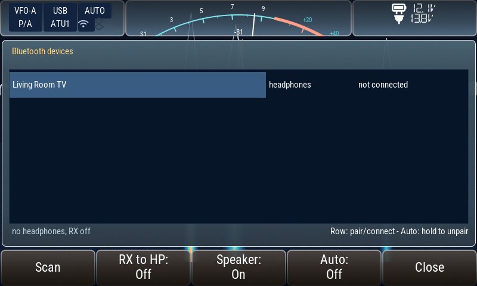</a> | `bt-dialog-tema-sprint` | bt-dialog | Sprint | 20 | HOST | c888308eede7 | REAL |
| <a href="captures/bt-dialog-tema-sunlit.png">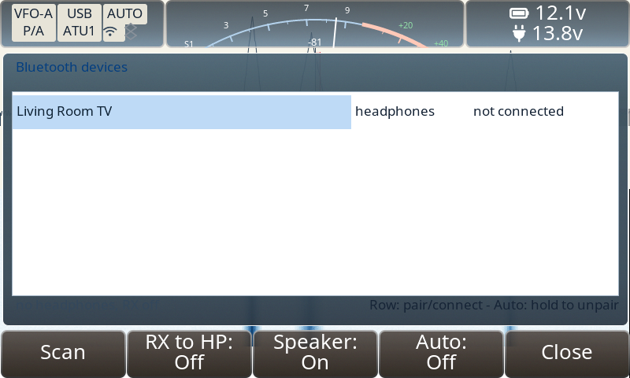</a> | `bt-dialog-tema-sunlit` | bt-dialog | Sunlit | 20 | HOST | c888308eede7 | REAL |
| <a href="captures/bt-dialog-tema-trail.png">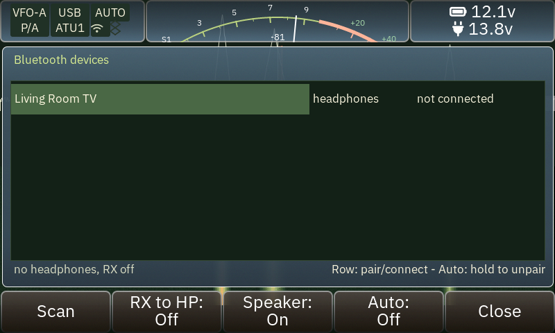</a> | `bt-dialog-tema-trail` | bt-dialog | Trail | 20 | HOST | c888308eede7 | REAL |
| <a href="captures/bt-dialog.png">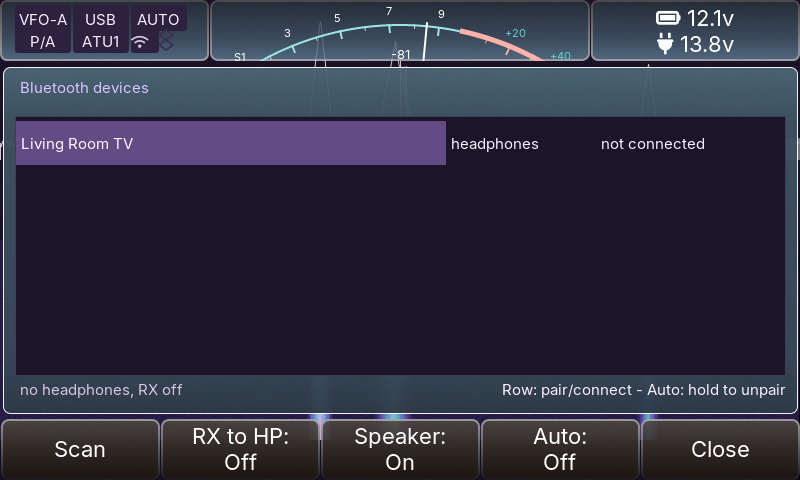</a> | `bt-dialog` | bt-dialog | Aurora | 20 | HOST | c888308eede7 | REAL |
|  | `cw-autotune-off` | cw-autotune-off | Redshift | 20 | HOST | c888308eede7 | REAL |
| <a href="captures/cw-autotune-on.png">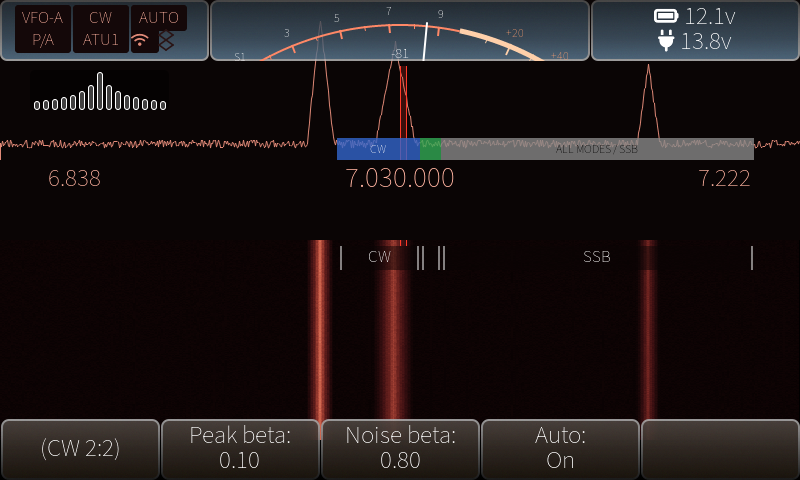</a> | `cw-autotune-on` | cw-autotune-on | Redshift | 20 | HOST | c888308eede7 | REAL |
| <a href="captures/cw-tune-default.png">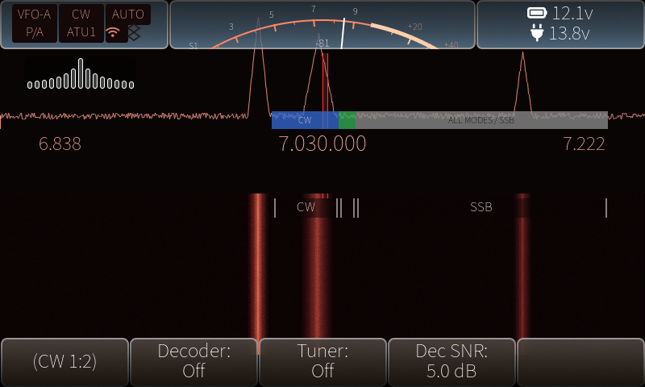</a> | `cw-tune-default` | cw-tune-default | Redshift | 20 | HOST | c888308eede7 | REAL |
| <a href="captures/cw-tune-ssb.png">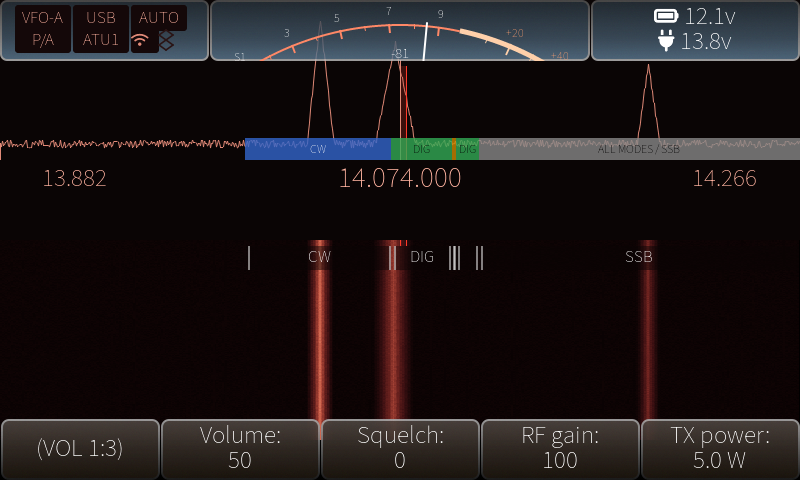</a> | `cw-tune-ssb` | cw-tune-ssb | Redshift | 20 | HOST | c888308eede7 | REAL |
| <a href="captures/cw-tune-tema-sunlit.png">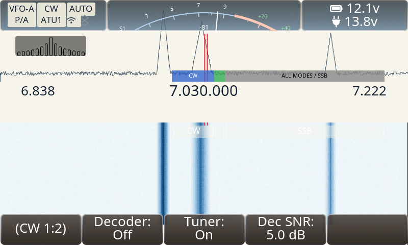</a> | `cw-tune-tema-sunlit` | cw-tune-tuner | Sunlit | 20 | HOST | c888308eede7 | REAL |
|  | `cw-tune-tuner` | cw-tune-tuner | Redshift | 20 | HOST | c888308eede7 | REAL |
| <a href="captures/dfl-editor-cycles.png">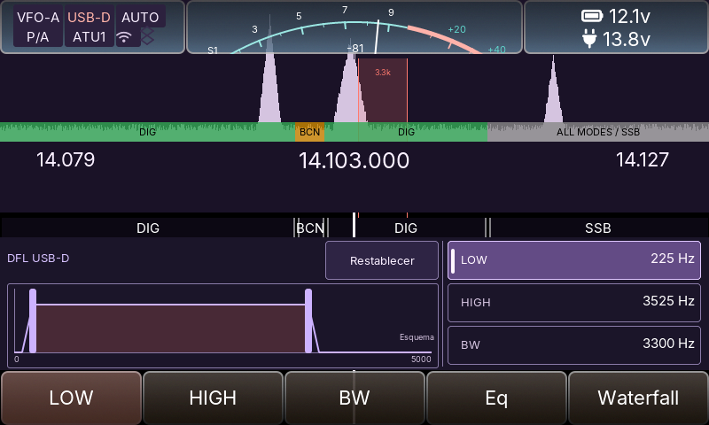</a> | `dfl-editor-cycles` | dfl-editor-cycles | Aurora | 173 | HOST | c888308eede7 | REAL |
|  | `dfl-editor-interaction` | dfl-editor-interaction | Aurora | 173 | HOST | c888308eede7 | REAL |
| <a href="captures/dfl-editor-lsb-d.png">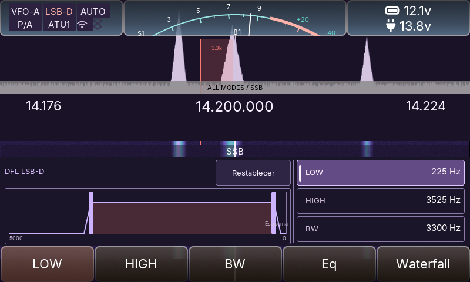</a> | `dfl-editor-lsb-d` | dfl-editor | Aurora | 173 | HOST | c888308eede7 | REAL |
| <a href="captures/dfl-editor-reset.png">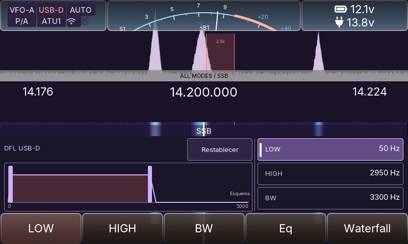</a> | `dfl-editor-reset` | dfl-editor-reset | Aurora | 173 | HOST | c888308eede7 | REAL |
| <a href="captures/dfl-editor-rotary0.png">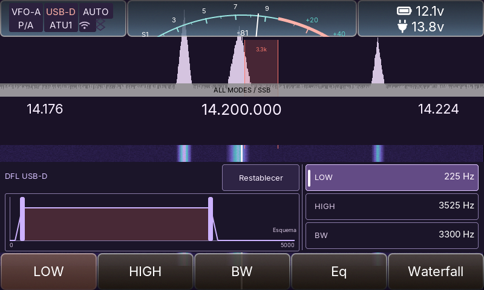</a> | `dfl-editor-rotary0` | dfl-editor-rotary0 | Aurora | 173 | HOST | c888308eede7 | REAL |
| <a href="captures/dfl-editor-sel-bw-tema-aurora.png">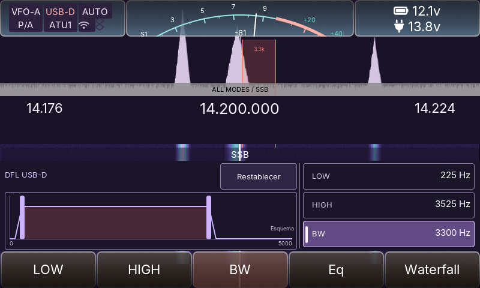</a> | `dfl-editor-sel-bw-tema-aurora` | dfl-editor-sel-bw | Aurora | 173 | HOST | c888308eede7 | REAL |
| <a href="captures/dfl-editor-sel-bw-tema-cathode.png">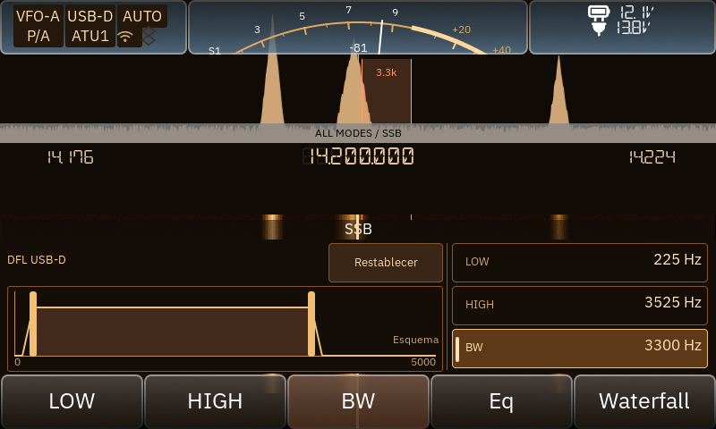</a> | `dfl-editor-sel-bw-tema-cathode` | dfl-editor-sel-bw | Cathode | 173 | HOST | c888308eede7 | REAL |
| <a href="captures/dfl-editor-sel-bw-tema-redshift.png">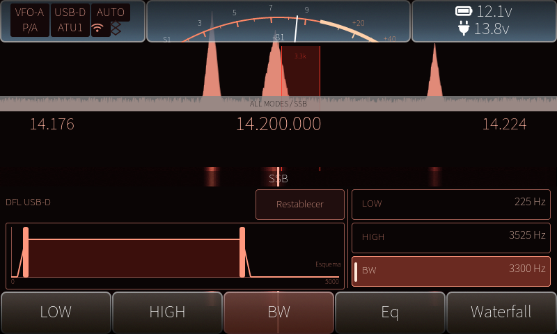</a> | `dfl-editor-sel-bw-tema-redshift` | dfl-editor-sel-bw | Redshift | 173 | HOST | c888308eede7 | REAL |
| <a href="captures/dfl-editor-sel-bw-tema-sprint.png">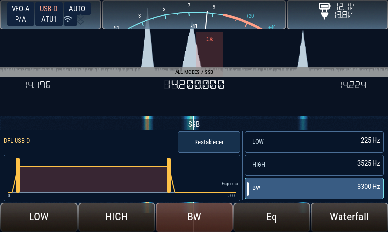</a> | `dfl-editor-sel-bw-tema-sprint` | dfl-editor-sel-bw | Sprint | 173 | HOST | c888308eede7 | REAL |
| <a href="captures/dfl-editor-sel-bw-tema-sunlit.png">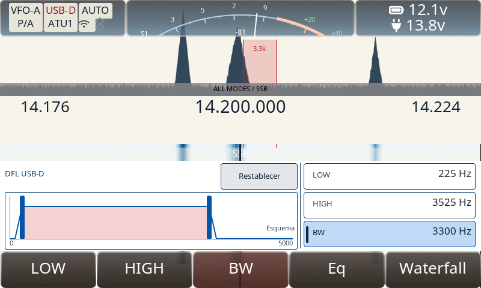</a> | `dfl-editor-sel-bw-tema-sunlit` | dfl-editor-sel-bw | Sunlit | 173 | HOST | c888308eede7 | REAL |
| <a href="captures/dfl-editor-sel-bw-tema-trail.png">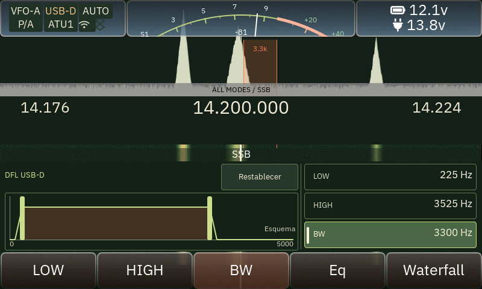</a> | `dfl-editor-sel-bw-tema-trail` | dfl-editor-sel-bw | Trail | 173 | HOST | c888308eede7 | REAL |
| <a href="captures/dfl-editor-sel-high-tema-aurora.png">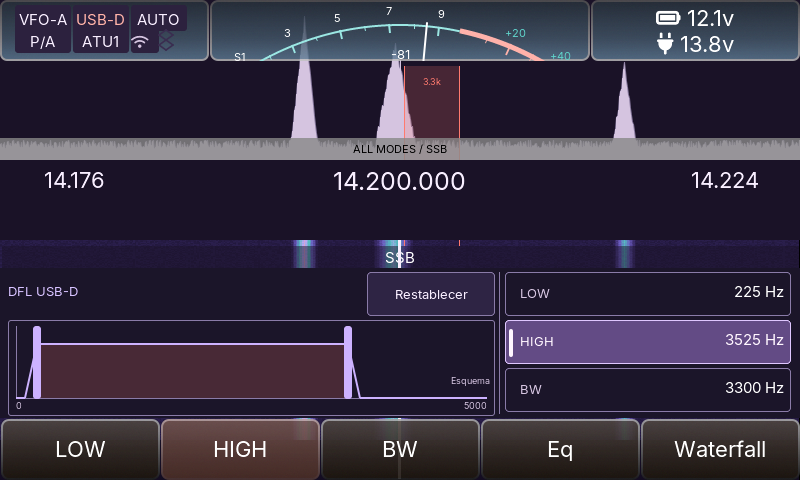</a> | `dfl-editor-sel-high-tema-aurora` | dfl-editor-sel-high | Aurora | 173 | HOST | c888308eede7 | REAL |
| <a href="captures/dfl-editor-sel-high-tema-cathode.png">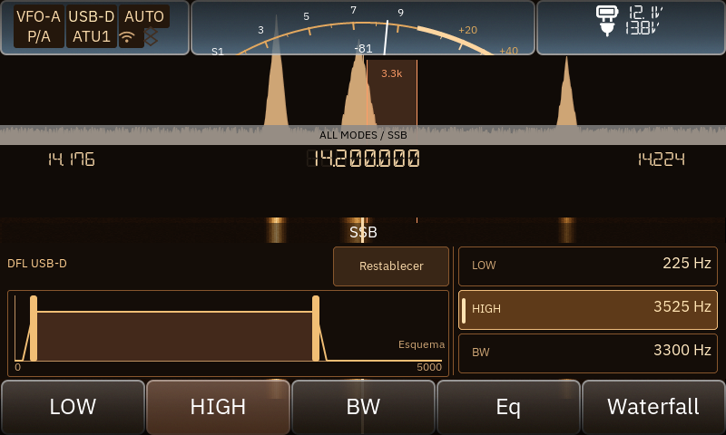</a> | `dfl-editor-sel-high-tema-cathode` | dfl-editor-sel-high | Cathode | 173 | HOST | c888308eede7 | REAL |
| <a href="captures/dfl-editor-sel-high-tema-redshift.png">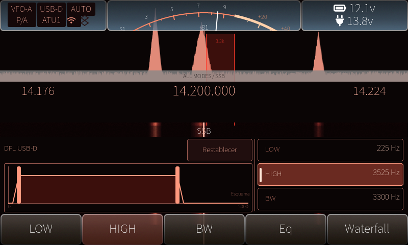</a> | `dfl-editor-sel-high-tema-redshift` | dfl-editor-sel-high | Redshift | 173 | HOST | c888308eede7 | REAL |
| <a href="captures/dfl-editor-sel-high-tema-sprint.png">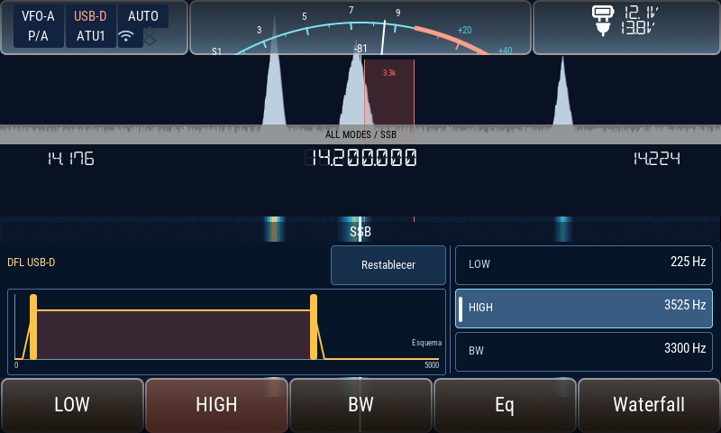</a> | `dfl-editor-sel-high-tema-sprint` | dfl-editor-sel-high | Sprint | 173 | HOST | c888308eede7 | REAL |
| <a href="captures/dfl-editor-sel-high-tema-sunlit.png">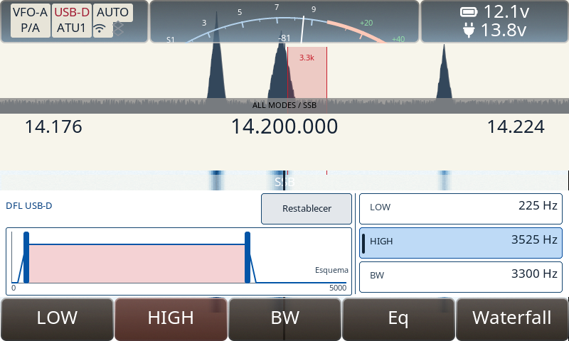</a> | `dfl-editor-sel-high-tema-sunlit` | dfl-editor-sel-high | Sunlit | 173 | HOST | c888308eede7 | REAL |
| <a href="captures/dfl-editor-sel-high-tema-trail.png">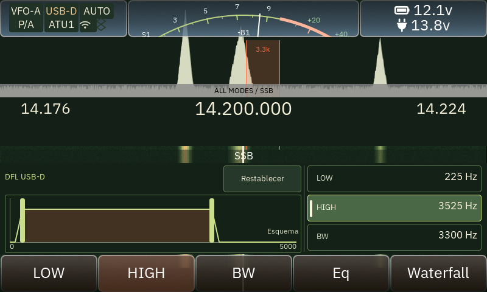</a> | `dfl-editor-sel-high-tema-trail` | dfl-editor-sel-high | Trail | 173 | HOST | c888308eede7 | REAL |
| <a href="captures/dfl-editor-tx.png">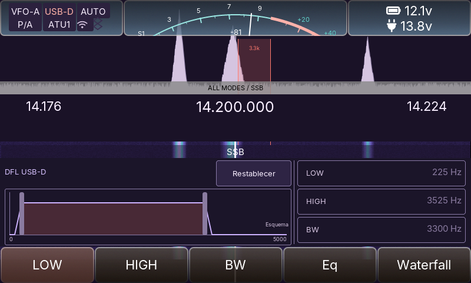</a> | `dfl-editor-tx` | dfl-editor-tx | Aurora | 173 | HOST | c888308eede7 | REAL |
|  | `dfl-editor-usb-d-tema-aurora` | dfl-editor | Aurora | 173 | HOST | c888308eede7 | REAL |
| <a href="captures/dfl-editor-usb-d-tema-cathode.png">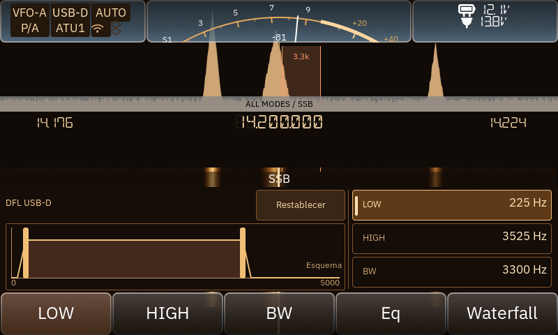</a> | `dfl-editor-usb-d-tema-cathode` | dfl-editor | Cathode | 173 | HOST | c888308eede7 | REAL |
| <a href="captures/dfl-editor-usb-d-tema-redshift.png">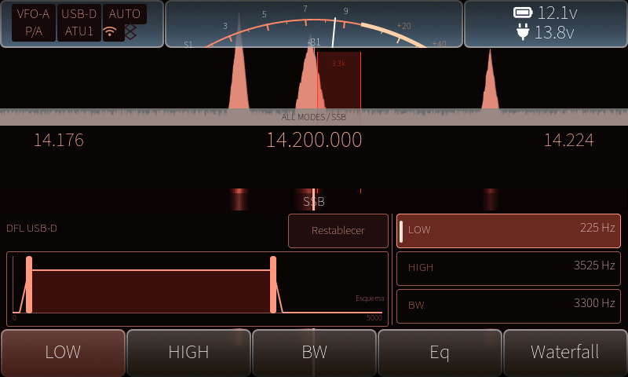</a> | `dfl-editor-usb-d-tema-redshift` | dfl-editor | Redshift | 173 | HOST | c888308eede7 | REAL |
| <a href="captures/dfl-editor-usb-d-tema-sprint.png">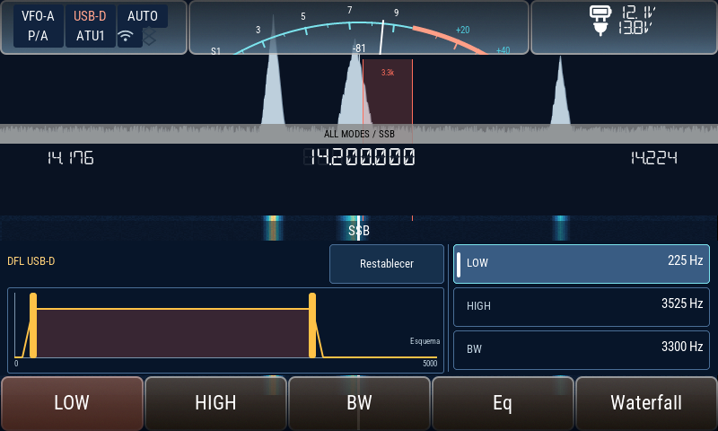</a> | `dfl-editor-usb-d-tema-sprint` | dfl-editor | Sprint | 173 | HOST | c888308eede7 | REAL |
| <a href="captures/dfl-editor-usb-d-tema-sunlit.png">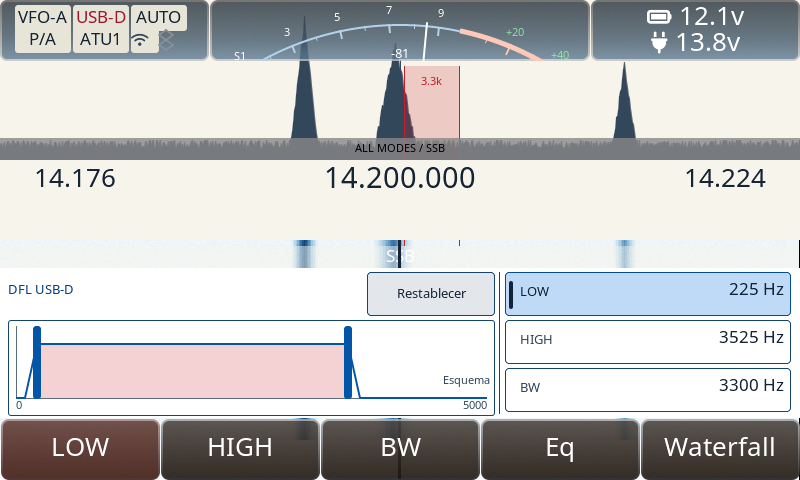</a> | `dfl-editor-usb-d-tema-sunlit` | dfl-editor | Sunlit | 173 | HOST | c888308eede7 | REAL |
| <a href="captures/dfl-editor-usb-d-tema-trail.png">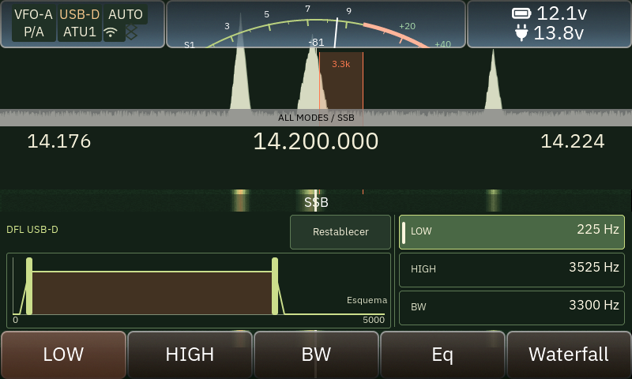</a> | `dfl-editor-usb-d-tema-trail` | dfl-editor | Trail | 173 | HOST | c888308eede7 | REAL |
| <a href="captures/dfl-editor-usb-d.png">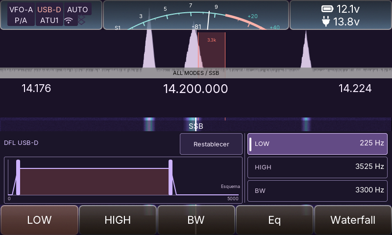</a> | `dfl-editor-usb-d` | dfl-editor | Aurora | 173 | HOST | c888308eede7 | REAL |
| <a href="captures/dfl-lsb-d.png">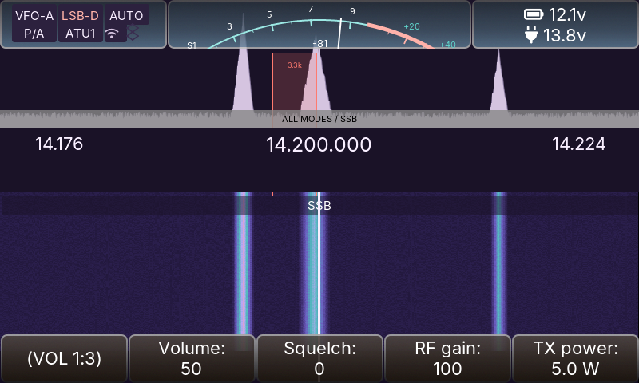</a> | `dfl-lsb-d` | main | Aurora | 173 | HOST | c888308eede7 | REAL |
| <a href="captures/dfl-mirror-lsb.png">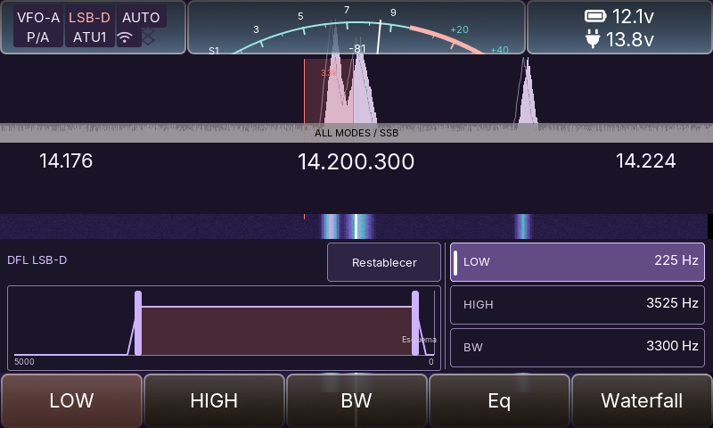</a> | `dfl-mirror-lsb` | dfl-editor-mirror | Aurora | 182 | HOST | c888308eede7 | REAL |
| <a href="captures/dfl-mirror-usb.png">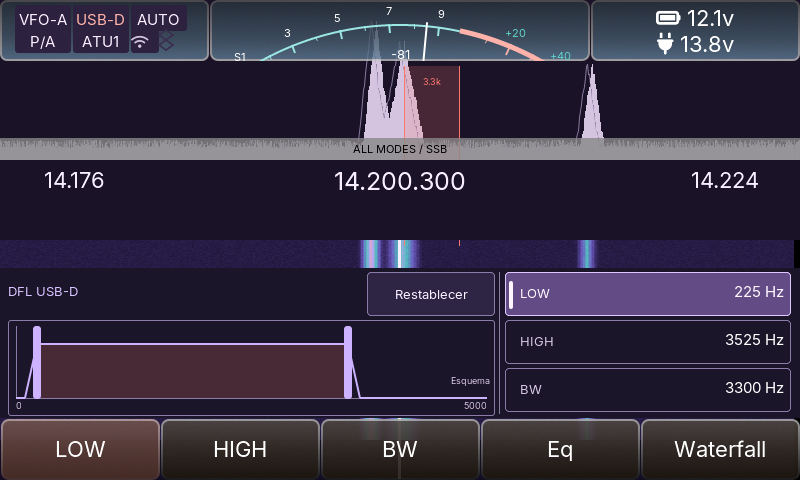</a> | `dfl-mirror-usb` | dfl-editor-mirror | Aurora | 182 | HOST | c888308eede7 | REAL |
| <a href="captures/dfl-page-tema-aurora.png">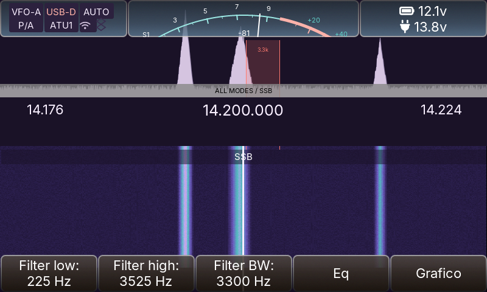</a> | `dfl-page-tema-aurora` | dfl-page | Aurora | 173 | HOST | c888308eede7 | REAL |
| <a href="captures/dfl-page-tema-cathode.png">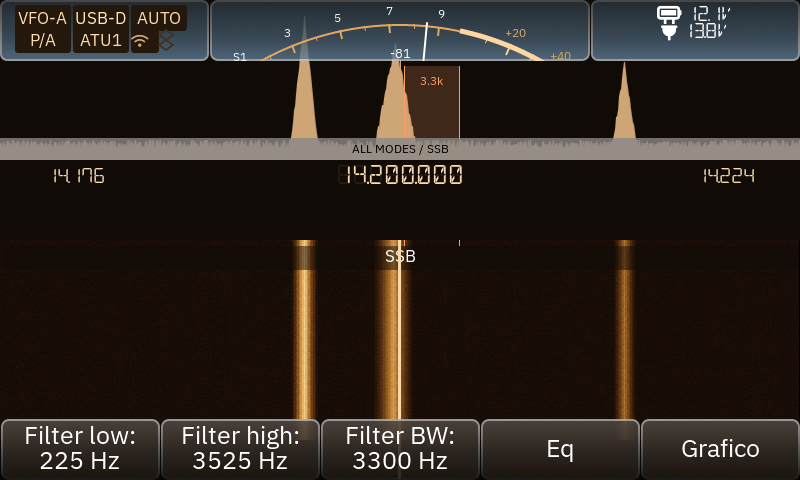</a> | `dfl-page-tema-cathode` | dfl-page | Cathode | 173 | HOST | c888308eede7 | REAL |
|  | `dfl-page-tema-redshift` | dfl-page | Redshift | 173 | HOST | c888308eede7 | REAL |
| <a href="captures/dfl-page-tema-sprint.png">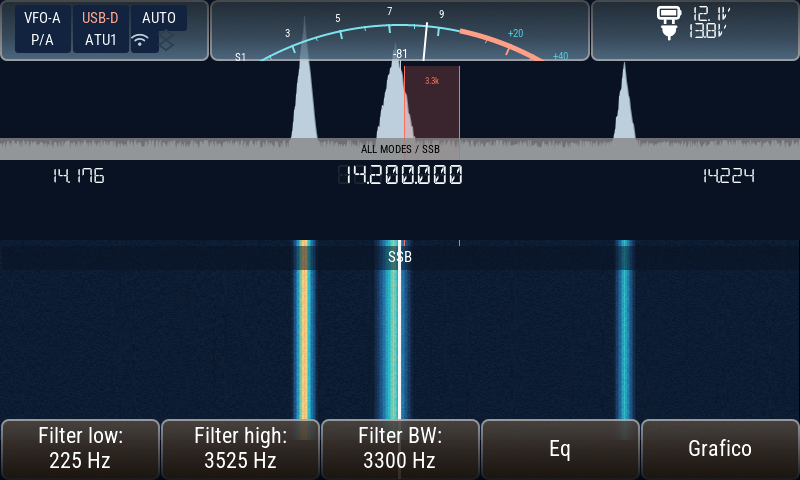</a> | `dfl-page-tema-sprint` | dfl-page | Sprint | 173 | HOST | c888308eede7 | REAL |
| <a href="captures/dfl-page-tema-sunlit.png">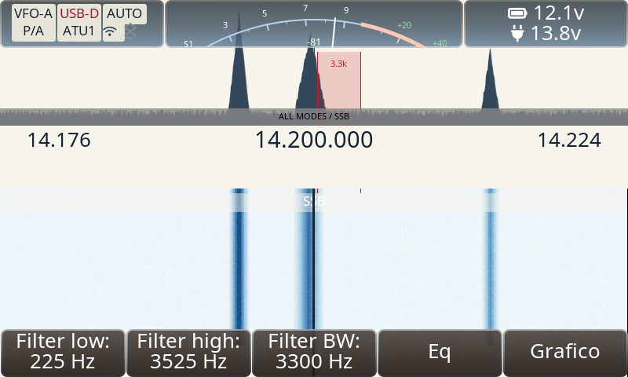</a> | `dfl-page-tema-sunlit` | dfl-page | Sunlit | 173 | HOST | c888308eede7 | REAL |
| <a href="captures/dfl-page-tema-trail.png">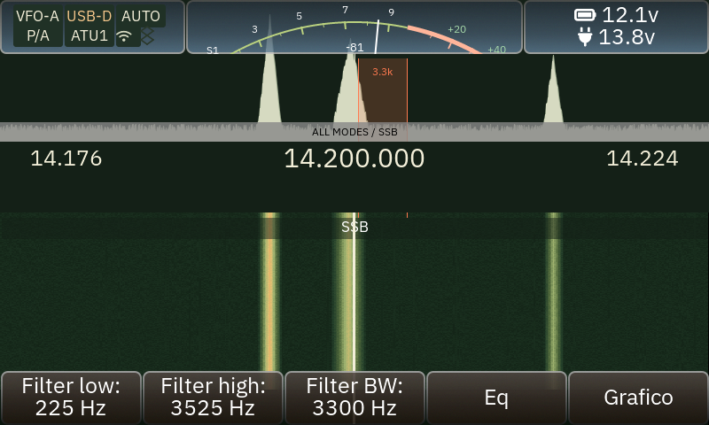</a> | `dfl-page-tema-trail` | dfl-page | Trail | 173 | HOST | c888308eede7 | REAL |
|  | `dfl-presets-activo` | dfl-presets-activo | Aurora | 183 | HOST | c888308eede7 | REAL |
| <a href="captures/dfl-presets-adj-tema-aurora.png">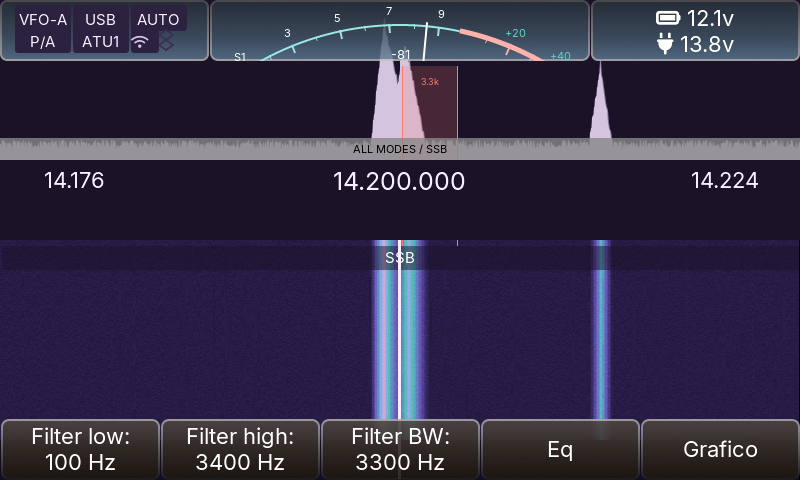</a> | `dfl-presets-adj-tema-aurora` | dfl-presets-adj | Aurora | 183 | HOST | c888308eede7 | REAL |
|  | `dfl-presets-adj-tema-cathode` | dfl-presets-adj | Cathode | 183 | HOST | c888308eede7 | REAL |
|  | `dfl-presets-adj-tema-redshift` | dfl-presets-adj | Redshift | 183 | HOST | c888308eede7 | REAL |
|  | `dfl-presets-adj-tema-sprint` | dfl-presets-adj | Sprint | 183 | HOST | c888308eede7 | REAL |
|  | `dfl-presets-adj-tema-sunlit` | dfl-presets-adj | Sunlit | 183 | HOST | c888308eede7 | REAL |
|  | `dfl-presets-adj-tema-trail` | dfl-presets-adj | Trail | 183 | HOST | c888308eede7 | REAL |
|  | `dfl-presets-apply` | dfl-presets-apply | Aurora | 183 | HOST | c888308eede7 | REAL |
|  | `dfl-presets-assign-cancel` | dfl-presets-assign-cancel | Aurora | 183 | HOST | c888308eede7 | REAL |
|  | `dfl-presets-assign-ok` | dfl-presets-assign-ok | Aurora | 183 | HOST | c888308eede7 | REAL |
|  | `dfl-presets-assign-tema-aurora` | dfl-presets-assign | Aurora | 183 | HOST | c888308eede7 | REAL |
|  | `dfl-presets-assign-tema-cathode` | dfl-presets-assign | Cathode | 183 | HOST | c888308eede7 | REAL |
|  | `dfl-presets-assign-tema-redshift` | dfl-presets-assign | Redshift | 183 | HOST | c888308eede7 | REAL |
|  | `dfl-presets-assign-tema-sprint` | dfl-presets-assign | Sprint | 183 | HOST | c888308eede7 | REAL |
|  | `dfl-presets-assign-tema-sunlit` | dfl-presets-assign | Sunlit | 183 | HOST | c888308eede7 | REAL |
|  | `dfl-presets-assign-tema-trail` | dfl-presets-assign | Trail | 183 | HOST | c888308eede7 | REAL |
|  | `dfl-presets-confirm-tema-aurora` | dfl-presets-confirm | Aurora | 183 | HOST | c888308eede7 | REAL |
|  | `dfl-presets-confirm-tema-cathode` | dfl-presets-confirm | Cathode | 183 | HOST | c888308eede7 | REAL |
|  | `dfl-presets-confirm-tema-redshift` | dfl-presets-confirm | Redshift | 183 | HOST | c888308eede7 | REAL |
|  | `dfl-presets-confirm-tema-sprint` | dfl-presets-confirm | Sprint | 183 | HOST | c888308eede7 | REAL |
|  | `dfl-presets-confirm-tema-sunlit` | dfl-presets-confirm | Sunlit | 183 | HOST | c888308eede7 | REAL |
|  | `dfl-presets-confirm-tema-trail` | dfl-presets-confirm | Trail | 183 | HOST | c888308eede7 | REAL |
|  | `dfl-presets-custom` | dfl-presets-custom | Aurora | 183 | HOST | c888308eede7 | REAL |
|  | `dfl-presets-cycles` | dfl-presets-cycles | Aurora | 183 | HOST | c888308eede7 | REAL |
|  | `dfl-presets-digi` | dfl-presets-digi | Aurora | 183 | HOST | c888308eede7 | REAL |
|  | `dfl-presets-fav-tema-aurora` | dfl-presets-fav | Aurora | 183 | HOST | c888308eede7 | REAL |
|  | `dfl-presets-fav-tema-cathode` | dfl-presets-fav | Cathode | 183 | HOST | c888308eede7 | REAL |
|  | `dfl-presets-fav-tema-redshift` | dfl-presets-fav | Redshift | 183 | HOST | c888308eede7 | REAL |
|  | `dfl-presets-fav-tema-sprint` | dfl-presets-fav | Sprint | 183 | HOST | c888308eede7 | REAL |
|  | `dfl-presets-fav-tema-sunlit` | dfl-presets-fav | Sunlit | 183 | HOST | c888308eede7 | REAL |
|  | `dfl-presets-fav-tema-trail` | dfl-presets-fav | Trail | 183 | HOST | c888308eede7 | REAL |
|  | `dfl-presets-graph-tema-aurora` | dfl-presets-graph | Aurora | 183 | HOST | c888308eede7 | REAL |
|  | `dfl-presets-graph-tema-cathode` | dfl-presets-graph | Cathode | 183 | HOST | c888308eede7 | REAL |
|  | `dfl-presets-graph-tema-redshift` | dfl-presets-graph | Redshift | 183 | HOST | c888308eede7 | REAL |
|  | `dfl-presets-graph-tema-sprint` | dfl-presets-graph | Sprint | 183 | HOST | c888308eede7 | REAL |
|  | `dfl-presets-graph-tema-sunlit` | dfl-presets-graph | Sunlit | 183 | HOST | c888308eede7 | REAL |
|  | `dfl-presets-graph-tema-trail` | dfl-presets-graph | Trail | 183 | HOST | c888308eede7 | REAL |
|  | `dfl-presets-mode-change` | dfl-presets-mode-change | Aurora | 183 | HOST | c888308eede7 | REAL |
|  | `dfl-presets-more-tema-aurora` | dfl-presets-more | Aurora | 183 | HOST | c888308eede7 | REAL |
|  | `dfl-presets-more-tema-cathode` | dfl-presets-more | Cathode | 183 | HOST | c888308eede7 | REAL |
|  | `dfl-presets-more-tema-redshift` | dfl-presets-more | Redshift | 183 | HOST | c888308eede7 | REAL |
|  | `dfl-presets-more-tema-sprint` | dfl-presets-more | Sprint | 183 | HOST | c888308eede7 | REAL |
|  | `dfl-presets-more-tema-sunlit` | dfl-presets-more | Sunlit | 183 | HOST | c888308eede7 | REAL |
|  | `dfl-presets-more-tema-trail` | dfl-presets-more | Trail | 183 | HOST | c888308eede7 | REAL |
|  | `dfl-presets-nav` | dfl-presets-nav | Aurora | 183 | HOST | c888308eede7 | REAL |
|  | `dfl-presets-nfm` | dfl-presets-nfm | Aurora | 183 | HOST | c888308eede7 | REAL |
|  | `dfl-presets-rotary0` | dfl-presets-rotary0 | Aurora | 183 | HOST | c888308eede7 | REAL |
|  | `dfl-presets-save-cancel` | dfl-presets-save-cancel | Aurora | 183 | HOST | c888308eede7 | REAL |
|  | `dfl-presets-save-fail` | dfl-presets-save-fail | Aurora | 183 | HOST | c888308eede7 | REAL |
|  | `dfl-presets-save` | dfl-presets-save | Aurora | 183 | HOST | c888308eede7 | REAL |
|  | `dfl-presets-touch-hold` | dfl-presets-touch-hold | Aurora | 183 | HOST | c888308eede7 | REAL |
|  | `dfl-presets-touch` | dfl-presets-touch | Aurora | 183 | HOST | c888308eede7 | REAL |
|  | `dfl-presets-tx` | dfl-presets-tx | Aurora | 183 | HOST | c888308eede7 | REAL |
|  | `dfl-presets-vol` | dfl-presets-vol | Aurora | 183 | HOST | c888308eede7 | REAL |
|  | `dfl-usb-d-span100k` | main | Aurora | 173 | HOST | c888308eede7 | REAL |
|  | `dfl-usb-d-span50k` | main | Aurora | 173 | HOST | c888308eede7 | REAL |
|  | `dfl-usb-d-tema-cathode` | main | Cathode | 173 | HOST | c888308eede7 | REAL |
|  | `dfl-usb-d-tema-redshift` | main | Redshift | 173 | HOST | c888308eede7 | REAL |
|  | `dfl-usb-d-tema-sprint` | main | Sprint | 173 | HOST | c888308eede7 | REAL |
|  | `dfl-usb-d-tema-sunlit` | main | Sunlit | 173 | HOST | c888308eede7 | REAL |
|  | `dfl-usb-d-tema-trail` | main | Trail | 173 | HOST | c888308eede7 | REAL |
|  | `dfl-usb-d` | main | Aurora | 173 | HOST | c888308eede7 | REAL |
|  | `home-bateria-externa` | main | Aurora | 20 | HOST | c888308eede7 | REAL |
|  | `home-cb-a` | main | Aurora | 149 | HOST | c888308eede7 | REAL |
|  | `home-cb-cathode` | main | Cathode | 148 | HOST | c888308eede7 | REAL |
|  | `home-cb-d` | main | Aurora | 150 | HOST | c888308eede7 | REAL |
|  | `home-cb-offchannel` | main | Aurora | 147 | HOST | c888308eede7 | REAL |
|  | `home-cb` | main | Aurora | 146 | HOST | c888308eede7 | REAL |
|  | `home-frecuencia-extrema` | main | Aurora | 55 | HOST | c888308eede7 | REAL |
|  | `home-usb-20m` | main | Aurora | 20 | HOST | c888308eede7 | REAL |
|  | `main-bateria-baja` | main | Aurora | 44 | HOST | c888308eede7 | REAL |
|  | `main-espectro-agua` | main | Aurora | 7 | HOST | c888308eede7 | REAL |
|  | `main-foco` | main-foco | Aurora | 20 | HOST | c888308eede7 | REAL |
|  | `main-frecuencia-dseg` | main | Aurora | 20 | HOST | c888308eede7 | REAL |
|  | `main-natural-eco` | main | Aurora | 13 | HOST | c888308eede7 | REAL |
|  | `main-natural` | main | Aurora | 13 | HOST | c888308eede7 | REAL |
|  | `main-tema-aurora-agua` | main | Aurora | 7 | HOST | c888308eede7 | REAL |
|  | `main-tema-aurora-eco` | main | Aurora | 44 | HOST | c888308eede7 | REAL |
|  | `main-tema-aurora-tx` | main | Aurora | 31 | HOST | c888308eede7 | REAL |
|  | `main-tema-aurora` | main | Aurora | 20 | HOST | c888308eede7 | REAL |
|  | `main-tema-cathode-agua` | main | Cathode | 7 | HOST | c888308eede7 | REAL |
|  | `main-tema-cathode-eco` | main | Cathode | 44 | HOST | c888308eede7 | REAL |
|  | `main-tema-cathode-tx` | main | Cathode | 31 | HOST | c888308eede7 | REAL |
|  | `main-tema-cathode` | main | Cathode | 20 | HOST | c888308eede7 | REAL |
|  | `main-tema-redshift-agua` | main | Redshift | 7 | HOST | c888308eede7 | REAL |
|  | `main-tema-redshift-eco` | main | Redshift | 13 | HOST | c888308eede7 | REAL |
|  | `main-tema-redshift-tx` | main | Redshift | 31 | HOST | c888308eede7 | REAL |
|  | `main-tema-redshift` | main | Redshift | 20 | HOST | c888308eede7 | REAL |
|  | `main-tema-sprint-agua` | main | Sprint | 7 | HOST | c888308eede7 | REAL |
|  | `main-tema-sprint-eco` | main | Sprint | 44 | HOST | c888308eede7 | REAL |
|  | `main-tema-sprint-tx` | main | Sprint | 31 | HOST | c888308eede7 | REAL |
|  | `main-tema-sprint` | main | Sprint | 20 | HOST | c888308eede7 | REAL |
|  | `main-tema-sunlit-agua` | main | Sunlit | 7 | HOST | c888308eede7 | REAL |
|  | `main-tema-sunlit-eco` | main | Sunlit | 13 | HOST | c888308eede7 | REAL |
|  | `main-tema-sunlit-tx` | main | Sunlit | 31 | HOST | c888308eede7 | REAL |
|  | `main-tema-sunlit` | main | Sunlit | 20 | HOST | c888308eede7 | REAL |
|  | `main-tema-trail-agua` | main | Trail | 7 | HOST | c888308eede7 | REAL |
|  | `main-tema-trail-eco` | main | Trail | 13 | HOST | c888308eede7 | REAL |
|  | `main-tema-trail-tx` | main | Trail | 31 | HOST | c888308eede7 | REAL |
|  | `main-tema-trail` | main | Trail | 20 | HOST | c888308eede7 | REAL |
|  | `main-tx-simulado` | main | Aurora | 31 | HOST | c888308eede7 | REAL |
|  | `settings-audio` | settings-audio | Aurora | 20 | HOST | c888308eede7 | REAL |
|  | `settings-bands` | settings-bands | Aurora | 20 | HOST | c888308eede7 | REAL |
|  | `settings-grupo-actions` | settings-grupo | Aurora | 20 | HOST | c888308eede7 | REAL |
|  | `settings-grupo-display` | settings-grupo | Aurora | 20 | HOST | c888308eede7 | REAL |
|  | `settings-grupo-info` | settings-grupo | Aurora | 20 | HOST | c888308eede7 | REAL |
|  | `settings-grupo-operation-tema-aurora` | settings-grupo | Aurora | 20 | HOST | c888308eede7 | REAL |
|  | `settings-grupo-operation-tema-cathode` | settings-grupo | Cathode | 20 | HOST | c888308eede7 | REAL |
|  | `settings-grupo-operation-tema-redshift` | settings-grupo | Redshift | 20 | HOST | c888308eede7 | REAL |
|  | `settings-grupo-operation-tema-sprint` | settings-grupo | Sprint | 20 | HOST | c888308eede7 | REAL |
|  | `settings-grupo-operation-tema-sunlit` | settings-grupo | Sunlit | 20 | HOST | c888308eede7 | REAL |
|  | `settings-grupo-operation-tema-trail` | settings-grupo | Trail | 20 | HOST | c888308eede7 | REAL |
|  | `settings-grupo-operation` | settings-grupo | Aurora | 20 | HOST | c888308eede7 | REAL |
|  | `settings-home` | settings-home | Aurora | 20 | HOST | c888308eede7 | REAL |
|  | `settings-perfil` | settings-perfil | Aurora | 20 | HOST | c888308eede7 | REAL |
|  | `settings-tema-aurora` | settings-perfil | Aurora | 20 | HOST | c888308eede7 | REAL |
|  | `settings-tema-cathode` | settings-perfil | Cathode | 20 | HOST | c888308eede7 | REAL |
|  | `settings-tema-redshift` | settings-perfil | Redshift | 20 | HOST | c888308eede7 | REAL |
|  | `settings-tema-sprint` | settings-perfil | Sprint | 20 | HOST | c888308eede7 | REAL |
|  | `settings-tema-sunlit` | settings-perfil | Sunlit | 20 | HOST | c888308eede7 | REAL |
|  | `settings-tema-trail` | settings-perfil | Trail | 20 | HOST | c888308eede7 | REAL |
|  | `settings-wfbat` | settings-wfbat | Aurora | 20 | HOST | c888308eede7 | REAL |
|  | `swrscan-3pass-p1` | swrscan | Aurora | 20 | HOST | c888308eede7 | REAL |
|  | `swrscan-3pass-p2` | swrscan | Aurora | 20 | HOST | c888308eede7 | REAL |
|  | `swrscan-3pass-p3` | swrscan | Aurora | 20 | HOST | c888308eede7 | REAL |
|  | `swrscan-3pass-stop` | swrscan | Aurora | 20 | HOST | c888308eede7 | REAL |
|  | `swrscan-3pass-tema-aurora` | swrscan | Aurora | 20 | HOST | c888308eede7 | REAL |
|  | `swrscan-3pass-tema-cathode` | swrscan | Cathode | 20 | HOST | c888308eede7 | REAL |
|  | `swrscan-3pass` | swrscan | Aurora | 20 | HOST | c888308eede7 | REAL |
|  | `swrscan-5pass-moving` | swrscan | Aurora | 20 | HOST | c888308eede7 | REAL |
|  | `swrscan-5pass-outliers` | swrscan | Aurora | 20 | HOST | c888308eede7 | REAL |
|  | `swrscan-double-valley` | swrscan | Aurora | 20 | HOST | c888308eede7 | REAL |
|  | `swrscan-flat` | swrscan | Aurora | 20 | HOST | c888308eede7 | REAL |
|  | `swrscan-narrow-zoom` | swrscan | Aurora | 20 | HOST | c888308eede7 | REAL |
|  | `swrscan-owner-40m-domo` | swrscan | Aurora | 20 | HOST | c888308eede7 | REAL |
|  | `swrscan-owner-40m-sweep` | swrscan | Aurora | 20 | HOST | c888308eede7 | REAL |
|  | `swrscan-owner-40m` | swrscan | Aurora | 20 | HOST | c888308eede7 | REAL |
|  | `swrscan-quick` | swrscan | Aurora | 20 | HOST | c888308eede7 | REAL |
|  | `swrscan-wide-zoom` | swrscan | Aurora | 20 | HOST | c888308eede7 | REAL |
