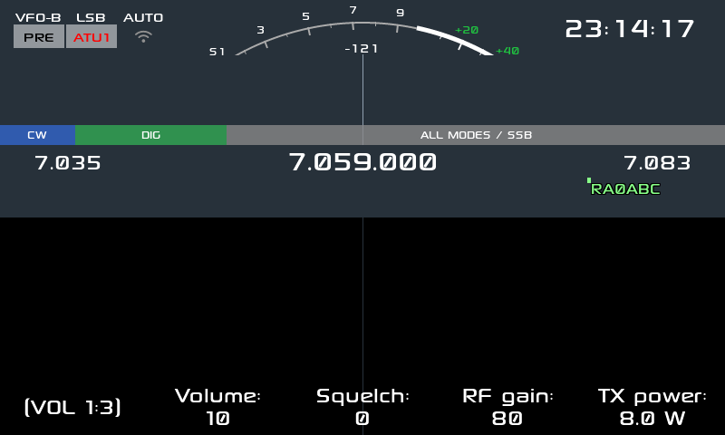

# Manual de uso — ROM LU2DSX para Xiegu X6200

Esta ROM parte del firmware del X6200 (GUI LVGL + Buildroot) y le agrega las funciones que el
X6100 de IU1WXY tenía y la plataforma del X6200 permite. Está pensada para usarse **en el
campo**: QRP, SOTA/POTA, digitales y CW.

## 1. Lo esencial

**Qué agrega, en una lista**

- Aviso de firmware nuevo, aguja de S-meter y plan de banda IARU.
- Grabación de pantalla (video + audio de RX) y capturas.
- Bluetooth: CAT, auriculares (A2DP) y teclados.
- wfview, configurador web ampliado (15 páginas con HTTPS) y control remoto en vivo.
- Modos digitales: FT8, FT4, WSPR, JS8, SSTV, WeFax y NavTex, con CW Keyboard y CW Trainer.
- Field Ops (SOTA/POTA), clúster DX y la app de posición (GPS).
- Temas: 8 disponibles, incluidos los del X6100 (Holo, Material 3, RS).
- Anuncios por voz (TTS en español), con el ajuste *Voice mode*.

**Qué necesitás**

- La radio Xiegu X6200 y una **microSD** (la que trae el equipo sirve). Ojo: la microSD va
  **dentro del adaptador** — si no queda bien asentada, la radio arranca su firmware interno y
  parece que "no bootea".
- Una PC para grabar la imagen (Linux/Windows/macOS con cualquier herramienta de imágenes).
- Opcional: cargador. **Para actualizar, siempre con el cargador puesto.**

## 2. Instalación

### 2.1 Desde cero (imagen completa)

1. **Respaldá tus datos.** Todo lo tuyo vive en la partición `DATA`: `params.db` (ajustes),
   `qso_log.db` (contactos), `msg/` (mensajes de voz), `rec/` (grabaciones), `themes/` y las
   capturas. Copiá esa partición a la PC **antes** de grabar.
2. **Grabá la imagen.** Escribí el archivo `.img` en la microSD (con `dd`, balenaEtcher,
   Raspberry Pi Imager o similar). La imagen trae 2 particiones: `BOOT` y `rootfs`.
3. **Poné la tarjeta en la radio y encendé.** En el primer arranque la radio crea sola la
   partición `DATA` (vfat, etiqueta `DATA`). Si ya tenía una partición DATA con formato FAT,
   **la monta sin formatear**: tus datos sobreviven.
4. **Restaurá tus datos** en `DATA` y reiniciá.

> **Importante:** la partición `DATA` nunca se toca al actualizar. Es lo que hace que tus
> ajustes y tu log de QSO sigan ahí después de cada actualización.

### 2.2 Actualización en el lugar (sin regrabar)

1. Copiá el archivo `x6200_r1cbu_<version>.tgz` a la raíz de la partición `DATA`.
2. **Poné el cargador** y encendé. El script `S02update` hace un respaldo
   (`backup_*.tgz`), aplica la actualización y borra el tgz.
3. Esperá a que termine y arranque normalmente.

> **Ojo:** si se corta la luz o la batería a mitad de la actualización, el sistema queda a
> medias y **no arranca**. Por eso: cargador puesto, siempre. Si pasa, se recupera grabando la
> imagen completa.

## 3. Primer arranque

La pantalla principal se lee de arriba hacia abajo:

| Zona | Qué es |
|---|---|
| Arriba a la izquierda | VFO (`VFO-A`/`VFO-B`), modo (LSB/USB/CW/…), `AUTO`, `PRE` (preamplificador) y `ATU1` |
| Arriba a la derecha | Hora (UTC) |
| El arco | **S-meter**: de S1 a +40 dB, con la lectura en dBm |
| La franja de colores | **Plan de banda IARU** (CW / DIG / ALL MODES) |
| Los números grandes | Los bordes de la banda y la frecuencia actual (en el centro) |
| La parte oscura | **Waterfall** (con las marcas de los spots del clúster) |
| Los botones de abajo | Volumen, Squelch, RF gain, TX power y los botones de función |

Debajo del waterfall está la **franja de spots**: los indicativos del clúster DX que caen
dentro de lo que estás mirando, con una línea hasta su frecuencia.

## 4. Lo básico

### Las tres ruedas

- **Dial (grande, a la derecha):** frecuencia. Al girar, la radio dice la frecuencia por voz
  (si el modo de voz está activo).
- **Rueda de volumen (izquierda):** volumen de audio. También cambia de función con sus modos.
- **MFK (abajo, al centro):** la rueda multifunción. Gira para cambiar el valor del modo
  activo; apretá para cambiar de modo. Los modos son: nivel mínimo/máximo del espectro,
  decimación de FFT, beta del espectro, peak hold, velocidad CW, modo CW, iambic, tono CW,
  volumen CW, DNF, NB, NR, AGC, decodificador CW y más.

### Botón de power

- **Toque corto:** apaga **sólo la pantalla** (sigue operando).
- **Pulsación larga:** apaga la radio.

### El ATU

1. Apretá `ATU` para habilitar el sintonizador (aparece `ATU1` arriba).
2. Mantené apretado `ATU` (o usá la acción *ATU tune*) para que sintonice.
3. El resultado queda guardado por banda y modo.

## 5. Las apps

Se abre con el botón `APP`, o asignando la acción a un botón desde Ajustes. Cerrá con la
tecla de escape del teclado o apagando la app desde el control remoto.

| App | Para qué |
|---|---|
|  **FT8 / FT4** | Llamar CQ, contestar, ver los decodificados y subir a la nube. |
|  **WSPR** | Reportar y escuchar balizas, con carga a WSPRnet. |
|  **JS8** | Mensajería digital, con mapa y envío de posición. |
|  **SSTV** | Recibir y transmitir imágenes. |
|  **WeFax** | Facsímil meteorológico: alineado y inclinación con la **perilla**. |
|  **NavTex** | Avisos marítimos. |
|  **Clúster DX** | Spots, filtros y sintonía con un toque. |
|  **Posición (GPS)** | Muestra de dónde viene la posición y la grilla QTH. |
|  **Field Ops** | SOTA/POTA: referencias, log ADIF, self-spot y CQ de voz. |
|  **RTTY** | Radioteletipo. |
|  **CW Keyboard / Trainer** | Transmitir con el teclado y practicar CW. |

## 6. Guías avanzadas, paso a paso

### 6.1 Control remoto desde el teléfono

El equipo abre un socket en `/tmp/x6200_remote.sock` con unos 65 comandos. Desde la página
`/remote` del configurador web podés abrir apps, cambiar banda, modo y frecuencia, y mandar tu
posición para Field Ops.

1. Conectá el equipo a tu red WiFi (Ajustes → WiFi).
2. Averiguá la IP del equipo en la pantalla de estado.
3. Abrí `http://<ip>/remote` en el teléfono.
4. Para mandar la posición:
   `{"cmd":"location","text":"-34.6037,-58.3816"}`.

**Diagnóstico útil:** `{"cmd":"app","text":"GPS"}` abre una app por nombre, y
`{"cmd":"cluster_feed","text":"DX de LU1ABC:  14074.0  LU2DSX  FT8  2313Z GF05"}` inyecta un
spot del clúster sin necesidad de servidor (la línea necesita la hora `HHMMZ`).

### 6.2 Configurador web

1. Averiguá la IP del equipo.
2. Abrí `https://<ip>/` (el certificado es autofirmado: aceptá la excepción).
3. Tiene 15 páginas: estado, ajustes de RF, audio, clúster, digitales, temas, WiFi, Bluetooth,
   actualizaciones y el control remoto.

### 6.3 Bluetooth

1. Ajustes → Bluetooth → activar.
2. **CAT (control por SPP):** vinculá el equipo con la PC o el teléfono y elegí el puerto serie
   que aparece. Usá 19200 8N1 (o lo que pida tu programa).
3. **Auriculares (A2DP):** poné los auriculares en modo vinculación y buscalos desde la app de
   dispositivos; después elegí la salida de audio.
4. **Teclado:** vinculá un teclado Bluetooth o conectá uno USB; sirve para el CW Keyboard y para
   navegar los menús.

### 6.4 Clúster DX, paso a paso

1. Abrí la app **Clúster**.
2. Configurá el **servidor** (host y puerto) y tu **indicativo** (el clúster lo pide para
   entrar).
3. Elegí los **filtros**: modos, bandas, actividad (CQ, etc.) y la antigüedad máxima.
4. Con los spots en pantalla: la **columna** de la derecha lista los más nuevos; tocando uno,
   el equipo **sintoniza** esa frecuencia.
5. Las **marcas sobre el waterfall** muestran los spots que caen dentro del ancho que estás
   viendo, con una línea hasta su frecuencia. Los que están fuera del ancho **no** se dibujan
   (es lo correcto).

### 6.5 wfview

1. Activá wfview en Ajustes (o desde el configurador web).
2. En la PC, abrí wfview y conectá a la IP del equipo.
3. Vas a ver el espectro, el waterfall y el audio del receptor, y podés cambiar frecuencia y
   modo desde la PC.

### 6.6 Temas

Hay **8 temas**: los incorporados (IU1WXY, Outdoor, Classic, Outdoor-Negative y Vision) y los
del X6100 que van como archivos (Holo, Material 3 y RS).

1. Ajustes → **Theme** → elegí uno de la lista.
2. El equipo guarda la elección y **se reinicia** para aplicar los colores (lo hace solo el
   daemon).
3. Para **tu propio tema**: copiá un `.json` a `DATA/themes/` y va a aparecer en la lista (el
   formato está en el archivo `Holo.json`). Un tema también puede ser una **carpeta** con un
   `theme.json` adentro, como `RS/`.

**Si un tema no aparece:** revisá que el archivo esté en `DATA/themes/` y que su JSON sea
válido. Un tema que no carga no rompe nada: el equipo usa el de siempre.

### 6.7 Anuncios por voz (TTS en español)

1. Ajustes → **Voice mode** → elegí **Off**, **When LCD off** o **Always**.
   - *When LCD off* es el más cómodo en el campo y el que menos batería gasta: habla justo
     cuando no estás mirando la pantalla.
2. Cambiá algo (girá el dial, el volumen, una opción de Ajustes) y lo vas a oír en español.
3. La voz **nunca habla mientras transmitís**, para no salir al aire.

### 6.8 Field Ops (SOTA/POTA)

1. Abrí la app **Field Ops**.
2. Elegí la **referencia** (SOTA o POTA) de la lista offline.
3. Configurá tu **indicativo** (Ajustes → Callsign) para el self-spot y la carga.
4. **Self-spot:** con la referencia y el modo elegidos, el equipo avisa a pota.app.
5. **Log ADIF:** cada contacto se guarda en `DATA/qso_log.db`; podés exportar y **subir a QRZ**
   con tu cuenta.
6. **CQ de voz:** grabá tu llamado una vez y el equipo lo emite por PTT cuando lo pedís (queda
   en `DATA/msg/` en formato WAV).

### 6.9 Grabación de pantalla y capturas

- **Captura:** acción *Screenshot* (o desde Ajustes → acciones). Se guarda un PNG en `DATA`.
- **Grabación:** acción *Screen rec*. Graba **video MJPEG + el audio del receptor** en un
  archivo AVI en `DATA`. Empezá y terminá desde la misma acción.

### 6.10 Motor de video DRM/KMS

Está portado y **apagado por defecto**. Se activa creando el archivo `/mnt/use_drm` (o desde
Ajustes si tu versión lo expone) y reiniciando. Si algo no se ve bien, borralo y volvés al
motor clásico.

### 6.11 Actualizaciones y SSH

- **Aviso de firmware nuevo:** el equipo consulta GitHub al arrancar (si hay red) y avisa en la
  pantalla de estado. No manda ningún dato tuyo.
- **SSH:** el equipo trae SSH habilitado con usuario `root`. **Cambiá la contraseña** — la de
  fábrica es conocida. Desde ahí podés ver los logs en `DATA/app_logs/`.

## 7. Solución de problemas

| Síntoma | Qué hacer |
|---|---|
| **Sólo se ve el logo y nunca arranca** | Casi siempre es la actualización cortada a mitad, o la microSD mal asentada en el adaptador. Sacá la tarjeta, revisá que la microSD esté a fondo, y si sigue: grabá la imagen completa. |
| **La radio arranca el firmware viejo** | La tarjeta no está siendo leída: revisá el adaptador y el contacto de la microSD. |
| **"No medium found" al grabar** | La microSD no está dentro del adaptador. |
| **No se oyen los anuncios de voz** | Ajustes → Voice mode en *Off*; o estás transmitiendo (no habla al aire). |
| **Un tema no aparece en la lista** | El archivo tiene que estar en `DATA/themes/` con el JSON válido. |
| **El clúster no muestra spots** | Revisá servidor, indicativo y filtros. Si es un spot de prueba, la línea necesita la hora `HHMMZ`. |
| **Falta espacio en `DATA`** | Borrá `rec/` y las capturas viejas; o `backup_*.tgz` de actualizaciones anteriores. |
| **Un ajuste raro después de actualizar** | Los ajustes se guardan en `params.db`: podés restaurar el respaldo o borrarlo para volver a los valores de fábrica (perdés tus ajustes, no tu log de QSO). |
| **Quiero ver qué pasó** | Los logs están en `DATA/app_logs/x6200_log_*.txt` (se escriben al cerrar la GUI). |

## 8. Referencia

### Layout de las particiones

| Partición | Contenido |
|---|---|
| `BOOT` (32 MB, vfat, arrancable) | `zImage`, el device tree y `boot.scr` |
| `rootfs` (512 MB, ext4) | El sistema y la GUI |
| `DATA` (vfat, etiqueta `DATA`) | **Tus datos**: ajustes, log de QSO, temas, mensajes, grabaciones y logs |

### Archivos que te importan

| Archivo | Qué es |
|---|---|
| `DATA/params.db` | Todos los ajustes |
| `DATA/qso_log.db` | El log de contactos |
| `DATA/themes/` | Tus temas (JSON o carpeta con `theme.json`) |
| `DATA/msg/` | Mensajes de voz (WAV) para el CQ de voz |
| `DATA/rec/` | Grabaciones de pantalla y capturas |
| `DATA/app_logs/` | Logs de la GUI (se escriben al cerrar) |
| `DATA/backup_*.tgz` | Respaldos que hace el actualizador |

### Créditos

- Firmware base del X6200 y buildroot: **iariap** (`x6200_gui`, `AetherX6200Buildroot`).
- Las funciones portadas vienen del firmware del **X6100 de IU1WXY**.
- Esta ROM: **lu2dsx**.

> Documento generado a partir de `docs/NEW_FEATURES.md` y `docs/X6100_FEATURE_GAP.md`, con
> capturas reales del firmware (banco de pruebas y equipo).
