# Manual del operador — ROM LU2DSX para Xiegu X6200

Esta ROM nace del firmware del X6200 (GUI LVGL + Buildroot) y le incorpora las funciones del
X6100 de IU1WXY que la plataforma permite. La idea es tener **un QRP de campo completo**: los
digitales, CW, el clúster, SOTA/POTA y todo lo que hace falta cuando estás en un cerro con una
batería y un cable de 20 metros.

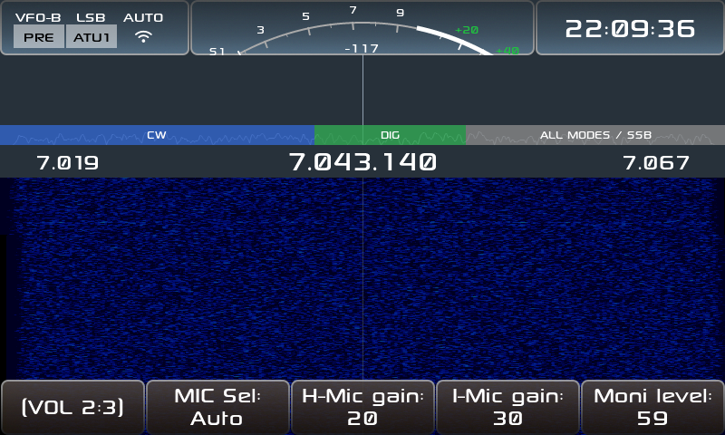

**Lo que vas a encontrar acá:** el equipo con 8 temas, plan de banda IARU, S-meter con aguja,
WFM, grabación, Bluetooth (CAT y auriculares), wfview, configurador web, control remoto desde el
teléfono, FT8/FT4, WSPR, JS8, SSTV, WeFax, NavTex, RTTY, CW Keyboard y CW Trainer, clúster DX
con spots sobre el waterfall, Field Ops (SOTA/POTA) y anuncios por voz en español.

## 1. Antes de empezar

**Lo que necesitás**

- La Xiegu X6200 y una **microSD**. Ojo: la microSD va **dentro del adaptador**; si no queda
  bien asentada, la radio arranca su firmware interno y parece que "no bootea".
- Una PC con cualquier herramienta de imágenes (para la instalación completa).
- **Cargador**, si vas a actualizar en el lugar: si se corta a mitad, el equipo no arranca.

**Regla de oro:** todo lo tuyo vive en la partición **`DATA`** (`params.db` con los ajustes,
`qso_log.db` con los contactos, `themes/`, `msg/`, `rec/` y `app_logs/`). **Esa partición nunca
se toca al actualizar.** Igual, respaldala antes de cada actualización.

## 2. Instalación

### 2.1 Instalación completa (imagen)

1. **Respaldá `DATA`** a la PC.
2. **Grabá el `.img`** en la microSD (`dd`, balenaEtcher, Raspberry Pi Imager). Trae dos
   particiones: `BOOT` (arranque) y `rootfs` (el sistema).
3. **Ponela en la radio y encendé.** En el primer arranque el equipo crea la partición `DATA`.
   Si ya existe una `DATA` con formato FAT, la monta **sin formatear**: tus datos sobreviven.
4. **Restaurá tus datos** en `DATA` y reiniciá.

### 2.2 Actualización en el lugar

1. Copiá `x6200_r1cbu_<version>.tgz` a la raíz de `DATA`.
2. **Con el cargador puesto**, encendé. El script `S02update` respalda (`backup_*.tgz`), aplica
   la actualización y borra el tgz.
3. Esperá a que termine y arranque.

## 3. La pantalla principal

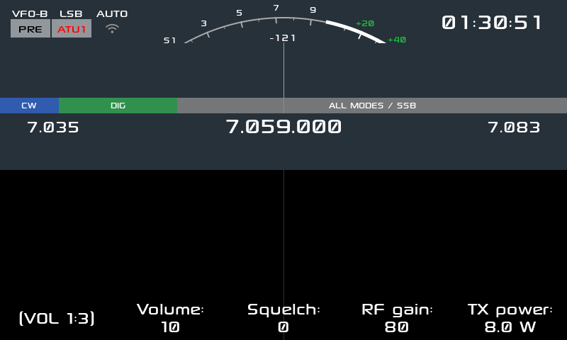

| Zona | Qué te dice |
|---|---|
| Arriba a la izquierda | VFO (`VFO-A`/`VFO-B`), modo (LSB/USB/CW/CWR/AM/FM/DIG), `AUTO`, `PRE` (preamplificador) y `ATU1` |
| Arriba a la derecha | Hora **UTC** |
| El arco | **S-meter** de S1 a +40 dB, con la lectura en dBm |
| La franja de colores | **Plan de banda IARU**: CW, DIG y ALL MODES, con los segmentos de la banda. Al **entrar al segmento CW** el equipo pasa solo a **CW** y al **salir** vuelve al modo anterior (si elegís el modo a mano dentro de la zona, se respeta tu elección) |
| Los números grandes | Los extremos de la banda y, en el centro, la frecuencia del VFO |
| La zona oscura | **Waterfall**; arriba, la franja con las **marcas de los spots** del clúster |
| Los botones de abajo | Volumen, Squelch, RF gain, TX power y las páginas de botones de función |

**Las páginas de botones.** La fila de abajo tiene 5 botones y el primero es el **cambiador de
página**: apretarlo pasa a la página siguiente, mantenerlo vuelve a la anterior. Hay varios grupos
de páginas (VOL, MFK, MEM y **APP**) y se cambian con la **tecla APP**. En las **6 páginas APP**
están **todas las aplicaciones**, 4 por página (la tabla está en la sección 6).

## 4. Los controles

### 4.1 El dial (rueda grande)

Cambia la frecuencia del VFO activo y **anuncia la frecuencia por voz** si el modo de voz está
activo. Con `Freq acceleration` activado, girando rápido salta más. El paso se cambia con las
acciones *Step up* / *Step down* (o desde las páginas de botones).

### 4.2 La rueda de volumen (izquierda) — 12 modos

Girala para el modo activo y apretala para cambiar de modo. Los modos son:

| Modo | Qué ajusta |
|---|---|
| **VOL** | Volumen de audio |
| **RFG** | RF gain del receptor |
| **SQL** | Squelch |
| **FILTER LOW / HIGH / BW** | Filtro de recepción: corte bajo, corte alto y ancho |
| **PWR** | Potencia de transmisión |
| **MIC / HMIC / IMIC** | Ganancia de micrófono: general, de mano y de línea |
| **MONI** | Nivel del monitor (te escuchás en TX) |
| **VOICE LANG** | Idioma de los anuncios (español / inglés) |

### 4.3 El MFK (rueda multifunción, abajo) — la perilla de todo

Girala para cambiar el valor del modo activo, apretala para cambiar de modo. Los modos y sus
parámetros:

| Grupo | Modos del MFK |
|---|---|
| **Espectro** | Min level, Max level, FFT decimation, FFT width, Spectrum beta, Peak hold, Peak speed, Spectrum fill, Spectrum peak |
| **Recepción** | DNF (center frequency, width), NB (level, width), NR (level), AGC (control, hang, knee level, slope level), ATT switcher, Antenna selector |
| **CW** | CW key speed, CW key mode, Iambic mode, CW key tone, CW key volume, CW key QSK time, CW key ratio, CW key train, CW tune, CW decoder (SNR level, noise beta, peak beta) |
| **Otros** | Comp (compresor de audio), Charger mode, Peak hold time |

### 4.4 El botón de power

- **Toque corto:** apaga **sólo la pantalla**. El equipo sigue operando; es lo que usa el ajuste
  de voz *When LCD off* para hablarte sin encender nada.
- **Pulsación larga:** apaga la radio.

### 4.5 El ATU

1. Apretá `ATU` para habilitarlo (aparece `ATU1`).
2. Mantené apretado `ATU` (o usá la acción *ATU tune*) para sintonizar; el equipo busca la mejor
   red de adaptación.
3. El resultado queda guardado por banda y modo, así que al volver no tenés que resintonizar.

### 4.6 El dial en CB (banda ciudadana, 27 MHz)

En las bandas **CB A** a **CB D** el dial deja de contar Hz y cuenta **canales de 40**. Se llega
igual que a cualquier banda: con `UP`/`DOWN` **largos** (la app Bands no las lista).

- Cada detent mueve **un canal**, sin aceleración y sin dar la vuelta en 1 ni en 40.
- La celda de arriba a la izquierda dice **`CH 19`** si estás en un canal exacto y **`CH --`** si
  caíste en un hueco o entre canales. El primer giro engancha el canal siguiente en la dirección
  del giro.
- **La fila grande de frecuencia** también muestra el canal, en grande: `27.185` (frecuencia del
  grid) · `CH 19` (o `CH --`) · `CB C` (el grid). Los tres textos usan la familia tipográfica
  **normal**, así se leen también en los temas con fuente segmentada (Cathode, Sprint); el «8»
  fantasma no se dibuja en CB y vuelve al salir a una banda de aficionado.
- **La franja del plan de banda** (al pie del espectro, arriba de la fila) se pinta **violeta** con
  el rótulo `CB` mientras el span cae dentro de un grid: es la misma franja donde las bandas de
  aficionado marcan CW / DIG / ALL MODES. Si el span cruza el borde de un grid, la barra se recorta;
  si cae en el hueco de 10 kHz entre grids, no se pinta.
- El **canal 23 → 24** sube el número y **baja** la frecuencia (27,255 → 27,235): es correcto,
  el dial cuenta canales.
- Al entrar, el equipo apaga el **split**, pasa a **AM** si no estaba en AM/SAM/NFM, recorta la
  potencia a **4 W** y bloquea el **XIT** (el RIT sigue disponible). Al salir restaura el split
  y la potencia que tenías.
- **Leé la sección 7.13 antes de transmitir**: el X6200 no es un equipo CB homologado.

## 5. Ajustes: todos los parámetros

Se entra con la acción *APP Settings* (o desde la página APP 5:6). Los ajustes están **agrupados por
tema en 8 secciones** y la fila de botones de abajo son **tabs**: cada botón salta a su sección, que
queda arriba de todo y con el foco en su primer campo. El tab en el que estás queda marcado. Los
nombres de los tabs están en **inglés de ham radio** (`Clock`, `Display`, `Spectrum`...): es el
idioma de la terminología del equipo.

Son 8 tabs y en la fila entran 4 más el botón de página, así que hay dos páginas: la primera tiene
`Operation · Audio · Spectrum · Clock · More >` y la segunda `Display · Appearance · Actions · Info
· < More`. El botón de la punta pasa a la otra página de tabs.

**El orden es por utilidad para hacer contactos**: primero lo que se toca mientras se opera, después
lo ergonómico y al final lo eventual. El detalle de cada decisión está en `docs/settings-order.md`.

| Tab | Parámetros | Para qué |
|---|---|---|
| **Operation** | Freq acceleration / Charger / Cluster column / Bluetooth / Discoverable (CAT) / Devices / wfview server / Transverter | Aceleración del dial, cargador, columna del clúster, Bluetooth y su panel de dispositivos, servidor wfview y transverter |
| **Audio** | Line-in, Line-out / audio gain / Audio enhance / Speaker mode / Voice mode, rate, pitch, volume | Entradas y ganancias, realce de audio, modo del parlante y los anuncios de voz |
| **Spectrum** | Spectrum auto min, max / Waterfall auto min, max / Waterfall line, zoom / Waterfall smooth scroll / Waterfall battery mode | Ajuste automático de niveles, líneas y zoom del waterfall, desplazamiento suave y ahorro en batería |
| **Clock** | Day, Month, Year / Hour, Min, Sec | Hora UTC de los decodificados (también la ajusta el NTP si hay red). El reloj de la barra superior muestra siempre la hora, y la alimentación/batería va en una banda compacta debajo (issue #250) |
| **Display** | Timeout, Brightness / Buttons brightness / S-meter needle / Band plan | Apagado automático, brillo de pantalla y de botones, aguja del S-meter y plan de banda |
| **Appearance** | Theme / Font | Los **8 temas** y la familia de fuente (se aplican al reiniciar) |
| **Actions** | APP long press / MIC long press | Asignar acciones a las pulsaciones largas: Screenshot, Screen rec, Mute, Voice mode, Battery info, ATT, PRE, ATU, ATU tune, APP Bands y las demás apps |
| **Info** | Mag Freq, Info, ALC | Qué muestra cada zona de la barra superior |

## 6. Las aplicaciones

Se abre con el botón `APP` (o asignando la acción del app a un botón). En las capturas se ve el
diálogo del app sobre la pantalla principal, tal como queda en el equipo.

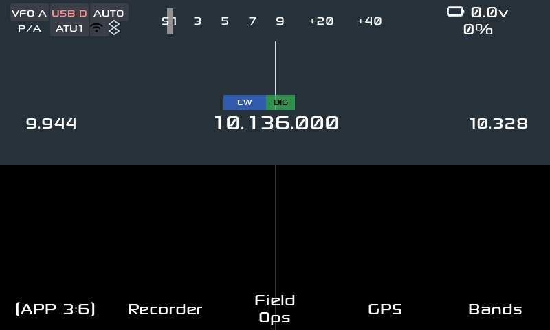

**Todas las apps están alcanzables.** La **tecla APP** entra al grupo y el primer botón de abajo
cambia de página: son **6**, con 3 o 4 apps cada una.

| Página | Apps |
|---|---|
| **APP 1:6** | FT8 (y FT4), JS8, WSPR, RTTY |
| **APP 2:6** | SSTV, WeFax, NavTex, Clúster |
| **APP 3:6** | Recorder, **Field Ops**, GPS, Bandas |
| **APP 4:6** | CW Kbd, CW Trainer, Eq, Status |
| **APP 5:6** | Ajustes, Callsign, QTH, Propagation |
| **APP 6:6** | WiFi, Bluetooth, SWR Scan |

Además de las páginas, **cada app está en la lista de acciones** de *Ajustes → Acciones* y se puede
asignar a un botón o a una pulsación larga. Es el camino para las que no tienen botón propio en las
páginas: **el editor DFL**, por ejemplo, también se abre desde ahí (o con la pulsación larga de la
tecla DFL).

### 6.1 FT8 / FT4

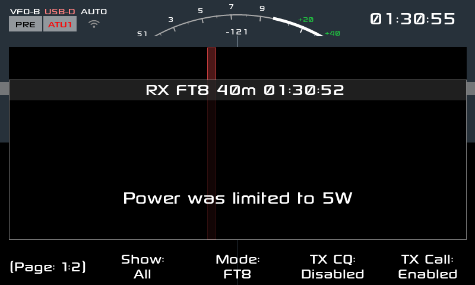

El modo digital más usado: ciclos de 15 segundos, decodificado y transmisión automática o
asistida. Sirve para hacer contactos con señales que no escucharías ni en sueños, con 5 W y un
cable cualquiera.

**Cómo se usa:** elegí banda y modo `DIG`; poné tu **indicativo** en Ajustes (Callsign); abrí
FT8 y elegí la frecuencia de llamada de la banda; para llamar CQ usá el botón de CQ, y para
contestar tocá una fila de la lista de decodificados. El app arma la secuencia y transmite
sola. Podés subir los decodificados por UDP a un programa de la PC (ver `docs/FT8_UDP.md`).

**Auto CQ (por defecto):** con `Auto` habilitado (es el ajuste de fábrica) la radio **llama
sola a la primera estación nueva que esté en CQ** cuando no hay un QSO en curso, igual que el
*Auto track CQ* + *Auto call tracked* de FT8CN. Se saltea las estaciones que ya figuran
trabajadas en esa banda y modo en el log (`/mnt/qso_log.db`), y no llama si vos ya iniciaste
un QSO, si estás llamando CQ o si tocaste una fila. Con `Auto: Disabled` se apagan tanto la
llamada automática como el avance automático del QSO.

**Subida de QSO a logs online:** los QSO guardados en `/mnt/qso_log.db` se suben solos
cuando hay WiFi a los proveedores configurados (**eQSL** y **Clublog** vienen habilitados;
**QRZ** requiere suscripción). Las credenciales se cargan desde la UI: **Ajustes → Operation
→ Log uploads → Configure** (o la app **Logs**), con la misma grilla que Ajustes; tocá una
fila para editar el valor con el teclado. Ver `docs/QRZ_UPLOAD.md`.

### 6.2 WSPR

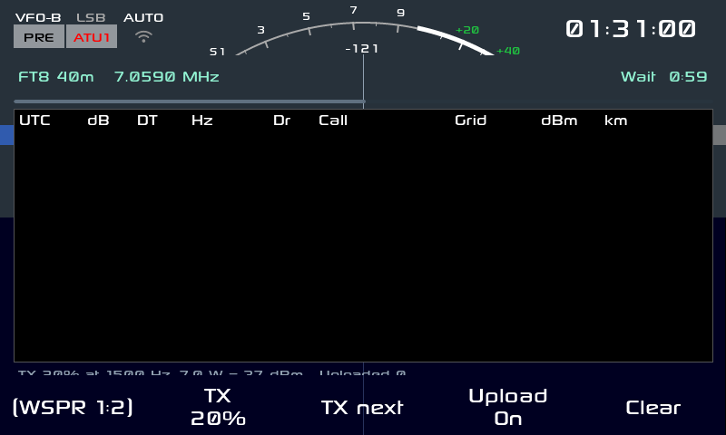

Baliza débil señal: transmite y escucha reportes de 2 minutos para ver hasta dónde llega tu
señal con muy poca potencia. Es la mejor forma de probar una antena nueva.

**Cómo se usa:** elegí el porcentaje de tiempo de TX (`wspr_txpct`) y la banda; el app transmite
en los slots elegidos y decodifica el resto. Subí los spots a **WSPRnet** con tu indicativo y
grilla; los reportes quedan en el log del app.

### 6.3 JS8

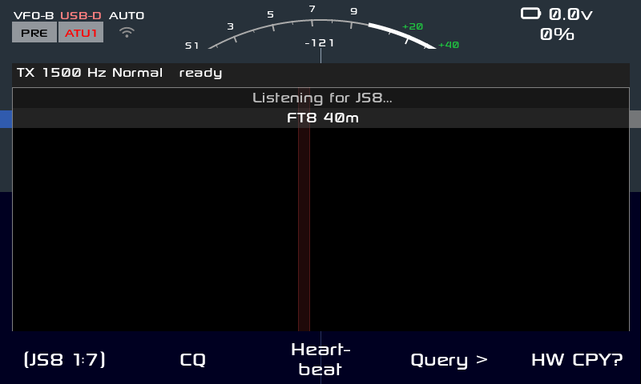

Mensajería digital de teclado a teclado, tolerante a señales flojas, con modos de velocidad
normal, rápido y turbo. Sirve para pasar un mensaje corto o tu posición a otro colega.

**Cómo se usa:** elegí el grupo de llamada y la banda, y escribí en el teclado; el app decodifica
las estaciones que te responden y muestra el mapa de estaciones conocidas. Permite mandar tu
**posición** (la toma del teléfono o del web) y guardar el QSO en el log.

### 6.4 SSTV

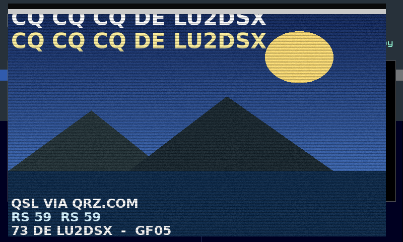

Imágenes por radio en modo analógico: mandás y recibís una foto dibujada línea por línea. Los
modos más usados son R36 y R72 (los que se usan en 20 metros).

**Cómo se usa:** abrí la app y elegí el modo (`R8BW`, `R36`, `R72`, `M1`, `M2`, `S1`, `S2`); para
recibir, sólo dejá el receptor en la frecuencia y el app va dibujando la imagen; para transmitir,
elegí la imagen y arrancá la TX (el app respeta el PTT). Las imágenes quedan guardadas en `DATA`.

### 6.5 WeFax

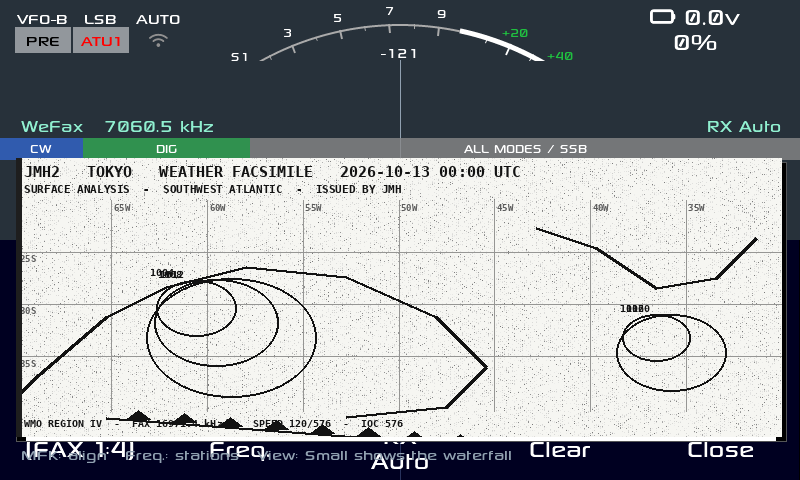

Facsímil meteorológico: las cartas que transmiten las estaciones de radiofax en HF. Se reciben
en blanco y negro y se leen como un mapa del tiempo.

**Cómo se usa:** elegí la frecuencia de la estación y el modo (blanco/negro o escala de grises),
y esperá el comienzo de la carta; el app alinea la imagen. Con la **perilla del MFK** (o los
botones *Align* y *Tilt*) corregís el **alineado** y la **inclinación**: girando se ve cómo se
endereza la imagen; después guardás el PNG.

### 6.6 NavTex

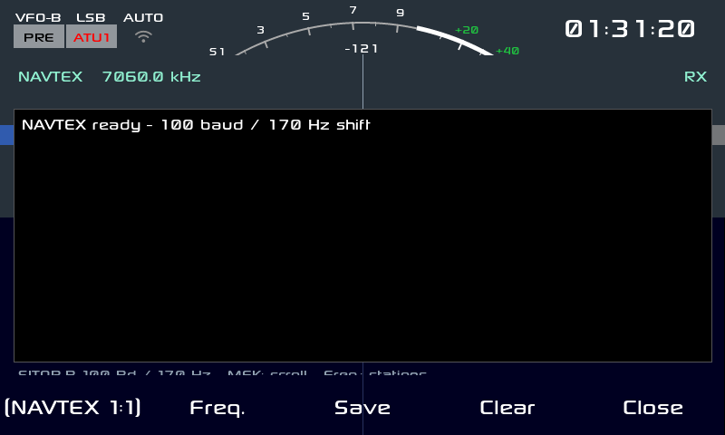

Avisos marítimos en 518 kHz: meteorología, avisos a los navegantes y búsquedas. Es la versión en
texto del radiofax y con muy poco ancho de banda.

**Cómo se usa:** sintonizá la frecuencia de la estación y abrí el app; el texto decodificado
aparece en pantalla y se guarda por estación. Es útil también en la costa para saber el estado
del mar.

### 6.7 Clúster DX

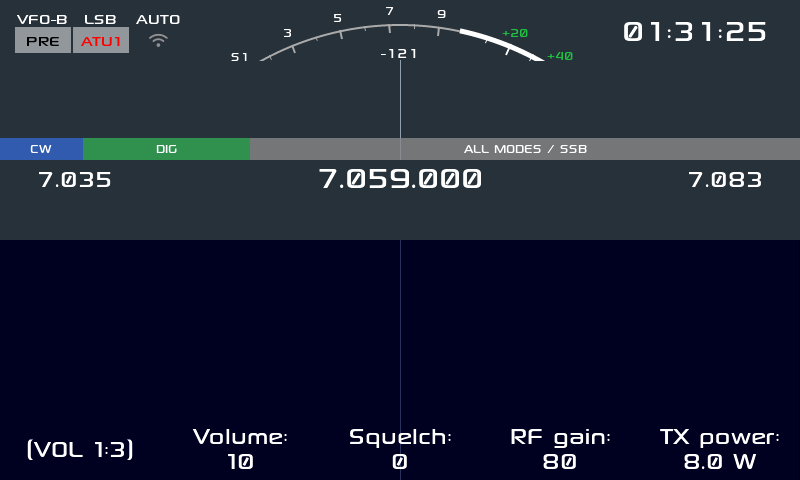

Los spots de DX en vivo: qué estaciones están en el aire y en qué frecuencia. Es la herramienta
de caza mayor, y con la columna y las marcas sobre el waterfall se convierte en un radar.

**Cómo se usa:** configurá **servidor**, **puerto** y tu **indicativo** (el clúster lo pide para
entrar), elegí los filtros (modos, bandas, actividad y antigüedad) y conectá. Los spots aparecen
en la **columna** de la derecha: al tocar uno, el equipo **sintoniza** esa frecuencia y ajusta el
modo. Las **marcas sobre el waterfall** muestran los que caen dentro del ancho que estás viendo.

### 6.8 Posición (GPS)

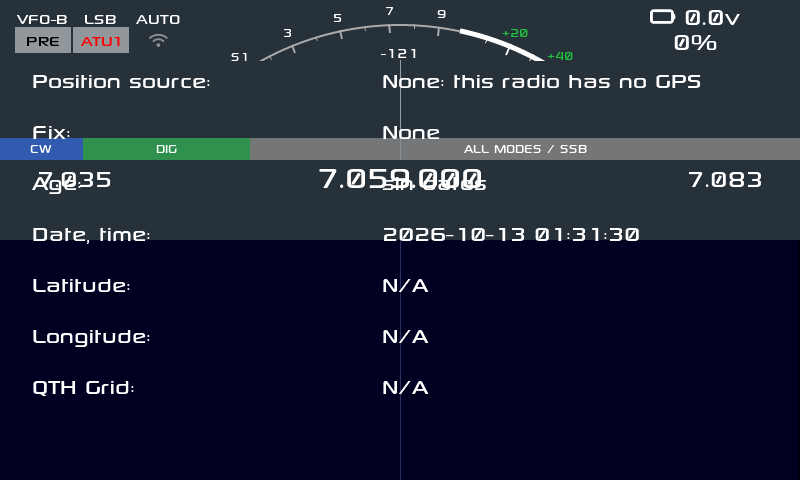

Muestra de dónde viene la posición y la grilla QTH, que es lo que Field Ops y JS8 necesitan para
reportar dónde estás. El X6200 **no trae receptor GPS**: la posición la manda el teléfono o el
configurador web.

**Cómo se usa:** mandá la posición desde el teléfono (`{"cmd":"location","text":"-34.60,-58.38"}`)
o desde el web. El app muestra la **fuente** (Phone / None), la **edad** del dato, la fecha y
hora, latitud, longitud y la **grilla**; si no hay nada, lo dice tal cual en vez de inventar
satélites.

### 6.9 Field Ops (SOTA/POTA)

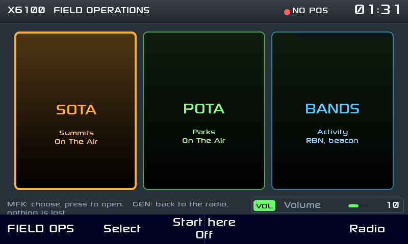

La app para salir al campo: referencias SOTA y POTA, log de contactos y self-spot. Está pensada
para que en la cumbre no tengas que pelear con nada. **Está en APP 3:6.**

**Cómo se usa:** elegí la **referencia** (la lista viene incluida, se puede usar sin internet),
poné tu **indicativo**, y activá el **self-spot** para avisar a pota.app en qué frecuencia estás.
Cada contacto se guarda en el log ADIF (exportable y subible a **QRZ**). El **CQ de voz** graba
tu llamado una vez y lo emite por PTT cuando lo pedís.

### 6.10 RTTY

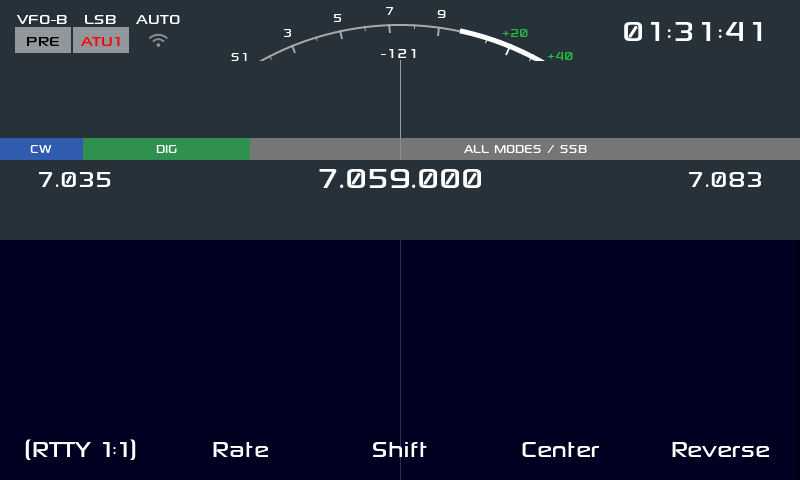

El digital clásico de los concursos: Baudot a 45 baudios, con shift de 170 Hz. Todavía se escucha
en 40 y 20 metros y sigue siendo divertido de decodificar.

**Cómo se usa:** elegí centro, shift y velocidad (`rtty_center`, `rtty_shift`, `rtty_rate`),
escribí en el teclado y el app transmite; lo que llega se decodifica en pantalla. Es ideal para
probar el filtro angosto del receptor.

### 6.11 CW Keyboard (la app `CW`)

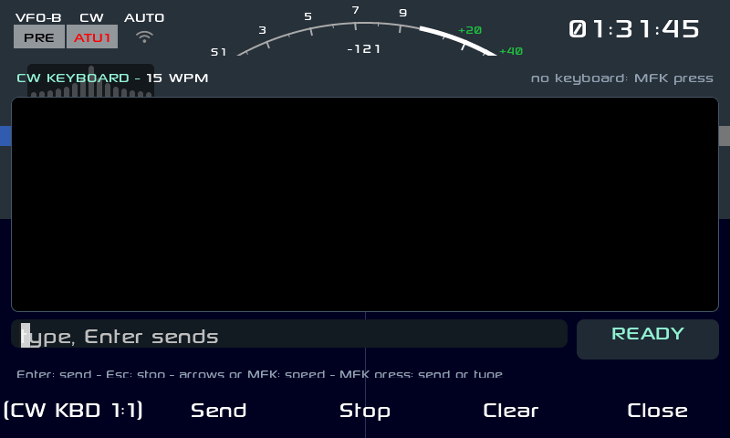

Telegrafía sin manipulador: escribís en un **teclado USB o Bluetooth** y el equipo sale al aire en
CW con tu velocidad, tono y peso. Ideal para el campo (nada que enchufar), para quien no puede usar
la paleta por una lesión, o para mandar un texto largo sin equivocarse.

**Cómo se usa:** abrí la app (página **APP 4:6**, o la acción *APP CW Keyboard*), escribí y mandá.
Una línea sale con **Enter**; lo que llega se decodifica en pantalla. La velocidad, el tono y el
peso se ajustan con el MFK (**CW key speed**, **CW key tone**, **CW key ratio**).

| Botón del pie | Qué hace |
|---|---|
| **Send** | Manda la línea escrita |
| **Stop** | Corta la transmisión |
| **Clear** | Borra el texto |
| **Close** | Cierra la app |

### 6.12 CW Trainer


Para practicar recepción: el equipo **te toca CW** y vos copiás. Arranca con el modo **Learn
(Koch)** —el clásico para aprender por etapas, sin contar puntos— y sube la velocidad a medida que
acertás. **Corre en el modo *train* del keyer: usa el sidetone y NO transmite**, así que no sales al
aire mientras practicás.

**Cómo se usa:** abrí la app (página **APP 4:6** o la acción *APP CW Trainer*) y elegí en el pie el
modo y la dificultad; hay 3 páginas de botones (`CWT 1:3`, `2:3` y `3:3`). Antes de empezar, poné el
keyer en modo train (**CW key train** en el MFK, grupo CW).

> **Aviso (defecto conocido).** En esta versión, usar el CW Trainer deja el equipo en un **bucle de
> reinicio de la GUI**: la pantalla se reinicia cada medio minuto y se pierde lo que estabas
> haciendo. Está identificado y reportado (issue **#19** del repositorio), con la causa medida: un
> desborde de buffer en el camino de audio al decodificador CW. Si te pasa: salí de la app y
> **reiniciá el equipo**; mientras no se arregle, conviene practicar recién arrancado, o usar el CW
> Keyboard para transmitir y practicar la recepción "en el aire".

### 6.13 Bandas

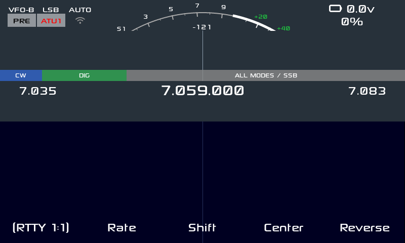

La vista de bandas: los límites de cada banda, la **propagación** estimada y los parámetros
guardados por banda y modo. Sirve para moverse rápido entre bandas sin pasar por el dial.

**Cómo se usa:** abrí la app (página **APP 3:6**), mirá las barras de cada banda (HIGH / FAIR /
GOOD, con los spots del clúster y del RBN de los últimos minutos) y tocá la banda; el equipo cambia
manteniendo el modo y sus ajustes. Cada banda recuerda su última frecuencia, filtro y estado del
ATU. **Use band** cambia a la banda elegida, y **Test beacon** emite un CQ de prueba para que el
**RBN** te escuche y veas hasta dónde llegás (transmite: hacelo con antena conectada).

### 6.14 Recorder (grabador)

Graba el **audio del receptor** y lo reproduce, para dejar registrado un contacto difícil, un
identificador de baliza o una señal rara y escucharla con calma después (o mandarla a un colega).

**Cómo se usa:** abrí la app (página **APP 3:6**) y usá el pie: **Rec** y **Rec Stop** graban,
**Play** y **Play Stop** reproducen, **Rename** le pone nombre y **Delete** borra. Los archivos
quedan en `DATA/rec/`.

### 6.15 EQ (ecualizador del micrófono)

Cinco bandas para tu **audio de transmisión**: si te reportan que salís muy grave ("gordo") o muy
chillón ("finito"), se corrige acá. Es el ecualizador de la **entrada**, así que se nota en tu señal
de SSB y de AM, no en lo que escuchás.

**Cómo se usa:** abrí la app (página **APP 4:6** o la acción *APP EQ*), prendé el ecualizador y
movés las bandas. Queda guardado y se aplica al equipo.

### 6.16 Callsign (indicativo)

Tu **indicativo**, en un solo lugar. Lo usan las apps digitales (FT8/FT4, WSPR, JS8, RTTY), el
clúster DX y Field Ops, así que conviene cargarlo **antes** de estrenar cualquier modo digital.

**Cómo se usa:** abrí la app (página **APP 5:6**), escribilo con el teclado y guardá. Si sale en
mayúsculas y sin errores, mejor: es lo que va a salir al aire y a los spots.

### 6.17 QTH (tu ubicación)

Tu **grilla** (locator, por ejemplo `GF05xx`) y tu QTH. Sin la grilla, WSPR y el clúster no pueden
ubicarte y los reportes pierden la mitad de la gracia.

**Cómo se usa:** abrí la app (página **APP 5:6**), cargá la grilla de 6 caracteres y el texto de tu
QTH, y guardá. Podés calcular tu grilla en cualquier página de locator o directamente en el
configurador web.

### 6.18 Status (estado del sistema)

Todo lo que el equipo "cree que tiene", en una pantalla: la **versión** del firmware
(`v0.1.2-lu2dsx`), el kernel, el **adaptador Bluetooth** y los emparejamientos guardados, el nivel
de TX, el **espacio libre** en `DATA`, si **wfview** está prendido y el puerto, y si hay **IP** web.
Es la pantalla para diagnosticar por teléfono o por radio: cuando reportes un problema, mirá acá los
datos y anotalos.

**Cómo se usa:** abrí la app (página **APP 4:6**). Se lee, no se toca; **Close** para salir.

### 6.19 WiFi

Para conectar el equipo a la red de tu casa o al hotspot del teléfono. Con WiFi andando tenés:
**control remoto** (`http://<ip>/remote`), **configurador web** (`https://<ip>/`), **wfview**,
**clúster DX** y la hora por NTP.

**Cómo se usa:** abrí la app (página **APP 6:6**), elegí la red de la lista, escribí la clave y
conectá. Anotá la **IP** que te asigna: es la que vas a escribir en el teléfono y en la PC. Si no
aparece tu red, revisá que el equipo esté cerca del router o usá el hotspot del teléfono.

### 6.20 Bluetooth

Para las tres cosas que hace el Bluetooth acá: **CAT** (puente serie para la PC), **auriculares
A2DP** (escuchar sin cables) y **teclado** (para el CW Keyboard y los menús). El paso a paso del
pareado —que es donde se traba todo el mundo— está en la **sección 7.3**; acá van los botones de la
app (página **APP 6:6**):

| Botón | Qué hace |
|---|---|
| **Scan** | Busca dispositivos (15 s, con cuenta regresiva) |
| **RX to HP** | Manda la recepción a los auriculares |
| **Speaker** | Apaga o prende el altavoz del equipo (para no escuchar doble) |
| **Auto** | Pulsando: auto-conexión del equipo elegido. Manteniendo: desempareja |
| **Close** | Cierra la app |

### 6.21 SWR Scan (barrido de ROE)

Mide la **ROE** (relación de ondas estacionarias) en **50 puntos** a lo largo de la banda y dibuja
la curva: sirve para ver **dónde resuena** tu antena, cuánto ancho tiene y si conviene el ATU. Es la
forma rápida de saber si el problema es la antena o el equipo.

**Cómo se usa:** abrí la app (página **APP 6:6**) y pulsá **Run**; la curva se dibuja a medida que
barre. **Usalo con la antena conectada** (la medición necesita RF) y, como siempre: **nunca
transmitas sin antena o carga fantasma**.

### 6.22 DFL editor (forma del filtro)

El **editor DFL** muestra la **forma del filtro** que está pasando en este momento y deja moverla. No
es una ventana: es un **panel que se dibuja encima del waterfall** (sin diálogo ni marco), con una
**gráfica esquemática** de la respuesta y tres filas — **LOW**, **HIGH** y **BW** — con el valor
exacto en **Hz** de cada borde y del ancho. La gráfica muestra la forma del filtro, **no** una
medición del equipo.

**Cómo se usa.** Se abre con la **pulsación larga de la tecla DFL** (la acción que esa tecla trae por
defecto) o con la celda **Grafico** de la página DFL; la acción **APP DFL editor** también está en
*Ajustes → Acciones* (asignable a una pulsación larga) y en el control remoto
(`{"cmd":"app","text":"DFLEditor"}`). Se cierra con la celda **Waterfall** de la barra, o con una
pulsación corta de DFL.

**Se edita con la rueda de volumen y con el dedo.** Girá la **rueda de volumen** para ajustar el
parámetro seleccionado y apretala para **cambiar de parámetro** (LOW → HIGH → BW). Con el **dedo**,
tocá una de las tres filas para seleccionar su parámetro, o **arrastrá uno de los bordes** sobre la
gráfica para moverlo (un toque lejos de los bordes no cambia nada). **La rueda principal (VFO) nunca
edita el filtro**: sigue sintonizando aunque el editor esté abierto. **Reset** vuelve a la forma por
defecto del modo.

| Fila | Qué ajusta | Paso de la rueda |
|---|---|---|
| **LOW** | Borde inferior del filtro | 10 Hz |
| **HIGH** | Borde superior del filtro | 50 Hz (10 Hz en CW/CWR) |
| **BW** | Ancho de banda | 20 Hz |

**Detalles.** En **TX** el editor queda de sólo lectura (las filas se apagan y **Reset** no
responde). En **AM/SAM/NFM/WFM** el borde **LOW** no es editable (son modos simétricos alrededor de
la portadora): la fila se ve apagada y la rueda arranca en **HIGH**. En **LSB/LSB-D** la gráfica se
**espeja** como el espectro (el cero a la derecha, HIGH a la izquierda); en el resto, el cero queda a
la izquierda.

### 6.23 Ajustes

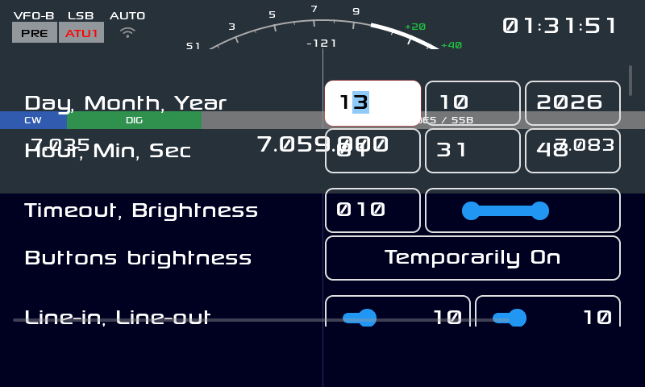

La app de **Ajustes** es la puerta a todo lo que vimos en la **sección 5**: reloj, pantalla, info,
audio, espectro, operación, apariencia y las **acciones** asignables a las pulsaciones largas. Está
en la página **APP 5:6** y el pie funciona como **tabs** (cada botón salta a su sección).

**Todas las apps se pueden asignar a un botón o a una pulsación larga.** En *Ajustes → Acciones*
tenés la lista completa de acciones, incluidas todas las apps: `APP FT8`, `APP Bands`,
`APP Bluetooth`, `APP Callsign`, `APP Cluster`, `APP CW Keyboard`, `APP CW Trainer`, `APP EQ` y
las demás. Con eso te armás el equipo a tu manera: FT8 a un toque corto, el entrenador CW a una
pulsación larga, y así.

### 6.24 Propagation (beacons IBP/IARU R2)


La app **Propagation** dice si la **banda actual** está abierta midiendo los
**beacons del IBP** (NCDXF/IARU) que transmiten en los próximos slots, **solo RX**
(nunca transmite). Está en la página **APP 5:6** y también por control remoto
(`{"cmd":"app","text":"Propagation"}`).

**Cómo se usa:** abrí la app en la banda que querés evaluar y pulsá **Run**
(también puede arrancar sola al abrirse, con el parámetro *run on open*). La app
bloquea el dial mientras está abierta y muestra el barrido en cuatro pasos:
**1/4 Preparando** (banda y beacons aplicables), **2/4 Sincronizando** (reloj NTP y
"transmitiendo ahora"), **3/4 Midiendo** (beacon por beacon, con la escalera
100/10/1/0.1 W y una barra de progreso) y **4/4 Resultado** (veredicto, evidencia,
cobertura y dirección).

- **ABIERTA / MARGINAL / CERRADA** sale del mejor SNR medido contra el piso de
  ruido, con umbrales configurables (el botón **Umbrales** recorre 12/6, 15/8,
  18/10, 21/12 y 9/4 dB).
- **Cancelar** está siempre disponible durante el barrido y devuelve el VFO. Al
  terminar, cancelar o cerrar, la frecuencia y el modo vuelven exactamente como
  estaban.
- **Escuchar** sintoniza el mejor beacon escuchado y lo deja hasta que pulses
  **Parar** o cierres (cerrar siempre devuelve el VFO).
- **40/30/80 m no tienen beacons IBP** (la IARU no los respalda debajo de 14 MHz):
  la app lo dice y muestra los spots recientes del cluster de esa banda, con su
  edad.
- El **reloj sin NTP** se avisa en pantalla: el turno de los beacons puede estar
  corrido. La app no puede forzar la sincronización (la hace el sistema).
- El registro **IARU R2 de 10 m** (983 radiofaros, 313 activos en la lista del
  2026-10-18) va empaquetado en el firmware; no consulta internet.

## 7. Guías avanzadas

### 7.1 Control remoto desde el teléfono

El equipo abre un socket en `/tmp/x6200_remote.sock` con unos 65 comandos.

1. Conectá el equipo al WiFi (Ajustes → Bluetooth/WiFi) y averiguá la IP.
2. Abrí `http://<ip>/remote` en el teléfono.
3. Comandos útiles: `{"cmd":"app","text":"FT8"}` abre una app;
   `{"cmd":"app","text":"off"}` la cierra (también a RTTY, que no tiene diálogo);
   `{"cmd":"band","val":1}` cambia de banda; `{"cmd":"mode","val":1}` cambia el modo;
   `{"cmd":"freq","val":14074000}` sintoniza;
   `{"cmd":"location","text":"-34.6037,-58.3816"}` manda tu posición.
   Con la app **SWR Scan** abierta, `{"cmd":"swrscan","val":1}` inicia el barrido de ROE y
   `{"cmd":"swrscan","val":0}` lo detiene. **Ojo: el Run transmite** (a 0.1 W): usalo con la
   antena o una carga conectada y con autorización; el `get` muestra `swrscan_state` y
   `swrscan_tx` para saber cuándo terminó.
4. Diagnóstico: `{"cmd":"cluster_feed","text":"DX de LU1ABC:  14074.0  LU2DSX  FT8  2313Z GF05"}`
   inyecta un spot del clúster (la línea necesita la hora `HHMMZ`).

### 7.2 Configurador web

1. Averiguá la IP y abrí `https://<ip>/` (certificado autofirmado: aceptá la excepción).
2. Tiene 15 páginas: estado, RF, audio, clúster, digitales, temas, WiFi, Bluetooth,
   actualizaciones y el control remoto.

### 7.3 Bluetooth

Sirve para tres cosas: **CAT** (puente serie para la PC), **auriculares A2DP** y **teclado**. El
estado se ve en la barra de arriba, al lado del WiFi: la **runa** queda invisible con el Bluetooth
apagado, gris cuando está prendido y **blanca** con auriculares conectados.

**Encenderlo:** Ajustes → **Bluetooth** (el interruptor de arriba). Marcá **Discoverable (CAT)** si
vas a usarlo desde la PC.

**CAT (SPP):** vinculá la PC y elegí el puerto serie que aparece (19200 8N1 o lo que pida tu
programa). Sirve para cualquier logger o programa CAT.

**Auriculares (A2DP):** entrá con el botón **BT** (al lado de WiFi, página **APP 6:6**) o desde
Ajustes → Bluetooth → **Devices**.

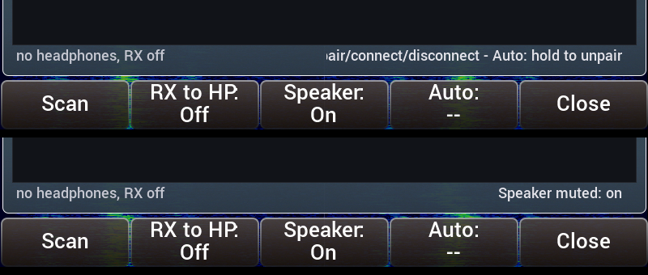

1. Pulsá **Scan** (15 s). El botón queda gris con la cuenta regresiva (`Scan 13s`) para que veas que
   está trabajando, y al terminar dice `Scan done: N device(s)` o `Scan done: nothing found`.
2. Poné los auriculares en **modo vinculación** y **desconectalos del teléfono**: si el teléfono
   está cerca vuelven a él y dejan de anunciarse (el síntoma es que no aparecen o sale
   `Pairing failed`).
3. Tocá la fila de los auriculares: **parean y se conectan**. Si piden un código, aparece en
   pantalla para escribirlo en el teclado.
4. Pulsá **RX to HP** para que la **recepción** salga por los auriculares.
5. El **volumen** de los auriculares se mueve con la **rueda de volumen** del equipo.
6. **Speaker** apaga el altavoz mientras los usás, para no escuchar doble.

| Botón de la app | Qué hace |
|---|---|
| **Scan** | Busca dispositivos (con cuenta regresiva) |
| **RX to HP** | Manda la recepción a los auriculares |
| **Speaker** | Apaga o prende el altavoz del equipo |
| **Auto** | Pulsando: prende/apaga el **auto-conexión** del equipo elegido. Manteniéndolo: **desempareja** (`Unpair`) |
| **Close** | Cierra la app |

**Teclado:** vinculá un teclado Bluetooth o conectá uno USB; se usa en el CW Keyboard y para
navegar los menús.

### 7.4 El clúster, paso a paso

1. Conseguí los datos del servidor (por ejemplo un nodo DXSpider) y tu indicativo.
2. Abrí la app **Clúster** → configurá servidor, puerto e indicativo → conectá.
3. Ajustá los **filtros**: modos, bandas, actividad y antigüedad máxima.
4. Activá la **columna** del clúster en Ajustes si querés verla siempre.
5. Tocá un spot de la columna para sintonizarlo, o mirá las **marcas** sobre el waterfall.

### 7.5 wfview: la radio como IC-705 en la red

El equipo se anuncia y responde el **protocolo LAN de Icom**, así que se comporta como un
**IC-705** y se puede manejar con **wfview** desde la PC: el waterfall, el audio del receptor y
el control de frecuencia y modo, todo por la red.

**Qué habla**

| Puerto | Uso |
|---|---|
| **UDP 50001** | Control (y el descubrimiento que hace wfview) |
| **UDP 50002** | CI-V (el CAT de la radio por red) |
| **UDP 50003** | Audio (LPCM 16 bits, mono) |

**Paso 1 — Preparar la radio**

1. Conectá el equipo a la **misma red** que la PC (Ajustes → WiFi).
2. Anotá la **IP** del equipo (pantalla de estado, o la lista del router).
3. Ajustes → **wfview server** → activar. Al activarlo se escribe su configuración en
   **`/mnt/wfview.conf`**:

   ```
   enabled=1
   user=x6200
   pass=<tu clave>
   ```

4. Si querés, cambiá el **usuario** y la **clave** desde el **configurador web** (página de
   wfview); la clave se guarda **hasheada**, no en texto plano. Anotá lo que pongas: es lo que
   vas a cargar en wfview.

**Paso 2 — Instalar wfview en la PC**

Instalá wfview desde [wfview.org](https://wfview.org) o el paquete de tu distribución. Sirve
también cualquier cliente que hable el protocolo LAN de Icom.

**Paso 3 — Registrar el equipo (el paso que importa)**

1. Abrí wfview y andá a **Settings → Radios**.
2. wfview **escanea la red** y suele encontrar la radio sola: aparece listada como **IC-705**
   (es lo que emula el equipo). Tocá **Connect**.
3. Si **no aparece** (hay routers que filtran el *broadcast* del descubrimiento), agregala a
   mano con **Manual / Add**:

   | Campo | Qué poner |
   |---|---|
   | **Radio Name** | `X6200` (el que quieras) |
   | **IP Address** | la IP del equipo (paso 1) |
   | **Control Port** | `50001` |
   | **Username** | `x6200` (o el que hayas puesto en el conf) |
   | **Password** | la clave del `wfview.conf` |
   | **Model** | **IC-705** |
   | **CI-V Address** | `A4` (la del IC-705) |

4. **Guárdala**: queda **registrada** para las próximas veces, ya no hay que buscarla de nuevo.

**Paso 4 — Usar**

1. Conectá. En la ventana principal vas a ver el **espectro y el waterfall**, y podés cambiar
   frecuencia y modo (el CAT viaja por red y se comparte con el UART: lo que cambies en la PC o
   en la radio se refleja en los dos lados).
2. Elegí el dispositivo de **audio** de la PC para escuchar el receptor.
3. **Un cliente a la vez**: el servidor atiende una conexión.

**Si algo no anda**

| Síntoma | Qué revisar |
|---|---|
| No aparece en la lista | Que esté en la misma red y que el **firewall** de la PC no bloquee **UDP 50001–50003**. Si el router no deja pasar el *broadcast*, agregala a mano (paso 3.3) |
| Conecta pero no suena | El dispositivo de audio elegido en wfview |
| No hay waterfall | Que el espectro esté activado en el cliente |
| Pide clave y no la sabés | Mirá `/mnt/wfview.conf` (o volvé a ponerla desde el configurador web) |
| Se corta | Es UDP: usá WiFi con buena señal o cable, y evitá otras aplicaciones pesadas en el equipo |

### 7.6 Temas

Hay **8**: los incorporados (IU1WXY, Outdoor, Classic, Outdoor-Negative y Vision) y los del
X6100 que van como archivos (Holo, Material 3 y RS).

1. Ajustes → **Theme** → elegí uno; el equipo guarda y **se reinicia** para aplicar los colores.
2. **Tu propio tema:** copiá un `.json` a `DATA/themes/` (tomá `Holo.json` como modelo) y aparece
   en la lista. También puede ser una **carpeta** con un `theme.json` adentro, como `RS/`.

**Accesibilidad:** los temas están medidos para **WCAG 2.1 AA**: cada par de colores que se dibuja
junto (texto sobre su fondo, bordes, el switch y el slider de Ajustes, la barra de estado) tiene
contraste **≥ 4.5:1** para texto normal y **≥ 3:1** para texto grande, bordes e indicadores. Un
chequeo automático recorre todos los pares declarados en cada compilación, así que un tema nuevo no
puede quedar por debajo.

> **Una salvedad medida en el equipo:** el **medidor (S-meter) del tema RS** queda en **2,4:1**
> contra el fondo real sobre el que se dibuja, por debajo del 3:1 que pide el criterio 1.4.11. Está
> reportado (issue **#44**) y se explica porque el color sale de la tabla compilada y no del archivo
> del tema. En los demás temas y elementos, el contraste es el medido por el chequeo.

### 7.7 Anuncios por voz (TTS en español)

1. Ajustes → **Voice mode** → **Off**, **When LCD off** o **Always**. *When LCD off* es lo más
   cómodo en el campo: habla justo cuando no estás mirando la pantalla.
2. Con la pantalla apagada, girando el dial o cambiando una opción te dice qué estás cambiando.
3. **Nunca habla mientras transmitís**, para no salir al aire.
4. Podés ajustar velocidad, tono y volumen en la misma página, y el idioma con el modo
   **VOICE LANG** de la rueda de volumen.

### 7.8 Field Ops con QRZ

1. Poné tu indicativo en Ajustes → Callsign.
2. Abrí Field Ops, elegí la referencia SOTA o POTA y activá el self-spot.
3. Cada QSO se guarda en `DATA/qso_log.db`; exportá el ADIF y subilo a QRZ con tu cuenta.

### 7.9 Grabación de pantalla y capturas

- **Captura:** acción *Screenshot* → un PNG en `DATA`.
- **Grabación:** acción *Screen rec* → video MJPEG + **audio del receptor** en un AVI en `DATA`.

### 7.10 Motor de video DRM/KMS

Está portado y **apagado por defecto**. Se activa creando `/mnt/use_drm` y reiniciando. Si algo
no se ve bien, borralo y volvés al motor clásico.

### 7.11 Transverter: trabajar VHF/UHF con el equipo

Un **transverter** es un conversor que traslada otra banda a la que trabaja tu equipo. El X6200 es de
HF y 6 m, así que con un transverter de **2 m** (o de 70 cm, o de 4 m) podés trabajar esas bandas: el
equipo sigue sintonizando en su banda de **IF** —casi siempre **28 MHz** (10 m)— y el transverter hace
el resto. Es la forma clásica de subir a VHF/UHF con un equipo de HF.

**Cómo lo maneja la GUI.** Vos ves y sintonizás la **frecuencia real** de la banda objetivo (por
ejemplo `144.300`) y el firmware, por dentro, pone el hardware en la **IF** (`28.300`). Se ve en el
propio log:

```
Radio set vfo 0 freq=144300000 (28300000)
                    ^ la que ves          ^ la que sintoniza el equipo
```

**Configuración:** *Ajustes → Operación → **Transverter***. Hay **3** transverters cargados, cada uno
con tres campos:

| Campo | Qué es |
|---|---|
| **From** / **To** | La **ventana** de la banda objetivo en la que el shift se aplica (en MHz enteros) |
| **Shift** | La diferencia entre la banda objetivo y la IF: `frecuencia objetivo − IF` |

Los valores de fábrica suponen **IF de 28 MHz** (las tres bandas típicas de un equipo de HF):

| From | To | Shift | Banda |
|---|---|---|---|
| 70 MHz | 72 MHz | 42 MHz | 4 m |
| 144 MHz | 150 MHz | 116 MHz | 2 m |
| 432 MHz | 438 MHz | 404 MHz | 70 cm |

**Para tu transverter:** si el tuyo tiene la IF en 28 MHz, los valores ya sirven; si no, poné
`Shift = banda objetivo − IF`. Por ejemplo, un transverter de 2 m con IF en 50 MHz usa `Shift = 94`.
Cuando la frecuencia en la que estás **cae dentro** de la ventana `From`..`To` el shift se aplica;
fuera de ella no pasa nada (shift 0) y el equipo vuelve a la banda de HF.

**Ojo con dos cosas:** los tres campos se editan en **MHz enteros** (no hay decimales), y la ventana
tiene que cubrir el segmento que vas a usar. Si sintonizás fuera de la ventana, el equipo trabaja en
su frecuencia real (la IF), así que no vas a ver la banda objetivo.

### 7.12 Actualizaciones y SSH

- Aviso de firmware nuevo en la pantalla de estado (consulta GitHub; no manda datos tuyos).
- **SSH**: usuario `root`. **Cambiá la contraseña** (la de fábrica es conocida). Los logs están
  en `DATA/app_logs/x6200_log_*.txt` y se escriben al cerrar la GUI.

### 7.13 CB 27 MHz: canales, potencia y marco legal

**Los cuatro grids.** Cada uno es un plan de 40 canales con la misma numeración y los mismos
offsets; cambia la base:

| Grid | Banda en pantalla | Canal 1 | Canal 40 | Nota |
|---|---|---|---|---|
| A | `CB A` | 26,065 | 26,505 | grid bajo |
| B | `CB B` | 26,515 | 26,955 | grid bajo |
| **C** | `CB C` | **26,965** | **27,405** | **CEPT / FCC / SBC argentino** |
| D | `CB D` | 27,415 | 27,855 | grid alto (termina 145 kHz antes de 10 m) |

El plan tiene **cinco huecos** (26,995 / 27,045 / 27,095 / 27,145 / 27,195) y los canales
**23, 24 y 25 van fuera de orden**: 23 = 27,255; 24 = 27,235; 25 = 27,245. Por eso, al pasar del
23 al 24, el número de canal sube y la frecuencia **baja**. La celda `CH --` marca justamente un
hueco o una frecuencia que no es canal. En los extremos 1 y 40 el dial no da la vuelta.

**En pantalla.** En CB la fila grande de frecuencia muestra la frecuencia del grid, el canal y el
grid (`27.185` · `CH 19` · `CB C`), y la franja del plan de banda (al pie del espectro) se pinta
violeta con el rótulo `CB`; la celda `CH nn` de la barra sigue mostrando el canal como indicador
de estado. Fuera de CB la fila vuelve a la frecuencia grande con los bordes del span y la franja
vuelve a los segmentos IARU.

**TX en CB.** El PTT de software pasa por un interlock por ventana de frecuencia:

| `cb_tx_scope` | Qué permite |
|---|---|
| `0` (default) | Sólo el SBC argentino: 26,960–27,410 MHz |
| `1` | Además los grids A, B y D completos |
| `2` | Sin interlock |

Fuera de 26–28 MHz el interlock no toca nada, así que las bandas de aficionado siguen iguales.
Si bloquea, la pantalla avisa `TX blocked: not a CB channel`, lo dice por voz y apaga el PTT. La
potencia en CB tiene un tope configurable (`cb_pwr_max`, 4,0 W por defecto). Los dos parámetros se
editan en `DATA/params.db` (configurador web/SQLite); no hay fila en Ajustes.

**Advertencia legal (Argentina).** El SBC está en **26,960–27,410 MHz** y exige **autorización
por estación** y **equipo homologado/registrado** (Res. SC 47/1982; CABFRA 2025 de ENACOM; alta
con formularios F1/F2/F23, D3/COPITEC y responsable técnico). El X6200 **no es un equipo CB
homologado**: transmitir en 27 MHz con él queda fuera del régimen del SBC y fuera del servicio de
aficionados, y modificar el firmware no cambia la homologación. Los grids A, B y D **no** son SBC
argentino: con el default quedan en recepción. Los modos y la potencia del SBC **no están
confirmados**; se usan AM/FM y 4 W como valores conservadores. El **PTT del micrófono** lo maneja
probablemente el MCU y el interlock de software no necesariamente lo frena: la protección real es
no sintonizar fuera de canal. **No des por validado el TX** hasta medir RF y armónicos con carga
fantasma (F0, a cargo del owner con autorización).

## 8. Solución de problemas

| Síntoma | Qué hacer |
|---|---|
| **Sólo el logo y no arranca** | Casi siempre la actualización cortada a mitad o la microSD mal asentada. Revisá el adaptador; si sigue, grabá la imagen completa. |
| **Arranca el firmware viejo** | La tarjeta no está siendo leída: revisá el adaptador y el contacto. |
| **"No medium found" al grabar** | La microSD no está dentro del adaptador. |
| **No se oyen los anuncios** | *Voice mode* en Off, o estás transmitiendo. |
| **Un tema no aparece** | Tiene que estar en `DATA/themes/` con el JSON válido. |
| **El clúster no muestra spots** | Revisá servidor, indicativo y filtros; una línea de prueba necesita la hora `HHMMZ`. |
| **Sin espacio en `DATA`** | Borrá `rec/`, capturas viejas o los `backup_*.tgz`. |
| **Ajustes raros tras actualizar** | Restaurá el respaldo de `params.db` o borralo (perdés los ajustes, no el log). |
| **No encuentro una app** | Están todas en las **6 páginas APP** (tecla APP); la tabla está en la sección 6. |
| **El Bluetooth no encuentra los auriculares** | Tienen que estar en modo vinculación **y desconectados del teléfono**: si el teléfono está cerca vuelven a él y dejan de anunciarse. |
| **Sale `Pairing failed`** | Lo mismo: ponelos en vinculación y reintentá (la app avisa cuando falla, antes quedaba muda). |
| **No se oye la radio en los auriculares** | Pulsá **RX to HP** en la app de Bluetooth y subí el volumen con la rueda del equipo. |
| **Se escucha doble (altavoz y auriculares)** | Pulsá **Speaker** en la app de Bluetooth. |
| **Subís el volumen y no cambia nada** | Defecto conocido y reportado (issue **#30**): el ajuste se guarda en `params.db` pero no se aplica al audio. No es tu equipo: está en estudio. Mientras tanto, la única forma de subir el nivel es la ganancia (*Ajustes → Audio*, `Play gain`, hasta +10 dB). |
| **La GUI se reinicia cada medio minuto** | Defecto conocido y reportado (issue **#19**): pasa después de usar el **CW Trainer** (o las apps de CW). Salí de la app y **reiniciá el equipo**; no es una falla del hardware ni del suministro. |

## 9. Referencia

| Partición | Contenido |
|---|---|
| `BOOT` (32 MB, vfat, arrancable) | `zImage`, device tree y `boot.scr` |
| `rootfs` (512 MB, ext4) | El sistema y la GUI |
| `DATA` (vfat, etiqueta `DATA`) | **Tus datos**: ajustes, log, temas, mensajes, grabaciones y logs |

| Archivo | Qué es |
|---|---|
| `DATA/params.db` | Todos los ajustes |
| `DATA/qso_log.db` | El log de contactos |
| `DATA/themes/` | Tus temas |
| `DATA/msg/` | Mensajes de voz (WAV) para el CQ de voz |
| `DATA/rec/` | Grabaciones y capturas |
| `DATA/app_logs/` | Logs de la GUI |

## 9. Créditos

Esta ROM es el trabajo de mucha gente, encadenado. En orden de abajo hacia arriba:

| Quién | Qué aportó |
|---|---|
| **Xiegu** | El hardware X6200 y la documentación del CAT |
| **Belousov Oleg (R1CBU)** | El firmware alternativo original (X6200 y X6100): la arquitectura, la GUI LVGL, el CAT, los modos digitales. La base de todo |
| **Georgy Dyuldin (R2RFE)** — [gdyuldin](https://github.com/gdyuldin/x6200_gui) | El port del firmware de R1CBU al X6200 con buildroot |
| **iariap (LU2DSX)** | El fork base ([iariap/x6200_gui](https://github.com/iariap/x6200_gui) y [iariap/AetherX6200Buildroot](https://github.com/iariap/AetherX6200Buildroot)) **y esta ROM**: el port de las funciones del X6100 al X6200, las correcciones y este manual |
| **IU1WXY** | El firmware del X6100 ([IU1WXY/X6100-IU1WXY](https://github.com/IU1WXY/X6100-IU1WXY)) del que se portaron las funciones: aviso de actualización, S-meter, plan de banda IARU, grabación de pantalla, Bluetooth (CAT, auriculares y teclados), wfview, configurador web, FT8/FT4, WSPR, JS8, SSTV, WeFax, NavTex, RTTY, CW Keyboard y Trainer, clúster DX, Field Ops, temas, GPS y los anuncios por voz |
| **Adrian Grzeca (SQ5FOX)** | Aportes al firmware base |

Y las bibliotecas y proyectos de software libre con los que se construye:

| Proyecto | Para qué |
|---|---|
| **LVGL** | La biblioteca gráfica de toda la interfaz |
| **Buildroot** | La compilación cruzada y el armado de la imagen |
| **Dave Gamble y colaboradores (cJSON)** y **jansson** | JSON (clúster, temas, web, control remoto) |
| **Equipo de wfview** | El protocolo y el cliente para controlar el equipo desde la PC |
| **Jonathan Duddington y el equipo de espeak** | El sintetizador de voz de los anuncios |
| **liquid-dsp**, **FFTW**, **GSL** | Procesamiento digital: espectro, modems y filtros |
| **PulseAudio**, **ALSA**, **BlueZ / bluealsa**, **Speex**, **mpg123**, **LAME**, **libvorbis** | Audio y Bluetooth |
| **OpenSSL**, **libcurl**, **NTP**, **NetworkManager**, **wpa_supplicant**, **OpenSSH** | Red, hora, seguridad y SSH |
| **e2fsprogs**, **dosfstools**, **util-linux**, **parted** | Particiones y sistemas de archivos |
| Y todos los demás paquetes de software libre del buildroot | Lo que hace que el equipo ande |

**Licencias:** el firmware es **LGPL-2.1-or-later** (la GUI y los archivos portados conservan su
atribución original en sus cabeceras); cada biblioteca mantiene la suya.


> Documento generado desde `docs/NEW_FEATURES.md` y `docs/X6100_FEATURE_GAP.md`, con capturas
> reales del firmware (banco de pruebas y equipo). Las secciones de las aplicaciones (nombres,
> botones de cada pie y ajustes que usan) se verificaron además contra el propio código
> (`src/buttons.cpp`, `src/dialog_*.c` y `src/params/params.c`), no sólo contra la documentación
> previa.
